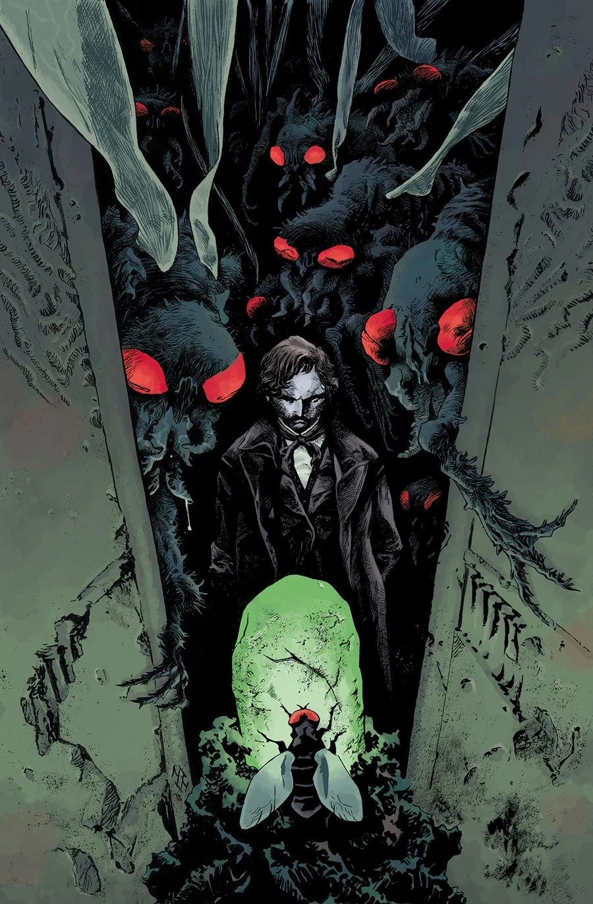
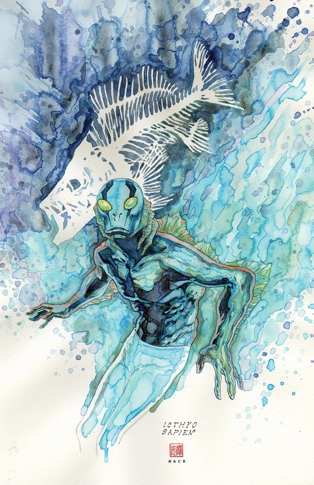

《**黑色学派**》（The Black School）是一个单期完结故事，由 Sebastián Fiumara 担任作画。

## 剧情简介

我们的反派抵达了他的目标——传说中的黑色学派（Black School），两百多年前他正是在这里开始了自己的修行。在这里，他将找到亚伯·塞皮恩本人多年来苦苦追寻的答案。施特罗布尔（Strobl）或许也能在这里找到他所需要的捷径，好恢复自己在世界末日中应有的位置：立于魔鬼的右手边，奴役整个人类。

## 画廊

[Max Fiumara](/entry/Max_Fiumara)

[David Mack](/entry/David_Mack)
