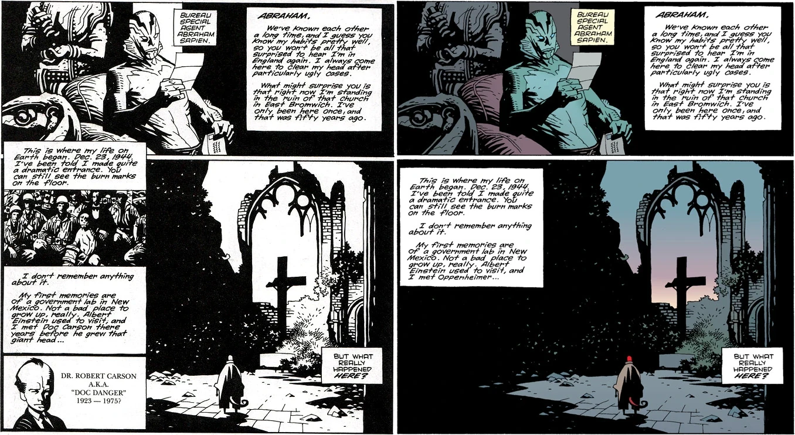

《**被锁链束缚的棺材**》（The Chained Coffin）是1995年的一个短篇故事，由 [Mike Mignola](/entry/Mike_Mignola)编剧并绘制。

## 出版历史

《被锁链束缚的棺材》最初以黑白形式发表于《[Dark Horse Presents](/entry/Dark_Horse_Presents)》第100–2期（1995年8月）。一个月前，《Dark Horse Presents》第100-0期曾刊登三页预告，那是随《Hero Illustrated》第26期附赠的独家内容。二十年后，[John Arcudi](/entry/John_Arcudi)写了一篇续作《[潜意识](/entry/Subconscious)》。

## 剧情简介

故事以 [亚伯·塞皮恩](/entry/Abe_Sapien)读一封[地狱男爵](/entry/Hellboy_%28character%29)的来信作为框架，信中讲述他重返东布罗姆威奇那座教堂——他“诞生”之地——的旅途。地狱男爵回忆说，灵媒 [Cynthia Eden-Jones](/entry/Lady_Cynthia_Eden-Jones)认为地狱男爵的现身与教堂里的两个灵魂有关，而不是纳粹实验。

地狱男爵在教堂里睡着了，梦见一个垂死的女人。女人承认自己曾是女巫，但现在她与过去决裂，请求上帝的宽恕。女人请求她的孩子们——一位神父和一位修女——拯救她的灵魂。她吩咐他们用锁链锁住她的棺材，连续三夜防备魔鬼。

地狱男爵醒来，看到神父和修女站在一具被锁链锁住的棺材旁的幻象。一个[恶魔](/entry/Azzael)走进教堂，短暂对峙之后杀死了神父和修女。恶魔透露，女人“真正的孩子”尚未出生，是多年前瓦尔普吉斯之夜受孕的。恶魔望向地狱男爵，说道：“我最心爱的儿子。”恶魔把女人永远带下了地狱。

故事结尾回到亚伯·塞皮恩，他睡着了，梦见了鱼。

## 故事年表

故事没有明确说明发生在何时。很可能是在《[唤醒恶魔](/entry/Wake_the_Devil)》之前的某个时候。

在给亚伯的信中，地狱男爵提到了卡文尼什宅邸的事件（见《[毁灭之种](/entry/Seed_of_Destruction)》），所以故事发生在那之后。在《[唤醒恶魔](/entry/Wake_the_Devil)》接近结尾处，三个人物（仙灵之王、一个女巫和一个兜帽男人）注视着事态发展，并提到地狱男爵“在地狱中由一个人类女子所生”，这暗指我们在本故事中看到的内容。在《[毁灭右手](/entry/The_Right_Hand_of_Doom)》中，相关事件似乎支持《被锁链束缚的棺材》发生在《唤醒恶魔》之前这一排序。《Hellboy: The Companion》将本故事的事件定在1994年5月14日，即 [Bruttenholm 教授](/entry/Trevor_Bruttenholm)葬礼的第二天。

## 从黑白版到彩色版的改动

''另见：[Dark Horse Comics § Legend](/entry/Dark_Horse_Comics)

黑白版中简要提到了 Robert Carson 医生，这个角色由 [John Byrne](/entry/John_Byrne)在《Danger Unlimited》中创造。Carson 医生的出场是 Adams-Byrne-Mignola 共享宇宙计划的一部分。然而，1998年8月该故事被收录进[《地狱男爵——第3卷：被锁链束缚的棺材及其他》](/entry/Trade_Collections)出彩色版时，Carson 医生被删除了；此时共享宇宙的计划已被放弃。

The_Chained_Coffin_changes.jpg

***左：**1995年黑白版
**右：**1998年彩色版*

## 内容

### 角色

#### 一般角色

- [B.P.R.D.](/entry/Bureau_for_Paranormal_Research_and_Defense)
  - [亚伯拉罕·塞皮恩](/entry/Abraham_Sapien)
  - [地狱男爵](/entry/Hellboy_%28character%29)
  - [Trevor Bruttenholm](/entry/Trevor_Bruttenholm)（被提及）（照片，仅黑白版）
- [女巫](/entry/Witches)
  - [Sarah Hughes](/entry/Sarah_Hughes)（闪回/梦境）

[Sarah Hughes](/entry/Sarah_Hughes)的孩子们（闪回/梦境）

- [恶魔](/entry/Demon)
  - [Azzael](/entry/Azzael)（闪回/梦境）
- [Cynthia Eden-Jones](/entry/Cynthia_Eden-Jones)（被提及）

#### 仅黑白版出现

- 美国陆军士兵（照片）
- Robert Carson 医生

### 地点

- 英格兰
  - 东布罗姆威奇教堂废墟
- 美国
  - [B.P.R.D.](/entry/Bureau_for_Paranormal_Research_and_Defense)总部（康涅狄格州法菲尔德）

## 注释
