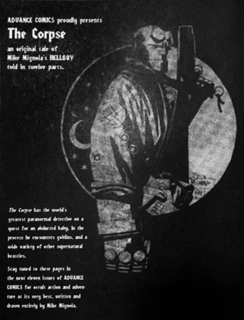

《**尸体**》（The Corpse）是一个连载形式的《[地狱男爵](/entry/Hellboy_%28series%29)》故事，后来成为迈克·米格诺拉本人和他的粉丝们都最喜爱的故事之一。尽管最初发表时看似是一个独立故事，但此后它已成为《地狱男爵》诸多事件的重要催化剂，尤其是在《[黑暗召唤](/entry/Darkness_Calls)》、《[大捕猎](/entry/The_Wild_Hunt)》以及《[风暴](/entry/The_Storm)与[狂怒](/entry/The_Fury)》中。

## 出版历史

《尸体》的大部分内容最初以每次两页的形式连载于 [Capital City Distribution](/entry/wikipedia%3ACapital_City_Distribution) 的《Advance Comics》目录中。《Advance Comics》并不是一本传统的漫画书，而主要是一本漫画、图像小说、玩具和其他周边商品的目录，由发行商寄给各家漫画店；[1] 像《尸体》这样的故事被用作该出版物的增值内容。

 《尸体》连载于《Advance Comics》第 75–82 期，时间从 1995 年 3 月到 10 月。尽管《Advance Comics》第 75 期刊登的故事引言称这是一个"分十二部分讲述"的故事，[2] 但最终在该目录中只发表了八期、每期两页的连载。随后在 1996 年 1 月，整个故事被结集，增加了一页新的开篇和八页的结局（即缺失的四个两页"部分"），收录在单刊《Hellboy: The Corpse and [the Iron Shoes](/entry/the_Iron_Shoes)》中。

### 再版与改编

1998 年 8 月，该故事被收入《[地狱男爵——第 3 卷：被锁链的棺材及其他故事](/entry/TPB)》。

《尸体》中的一些元素被改编进了[2004 年的《地狱男爵》电影](/entry/Hellboy_%28film%29)。作为电影上映前宣传的一部分，《尸体》于 2004 年 3 月以一本售价 25 美分的独立漫画形式再版，并额外增加了三页关于该故事被改编用于电影的内容。在影碟发行时，该故事作为插页收录在部分版本电影的 DVD 盒内。

## 剧情简介

1959 年，[地狱男爵](/entry/Hellboy_%28character%29)被召往爱尔兰处理一起儿童绑架案。孩子[爱丽丝·莫纳汉](/entry/Alice_Monaghan)被伪装起来的仙灵[格鲁阿加赫](/entry/Gruagach)调了包。地狱男爵用烙铁烫伤格鲁阿加赫，逼他现出原形。为了换回真正的孩子，地狱男爵与一群小矮人达成了协议——格鲁阿加赫告诉他，要把塔姆·奥克拉尼的遗体安葬在一座合适的基督教坟墓中。在前两座教堂，死者都高喊"没有位置"，地狱男爵被迫继续前行。仙灵之王[达格达](/entry/Dagda)（在此首次登场）看出地狱男爵将会成功，便命令一个哥布林把莫纳汉家的孩子送回去。与此同时，格鲁阿加赫一心想向地狱男爵复仇，放出了野猪头巨人[格罗姆](/entry/Grom)，格罗姆却立刻吃掉了格鲁阿加赫。地狱男爵与格罗姆搏斗，并埋葬了塔姆。交易完成后，仙灵们把婴儿还给地狱男爵，哥布林告诉他，他们原本打算把这个孩子当作自己的孩子抚养，因为仙灵已经无法再生育；如今没有了爱丽丝，达格达把他的族人永远带离这个世界只是时间问题。

## 故事年表

故事发生在 1959 年。这与地狱男爵对战冯·克勒姆普特的《["世界上最伟大的超自然调查员"（CBG）](/entry/World%27s_Greatest_Paranormal_Investigator_%28CBG%29)》（1959 年）是同一年，比《[飞头妖](/entry/The_Penanggalan)》和《[扭曲人](/entry/The_Crooked_Man_%28comic_story%29)》（1958 年）晚一年，比《[铁鞋](/entry/The_Iron_Shoes)》和《[九头蛇与狮子](/entry/The_Hydra_and_the_Lion)》（1961 年）早两年。

## 内容

### 角色

#### 一般角色

- [B.P.R.D.](/entry/Bureau_for_Paranormal_Research_and_Defense)
  - [地狱男爵](/entry/Hellboy_%28character%29)
- 塔姆·奥克拉尼（"尸体"）
- 莫纳汉一家
  - [爱丽丝·莫纳汉](/entry/Alice_Monaghan)
  - 玛格丽特·莫纳汉
  - 莫纳汉先生
- 若干无名鬼魂

#### [达努神族](/entry/Daoine_Sidhe)

- [格鲁阿加赫](/entry/Gruagach)
- 十字路口哥布林
- [格罗姆](/entry/Grom)
- [达格达](/entry/Dagda)
- 抽烟斗的无名哥布林
- 绿牙珍妮
- [梅布女王](/entry/Queen_Mab)（被提及，拼写为"梅德芙女王"）

### 地点

- 爱尔兰
  - 莫纳汉宅邸
  - 十字路口
  - Teampoll-Démus
  - Carrick-fhad-vic-Orus
  - Imolgue-Fada
  - 绿牙珍妮的池塘
  - Kill-Breedya

## 花絮

- 该故事改编自爱尔兰民间故事"泰格·奥凯恩与尸体"，由道格拉斯·海德收集，首次发表于 W. B. 叶芝的《爱尔兰农民的仙灵与民间故事》（1890 年），[3] 主要借用了被仙灵强迫把一具尸体抬到某个特定名字的庭院中下葬这一核心设定。

## 注释

[1] ["Advance Comics - The Corpse"](https://community.cbr.com/threads/advance-comics-the-corpse.93307/)。*CBR* 社区。

[2]

[3] Yeats, William Butler. 1890. "Teig O'Kane (Tadhg O Cathan) and the Corpse"，收录于 *Fairy and Folk Tales of the Irish Peasantry*。第 16–31 页。伦敦：Walter Scott。
