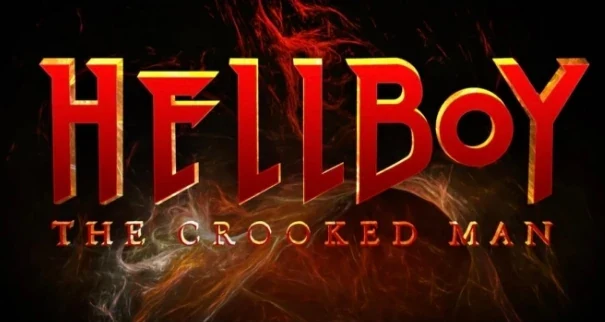

*关于 2024 年的改编电影，见[《地狱男爵：扭曲人》（电影）](/entry/Hellboy__The_Crooked_Man_%28film%29)。*
*译名说明：The Crooked Man 在民间汉化组「不高兴汉化」中原译《驼背人》；2024 年真人电影上映后，简体中文网络通行译名为《扭曲人》。本站现统一采用《扭曲人》为标准名，保留旧译以备查考。*

在***《扭曲人》***中，[地狱男爵](/entry/Hellboy_(character))于 20 世纪 50 年代的阿巴拉契亚与魔鬼的一名爪牙正面对决。

## 出版历史

《扭曲人》于 2008 年 7 月至 9 月以三期限定迷你剧的形式出版。2010 年 6 月，该故事收入*[《地狱男爵：第 10 卷 扭曲人及其他故事》](/entry/Trade_Collections)*再版。

第二期还附有一页漫画，讲解如何制作故事中登场的道具“巫球”（witchball）。在合订本中，这则小故事并未单独收录，而是嵌在《扭曲人》第 2 期与第 3 期之间。

2020 年，[迈克·米格诺拉](/entry/Mike_Mignola)推出了两期续作 *[《地狱男爵与超自然调查防御署：埃菲·科尔布归来》](/entry/The_Return_of_Effie_Kolb)*，由画师 [Zach Howard](/entry/Zach_Howard) 执笔。

## 剧情简介

### 第一部分

1958 年，弗吉尼亚州的阿巴拉契亚山区，[地狱男爵](/entry/Hellboy)与一个被施了巫术的女孩坐在一间小木屋里。当地一个女人说，这一定是[科拉·费舍（Cora Fisher）](/entry/Cora_Fisher)干的，因为有人看见她们俩吵过架。

一个名叫[汤姆·法瑞尔（Tom Ferrell）](/entry/Tom_Ferrell)的流浪者找到一只[巫球](/entry/Witchball)，拿给地狱男爵看。汤姆教当地人如何破解巫球的诅咒，自己则和地狱男爵一起去找科拉。汤姆说他想先停下来看看父母，却被告知母亲已经去世，父亲则自他离镇后便下落不明。

赶路途中，汤姆告诉地狱男爵，他已经离开二十年，但觉得是时候回家了。地狱男爵说自己只是路过。两人聊着天，汤姆说魔鬼无法进入教堂，因此地狱男爵不可能是魔鬼。汤姆还说地狱男爵长得一点也不像魔鬼。

两人来到科拉的小屋。汤姆在地板下找到几只巫球、一本被划得乱七八糟的圣经，还有一只封在瓶子里的大虫子。汤姆听到一个声音在呼唤他，意识到那虫子是她的恶魔魔宠。地狱男爵打断他，指了指床上一张空空的人皮。两人决定等科拉回来取她的皮。

地狱男爵问起汤姆当年见到魔鬼的事。汤姆回答说那时他才 15 岁。一个名叫[埃菲·科尔布](/entry/Effie_Kolb)的女孩怂恿他成为巫师。他与[扭曲人](/entry/Jeremiah_Witkins)——一个效忠魔鬼的本地死人——订立了契约。汤姆逃走了，但保留了作为契约一部分制成的[幸运猫骨](/entry/Lucky_cat_bone)。他一路逃亡，最后参了军，在太平洋战场服役。那块猫骨一直保他平安，但他从没用它伤害过任何人。

一只浣熊钻进屋子，爬进科拉的皮中，变回了那个女孩。科拉解释说，她是走投无路才成为女巫的，但她对此后悔不已。就在这时，埃菲骑着一匹衰老疲惫的马赶来。她告诉他们，扭曲人要把科拉带回去，而且他知道汤姆已经回来了。她还把那匹马留给汤姆，随后飞走。汤姆取下[马嚼子](/entry/Magic_horse's_bit)，那马变回汤姆的父亲，随即死去。

汤姆、地狱男爵和科拉动身上山，前往教堂，以便安葬汤姆的父亲。

### 第二部分

[地狱男爵](/entry/Hellboy)、汤姆和科拉三人沿山而上，走入林中。接近煤矿时，科拉害怕得停住了脚步，不敢再往前走。汤姆解释说，矿里尽是“梅伦琼女巫”（Melungion Witches），她们是来自罗阿诺克的早期定居者的后裔。三人继续前行，突然天空变暗，夜幕降临。女巫们从矿里呼唤科拉。刹那间，科拉爆成一大群昆虫、蛇和青蛙。这些生物蜂拥扑向地狱男爵。

汤姆用他的幸运骨帮他们摆脱了虫群。埃菲出现，告诉汤姆，就算他以前不属于扭曲人，现在扭曲人也已经拥有了他。地狱男爵开枪打中埃菲。地狱男爵和汤姆抵达教堂。神父告诉他们，已经有一个女孩提前告知他们会来。他说科拉的鬼魂正坐在教堂里。女巫们慢慢包围了教堂的庭院。神父说女巫无法触碰圣地。就在地狱男爵准备迎击女巫们时，扭曲人现身了。他声称自己是来收取汤姆的债务的，而且他并不惧怕地狱男爵。

### 第三部分

扭曲人向汤姆喊话，说他们有过约定，现在是还债的时候了。神父告诉他，汤姆如今属于主，但扭曲人不为所动。[地狱男爵](/entry/Hellboy)受够了扭曲人，走出教堂。栅栏上的尖桩飞下刺中地狱男爵。神父大怒，点名怒斥扭曲人。他叫扭曲人要么进教堂来带走汤姆，要么滚回地狱。

扭曲人试图引诱神父交出汤姆。一批财宝从教堂地板下喷涌而出，但神父不为所动。扭曲人让神父年轻了二十岁，还恢复了他的视力，可他依然不为所动。扭曲人又让一个年轻女子复活，以此诱惑神父。随着女巫们追忆死者的罪孽，教堂墓地里埋葬的所有死者缓缓爬出坟墓。地狱男爵和汤姆与亡者搏斗。

扭曲人试图与汤姆订立新约，并告诉地狱男爵，人人都知道他是个魔鬼。沃茨牧师意识到，扭曲人想要那块骨头更甚于想要汤姆的灵魂：骨头里蕴含着恶魔的力量，而扭曲人这个吝啬鬼至死都无法容忍汤姆哪怕只持有一丁点那种力量——哪怕他根本不去使用。沃茨从汤姆手中拿过骨头，将圣灵逼入骨中，把邪恶逼出。他祝圣了一把铲子，交给地狱男爵。地狱男爵一铲击中扭曲人，刹那间他便消失了，女巫们也四散奔逃。

早晨，神父、汤姆和[地狱男爵](/entry/Hellboy)安葬了汤姆的父亲。事后，汤姆和地狱男爵走进树林去处理那块猫骨。他们走进扭曲人的屋子，只看到一个触手怪物抱着满罐的钱。汤姆把已被祝圣的骨头扔给扭曲人。扭曲人和他的“黄金”一同消失。

返回教堂的路上，地狱男爵发现了埃菲。失去扭曲人后，她已变得苍老。汤姆把嚼子和笼头戴到她身上，她变成了一匹马。地狱男爵和汤姆在她身上写下“小心！我是女巫！”后，把她留了下来。

## 电影改编

> 
>
> *主条目：[《地狱男爵：扭曲人》](/entry/Hellboy%3A_The_Crooked_Man_(film))*

电影改编于 2023 年宣布，确定由 [Jack Kesy](/entry/Jack_Kesy) 出演[地狱男爵](/entry/Hellboy_(character))。影片于 2024 年上映。

## 画廊

封面作者：[Richard Corben](/entry/Richard_Corben)。

第 1 期

第 2 期

第 3 期

地狱男爵出版顺序

&#10;
前作
《鼹鼠》（The Mole）
扭曲人（漫画故事）

后作
《在摩洛的礼拜堂中》（In the Chapel of Moloch）

地狱男爵平装合订本顺序

第 9 卷《狂猎》
第 10 卷《扭曲人及其他故事》

&#10;
前作
《狂猎》
扭曲人（漫画故事）

后作
《乘船下海者》（They That Go Down to the Sea in Ships）

地狱男爵故事年表

&#10;
前作
《沃尔德王》（King Vold）
扭曲人（漫画故事）
同期
《潘那贾兰》（The Penanggalan）
后作
《尸体》
世界最伟大超自然调查员（CBG）
