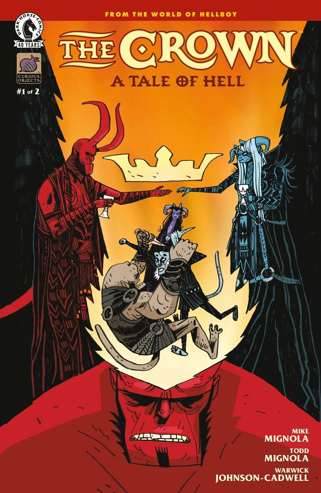
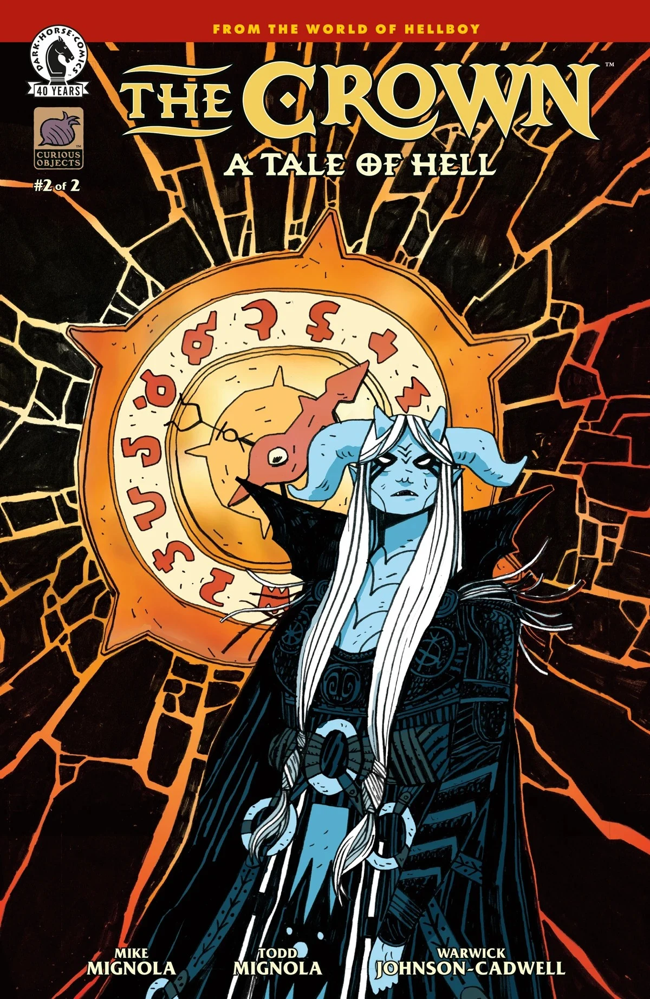
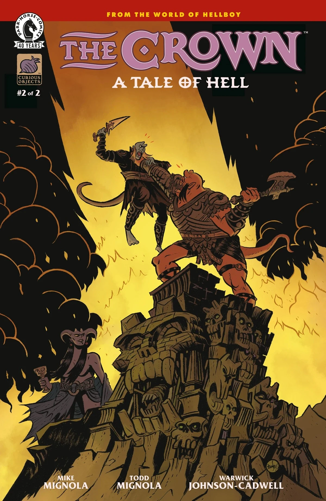

***《王冠：地狱故事》（The Crown: A Tale of Hell）*** 是一部两期完结的迷你系列，由 [Mike Mignola](/entry/Mike_Mignola) 与 [Todd Mignola](/entry/Todd_Mignola) 编剧，Warwick Johnson-Cadwell 作画，这也是他在地狱男爵宇宙中的首次亮相。故事聚焦地狱男爵的两个兄弟——[加蒙](/entry/Gamon)（Gamon）和[卢斯克](/entry/Lusk)（Lusk）——在十六世纪地狱中的经历。

## 剧情简介

### 第一部分

这场恶魔式的家族重聚中，地狱男爵的兄弟们为争夺群魔殿（Pandemonium）的控制权而战。但卷入这场权力争斗的不只是兄弟几人：他们的母亲百年来第一次从囚禁中归来，并且怀着自己的盘算。

### 第二部分

恶魔兄弟争夺群魔殿控制权的厮杀变得更加混乱——他们的姐妹也加入战局，对地狱的未来提出了自己的主张。

## 画廊

*《王冠：地狱故事》* \#1  
作者：Warwick Johnson-Cadwell

*《王冠：地狱故事》* \#1  
变体封面：Mike Mignola，Dave Stewart 上色

*《王冠：地狱故事》* \#2  
作者：Warwick Johnson-Cadwell

*《王冠：地狱故事》* \#2  
变体封面：Bruno Seelig

|The Crown: A Tale of Hell #1 by Warwick Johnson-Cadwell

|The Crown: A Tale of Hell #2 by Warwick Johnson-Cadwell

|The Crown: A Tale of Hell #2 variant by Bruno Seelig
