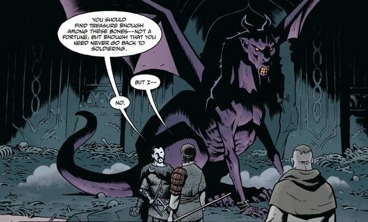

**巨龙（The Dragon）**是 [柯歇伊（不死者）](/entry/Koshchei_%28character%29) 在世时的一位魔法统治者。

## 历史

在柯歇伊生活的年代，巨龙是斯拉夫地区一个国度的统治者，其宫廷中聚集了形形色色的恶魔、女巫和鬼魂。一天他在林中散步时，偶然发现了奄奄一息的年轻柯歇伊。巨龙提出用魔法治愈柯歇伊，条件是柯歇伊做他九年的仆人。柯歇伊答应了。九年勤勉服役期满后，巨龙越来越喜欢他，提出收柯歇伊为义子，教他魔法，并允许他永远留在自己的领地；柯歇伊拒绝了，表示自己宁愿像普通人一样生活。巨龙理解他的选择，送给他一份临别礼物：一件魔法锁子甲，只要柯歇伊穿着它，任何武器都伤不了他。

后来柯歇伊遭到背叛、被杀害，尸体被切碎丢弃在林中。巨龙闻到了熟悉的血腥味，找到了柯歇伊的残骸。巨龙把朋友的残骸带回自己的城堡，让他重新活了过来。为确保柯歇伊再也不会遭受死亡，巨龙把柯歇伊的灵魂从身体中取出，藏在一枚蛋里，蛋在一只鸭子体内，鸭子在一只兔子体内，兔子在一只山羊体内，山羊在一棵树里，树长在世界尽头之外的一座岛上。此后柯歇伊再次启程，而这一次是为了复仇。

两人将在悲惨的境况下重逢。柯歇伊被[雅加婆婆](/entry/Baba_Yaga_%28character%29)欺骗，她设计让他杀死了巨龙的伴侣和孩子们。尽管对此感到愤怒和悲痛，巨龙并没有责怪自己的养子。如今作为同类中最后的幸存者，巨龙郁郁而终。

## 画廊

|The Dragon in his true form.
