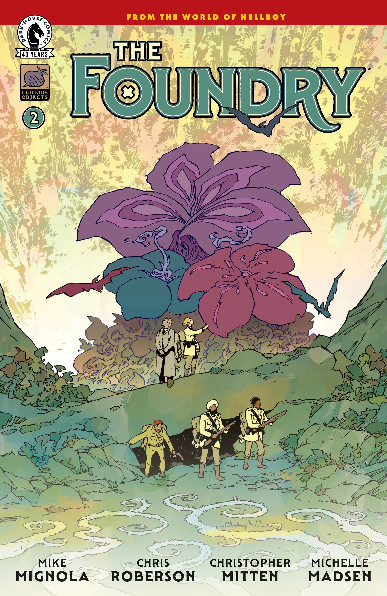

*本条目仍是一个小作品（stub）。你可以帮助地狱男爵维基扩充它。*

***《铸造厂》（The Foundry）*** 是一部漫画系列，由 Mike Mignola 与 Chris Roberson 编剧，Christopher Mitten 作画。故事围绕[铸造厂](/entry/Foundry_(organization))展开，尤其聚焦卡拉姆·辛格少校（Major Karam Singh）一角。

## 出版历史

该系列最初公布时，黑马的营销宣传称其为名为《铸造厂：海上遇险》（The Foundry: In Peril on the Seas）的四期迷你系列。由于不明原因，如今书名简化为《铸造厂》。编辑 Katii O'Brien 在公布消息时暗示，故事中将出现对整个地狱男爵宇宙产生影响的重大进展。

## 剧情简介

### 第一部分

来认识女王麾下专门调查超自然与神秘事件的秘密机构！来自《猎巫人》（Witchfinder）与《英国超自然学会》（The British Paranormal Society）的角色在这部冒险系列中集结，他们走遍世界，追寻以超自然力量驱动的技术，以及那些曾驾驭这些力量——无论用于善还是用于恶——的文明留下的故事。

### 第二部分

女王的超自然调查员们的任务开局便遭遇沉船危机：他们的飞艇遭到了一名看不见的敌人的袭击！

## 画廊

所有封面均由 Christopher Mitten 绘制。

*《铸造厂》* \#1

*《铸造厂》* \#2

|The Foundry #2
