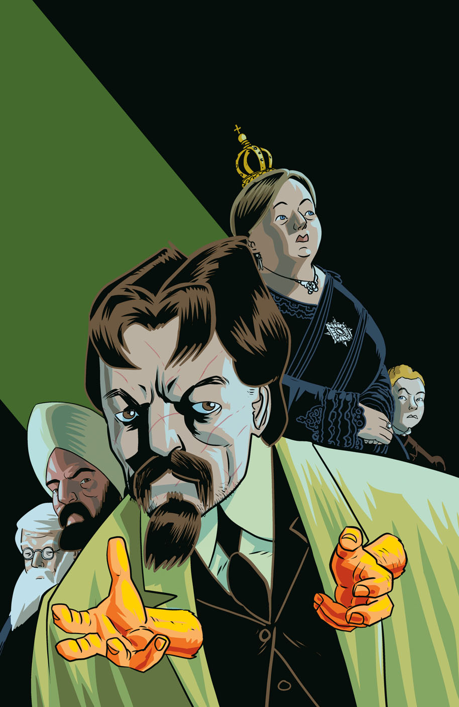
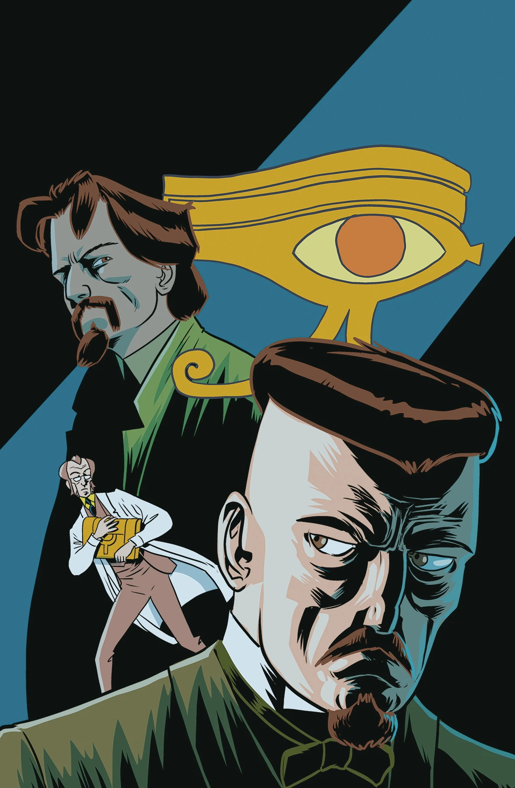
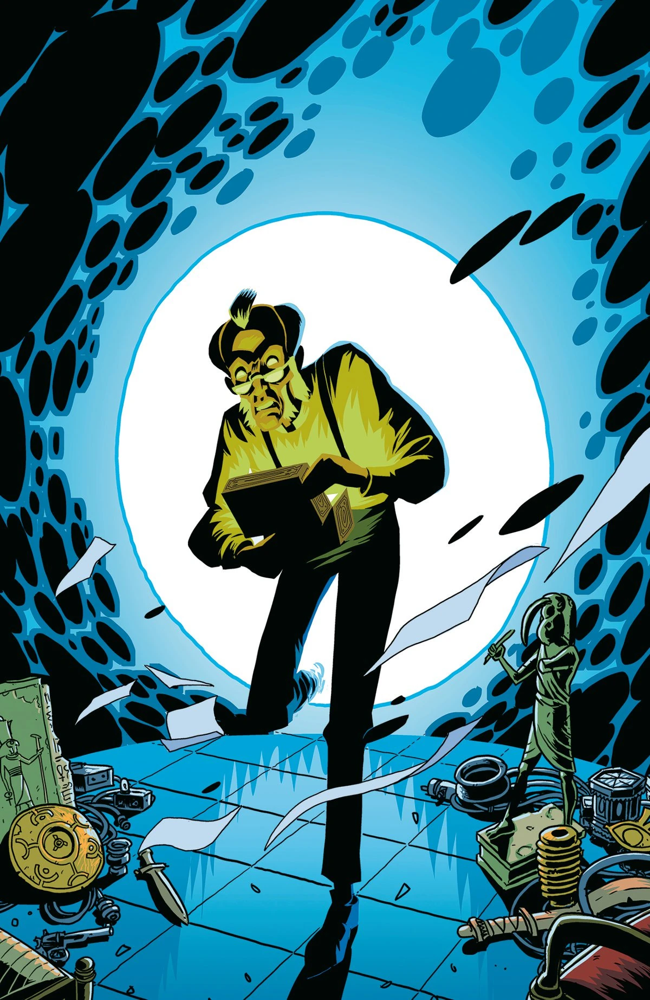
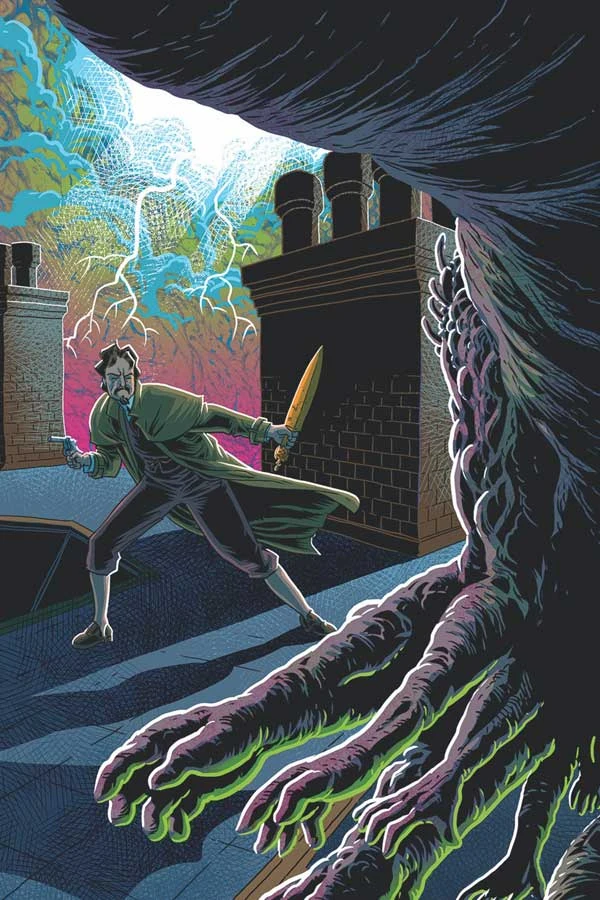

《**天堂之门**》（The Gates of Heaven）是一部五期限定连载，由 [Mike Mignola](/entry/Mike_Mignola) 与 [Chris Roberson](/entry/Chris_Roberson) 编剧，[D'Israeli](/entry/D%E2%80%99Israeli) 担任作画。[1]

## 剧情简介

### 第一部

一连串神秘学事件令这位人称猎巫人的男子困惑不已，而更令人意外的是，他发现自己并非伦敦唯一在探究超自然现象的人。当一封发自宫廷的私人邀请函送达时，[爱德华·格雷爵士](/entry/Sir_Edward_Grey)被更深地卷入地下超自然探索之中，与新盟友并肩竞速，去阻止一名疯狂科学家为追求神秘力量而毁灭伦敦。

### 第二部

就在一个熟悉的敌人企图扼杀他的调查之际，爱德华·格雷的线索开始告罄。与此同时，一名幽灵窃贼继续在伦敦肆虐，风险只增不减。

### 第三部

猎巫人从一个与[赫利奥皮克兄弟会](/entry/Heliopic_Brotherhood_of_Ra)有关联的神秘来源处获得了极为宝贵的情报；与此同时，伦敦的超自然活动达到了临界点：一个疯狂的、看似被附身的男子当街袭击行人，而当一只巨型怪物出现在泰晤士河上空时，码头区陷入一片骚乱。

### 第四部

一场惨痛的损失促使猎巫人愈发深入地追查笼罩伦敦的超自然恐怖之源。格雷为自己的事业招募了新的盟友，他的搜寻将他带到了肇事者的门前——但他是否还来得及阻止他们那可怕的阴谋将整座城市吞没于黑暗之中？

### 第五部

魔法与科学在伦敦上空相撞！当恐怖自天而降时，猎巫人与他的盟友们展开了最后的抵抗，而他们噩梦般的敌人也终于显露真容！

## 画廊

封面作者 [D'Israeli](/entry/D%E2%80%99Israeli)。

第 1 期

第 2 期

第 3 期

第 4 期

第 5 期

## 参考资料

[1] <https://geekandsundry.com/mike-mignola-and-chris-robersons-witchfinder-returns-in-the-gates-of-heaven-exclusive/>
