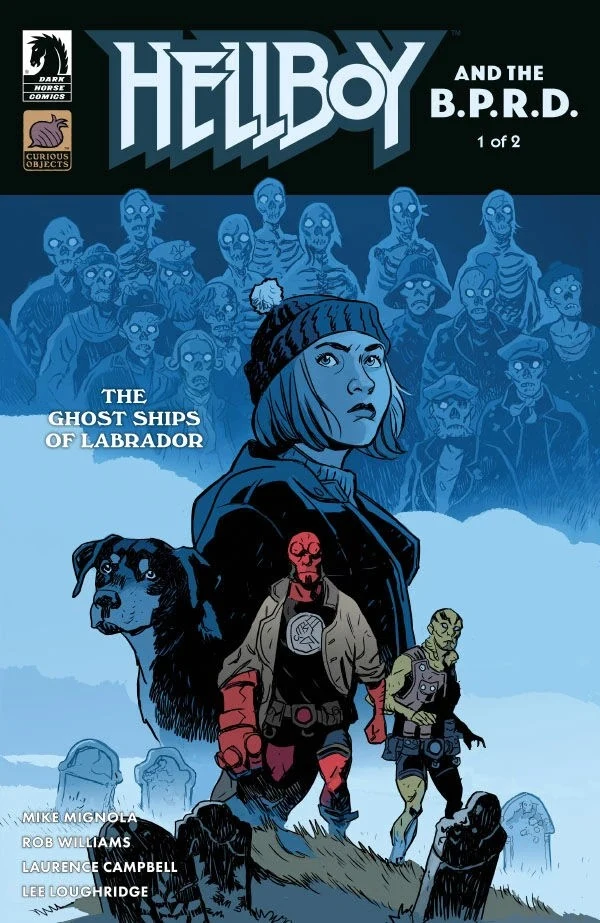
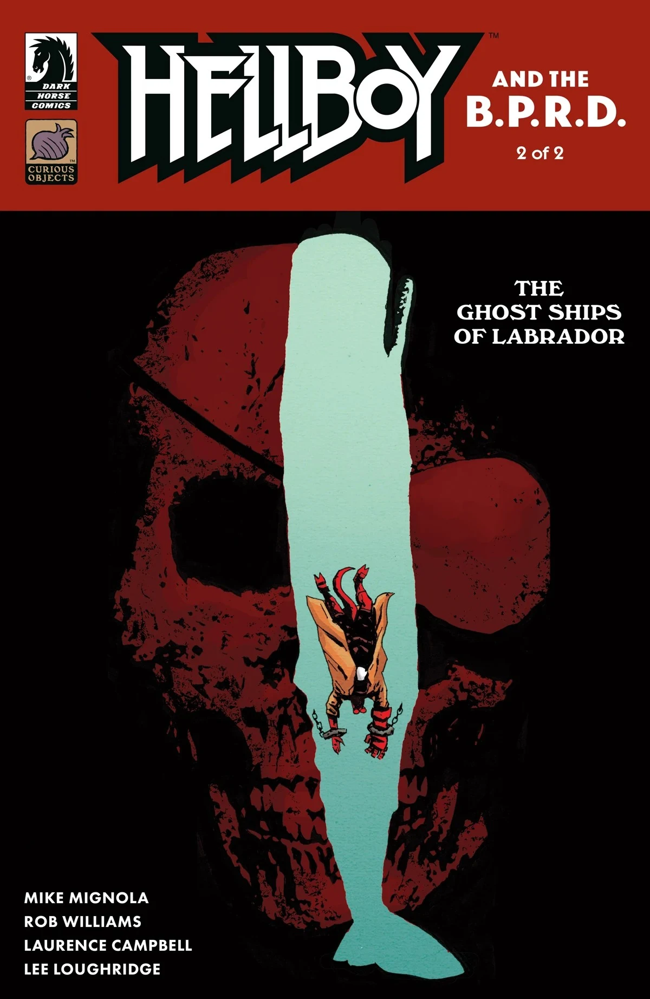
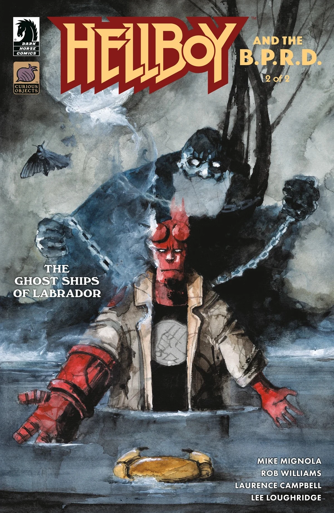

***《拉布拉多的幽灵船》***是 *[Hellboy and the B.P.R.D.](/entry/Hellboy_and_the_B.P.R.D.)* 的一个两期故事线，由[迈克·米格诺拉](/entry/Mike_Mignola)和 [Rob Williams](/entry/Rob_Williams) 编剧，[劳伦斯·坎贝尔](/entry/Laurence_Campbell)作画。

## 剧情简介

### 第一部分

一座被鬼魂占据的城镇本身就已经够棘手，而当地狱男爵的一名超自然调查防御署同僚在这片超自然乱象中失踪后，他手上的麻烦变得更大了。

### 第二部分

为了救出失踪的探员，地狱男爵不惜一切——哪怕意味着要钻进那头幽魂巨兽的腹中。

## 画廊

*Hellboy and the B.P.R.D.：拉布拉多的幽灵船* \#1  
封面：[劳伦斯·坎贝尔](/entry/Laurence_Campbell)

*Hellboy and the B.P.R.D.：拉布拉多的幽灵船* \#1  
变体封面：[Matt Smith](/entry/Matt_Smith)

*Hellboy and the B.P.R.D.：拉布拉多的幽灵船* \#2  
封面：[劳伦斯·坎贝尔](/entry/Laurence_Campbell)

*Hellboy and the B.P.R.D.：拉布拉多的幽灵船* \#2  
变体封面：[Daniele Serra](/entry/Daniele_Serra)

|Hellboy and the B.P.R.D.: The Ghost Ships of Labrador #1 variant cover by Matt Smith

|Hellboy and the B.P.R.D.: The Ghost Ships of Labrador #2  cover by Laurence Campbell

|Hellboy and the B.P.R.D.: The Ghost Ships of Labrador #2 variant cover by Daniele Serra
