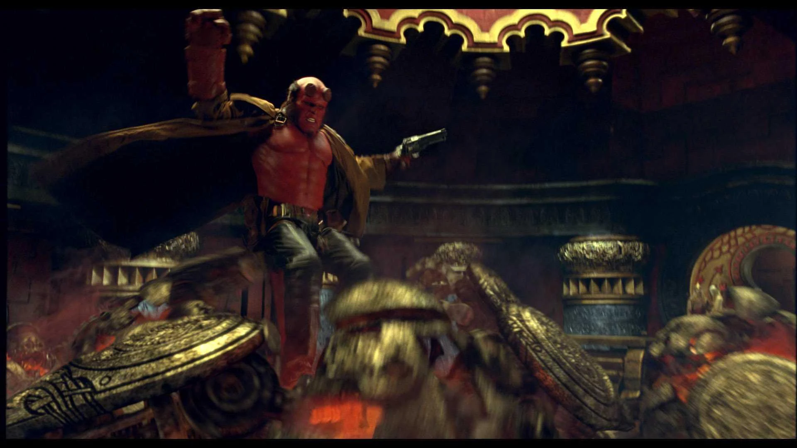
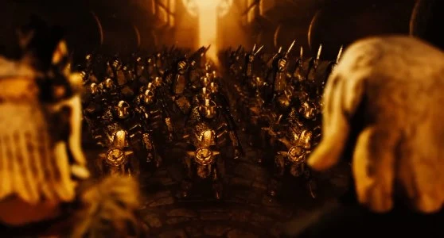
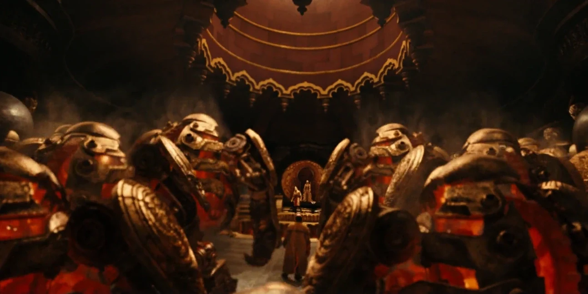
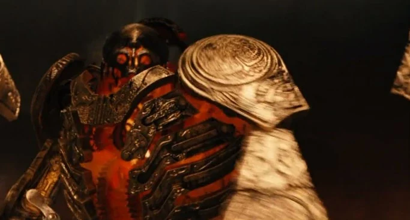

**黄金军团（Golden Army）**，又称"不可阻挡之力"，是一支由 70×70（4900 名）机械战士组成的发条军团，每个战士都远比人类高大、强壮。它们能自行修复一切损伤，因此实际上是不可摧毁的。

军团是[巴洛尔](/entry/Balor)国王在与人类的最初战争期间下令打造的，后来被他封存，以防这股力量落入不配者之手。只有佩戴[黄金王冠](/entry/Crown_of_Bethmora)的王室血脉才能号令黄金军团，但军团的指挥权也可以通过荣誉决斗赢取。

## 历史

 黄金军团诞生于无数世代以前，当时一位[地精铁匠](/entry/Goblin_%28Bethmoran%29)大师向精灵族的[巴洛尔国王](/entry/King_Balor)（[精灵](/entry/Elves)一族之王）进言：要打败人类，他们需要一支有能力将人类彻底消灭的军队——即便不真的动手，也可作为威慑。在儿子[弩阿达](/entry/Nuada)的劝说下，巴洛尔下令打造黄金军团，以及启动和控制它们的唯一手段：传说中的[贝斯莫拉王冠](/entry/Crown_of_Bethmora)（Crown of Bethmora）。然而，等到巴洛尔看着敌方人类被彻底毁灭时，他醒悟得太迟了：黄金军团既不懂仁慈，也不懂悔恨，因此在战斗中毫不留情。黄金军团不分敌我——它们对弱者、残者、幼者、老者都毫无怜悯。它们走到哪里就毁灭哪里，所过之处留下无数尸体。

目睹这场屠杀后，巴洛尔决心与被彻底吓破胆的人类缔结休战协定。作为协定的一部分，他下令把王冠碎成三片：两片由精灵保管，一片交人类守护；黄金军团本体则被关闭，封印在北爱尔兰的[贝斯莫拉](/entry/Bethmora)，此后这座城市才被瘟疫摧毁。

数百年后，弩阿达结束自我放逐归来，开始重组贝斯莫拉王冠，要让黄金军团复活，对人类实施彻底的种族灭绝。尽管[超自然调查防御署（B.P.R.D.）](/entry/B.P.R.D.)的探员们试图阻止弩阿达，却发现自己在黄金军团面前寡不敌众、不堪一击。幸运的是，作为[堕落者](/entry/Azzael)之子，[地狱男爵](/entry/Hellboy_%28character%29)得以向弩阿达发起挑战；黄金军团在一旁观战，准备服从胜者的命令。[丽兹·舍曼](/entry/Liz_Sherman)熔毁王冠之后，黄金军团终于被永远关闭，再也不会苏醒。

## 外观与能力

顾名思义，黄金军团是一整支巨大的发条士兵部队，通体由黄金铸成，由一种特殊魔法赋予生命，这种魔法将军团与[王冠](/entry/Crown_of_Bethmora)——[贝斯莫拉](/entry/Bethmora)之冠——联结在一起——这顶神秘王冠赋予佩戴者号令这些可怕造物的能力。未启动时它们呈球形；一旦苏醒，头部和四肢便弹伸出来，躯体中似乎有某种魔法发条反应堆，散发金橙色的光芒。

每个发条士兵的粗大手臂上都装有可伸缩的炽热刀刃，作为主要武器。它们展现出超人类的力量与韧性：能徒手撕碎敌人，甚至在完全失去行动能力的边缘仍能战斗。话虽如此，由于由黄金铸成，军团仍会被它们自己的武器、火器，或至少与地狱男爵的"撒玛利亚人"相当的火力所伤。

然而，它们真正的威力既在于数量，也在于从任何损伤中自我修复的能力。它们不可摧毁的明证是：当这些造物受到重创时，散落的部件会回到躯体其余部分，重新组合。没有任何东西能阻止它们修复损伤，哪怕是严重的肢解。阻止它们的唯一办法，是摧毁贝斯莫拉王冠，将它们关停。

## 性格

尽管对[王冠](/entry/Crown_of_Bethmora)佩戴者唯命是从，军团在消灭敌人时却过于野蛮无情，因为它们没有能力分辨善与恶、士兵与平民，甚至无辜者与有罪者。电影小说版进一步说明了它们的野蛮：军团不仅开赴战场，还袭击恰好保持中立、或根本与人类和魔法生物之间的战争毫无瓜葛的无辜人类聚居地。

尽管只是一群没有灵魂的造物，军团本身也能表现出有限的情绪：克劳斯曾短暂附身其中一个，当这位探员离开装甲、附身其上时，那个士兵表现出困惑与恐惧。片中还可以看到这些造物在嘲弄英雄们，或受到重创以至于暂时失去行动能力时，会咆哮和尖叫。即便如此，军团在攻击自己的同类时也毫不迟疑，因为它们可以自我修复——有一个发条士兵甘愿把被克劳斯附身的同伴一刀劈成两半，只为把它从克劳斯的控制和影响下解放出来。

## 剧情角色

军团是一位[地精](/entry/goblin)[铁匠大师](/entry/Goblin_Master_Blacksmith_%28Bethmoran%29)提议打造的，他想借此赢得巴洛尔国王的尊重；当国王为人类的攻势而绝望时，便同意让铁匠为他建造一支庞大的军团。

人类下次进军时，大地震颤，逼近的黄金军团令天色变暗。这场攻势势不可挡，残忍的黄金军团对伤兵和无辜旁观者格杀勿论。黄金军团所到之处，无人幸存。

有人或许会说，是人类挑起战争，罪有应得；但暴力真的能解决暴力吗？

军团野蛮屠杀无辜人类之后，巴洛尔国王对它们造成的恶果更加痛心，于是下令将其关闭。负责打造它们的地精铁匠也赞同巴洛尔，并坦言有时他真希望自己从未造过这支军团。

地精把[地狱男爵](/entry/Hellboy_%28character%29)带到王子面前时，亚伯·塞皮恩把能控制军团的[贝斯莫拉王冠](/entry/Crown_of_Bethmora)第三块碎片交给弩阿达，因为谁戴上王冠，谁就是军团合法的领袖与国王。拥有王室血脉者只需戴上王冠，宣布"我是国王（此处填入姓名），黄金军团的统治者。有谁质疑我的权利吗？"如果黄金军团承认其王室血脉，就会向这位统治者敬礼。如果统治者受到另一个存在挑战，就必须接受挑战。多年后，弩阿达王子戴上王冠、自立为王时，不可阻挡的军团苏醒了。地狱男爵试图独自迎战黄金军团。最终，幽灵密探约翰·克劳斯附身一个黄金军团士兵加入战斗。二人一度不落下风，但其中一个士兵刺伤了克劳斯，迫使他回到自己原本的身体里。

黄金军团最终完成了自我修复，把地狱男爵、丽兹、亚伯和约翰团团围住。无计可施之际，地狱男爵想起布鲁姆教授给他讲过的故事，便为争夺黄金军团的号令权向弩阿达王子发起挑战。弩阿达王子声称地狱男爵并非王室成员，无权挑战军团号令权。然而弩阿拉公主告诉哥哥，地狱男爵是王室血脉，她称他为"[堕落者](/entry/Azzael)之子"。得知此事后，弩阿达王子接受挑战，二人交手，地狱男爵胜出。但弩阿达不愿让任何人染指黄金军团的力量，试图杀死地狱男爵。幸好弩阿拉公主以自杀救下地狱男爵——因为如果她受伤，她哥哥也会受到同样的伤。弩阿达王子死后，地狱男爵一度受到诱惑，想要夺取黄金军团的力量，但丽兹·舍曼上前一步，用她的纵火能力熔毁了王冠，黄金军团随之永久关闭。

## 画廊

