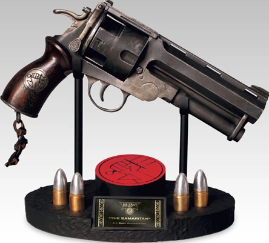

 **撒玛利亚人（The Samaritan）**是 2004 年电影《[地狱男爵](/entry/Hellboy_%282004_film%29)》及其 2008 年续集《[黄金军团](/entry/Hellboy_II%3A_The_Golden_Army)》中出现的一把武器。它是[地狱男爵](/entry/Hellboy_%282004%E2%80%932008_film_character%29)最钟爱的随身配枪。撒玛利亚人是一把由[超自然调查防御署](/entry/Bureau_for_Paranormal_Research_and_Defense)打造的巨型转轮手枪，能够发射多种专用子弹来对付怪物。

## 武器规格

撒玛利亚人是一把超大号的撅把式转轮手枪，外形酷似一把加大加强版的韦伯利转轮手枪。它的尺寸和重量——接近 10 磅——使其除了正常射击外，还能当作钝器来砸击。[1][2]

弹巢有四个膛室，可装填 22 毫米（0.866 口径）子弹，出膛初速为每秒 1775 英尺。[3]膛室上的凹槽可作为指示器，让使用者一眼就能看清枪里是否装有子弹。

由于[地狱男爵](/entry/Hellboy_%282004%E2%80%932008_film_character%29)[毁灭之右手](/entry/Right_Hand_of_Doom)的手指过于粗大，很难完成精细动作，他通常用左手来装填和射击这把配枪；地狱男爵会使用快速装弹器以便更轻松地为武器上弹。不过在《黄金军团》中，他确实在巨魔市场的一场打斗里展示过用右手射击的能力。

### 构造

撒玛利亚人于 1956 年在马萨诸塞州布伦特里手工锻造而成。[4]其金属部件由一种特殊合金锻造，原料包括爱尔兰教堂钟的铁、[5]神圣的白银、十字军东征时所用刀剑的碎片、炮弹以及各种神圣护身符；工匠们在熔炼过程中诵念古老而神圣的咒语。金属在鼠尾草水中冷却，并以手工完成最后的加工。[6]

一枚银色的[7] B.P.R.D. 纪念章被嵌在木质握把片中，这是[布鲁姆教授](/entry/Trevor_Bruttenholm)送给地狱男爵的 18 岁生日礼物。[8]有人说握把所用的木材刻自真十字架的一块碎片。[9]

枪柄底部编有一根打结的短皮挂绳；绳尾松散地垂下，并没有系在任何东西上。地狱男爵把枪装在一个皮质腰挂枪套里，枪套上烙着一个大大的「US」皮印；这个枪套是定制的，并针对武器惊人的重量和尺寸做了加固。[10]

### 特殊子弹

地狱男爵有自制定制子弹的爱好；总共有十二种不同的类型，包括银弹、金弹、空尖弹，以及「重磅弹」和追踪弹。[11]

#### 重磅弹

这种子弹是地狱男爵的最爱，弹头是爆炸性的弹壳，里面装有白橡木屑、圣水、三叶草叶和银屑。每一种成分都在民间传说中具有遏制邪恶和/或特定怪物的力量，因此有可能对地狱男爵面对的超自然敌人造成伤害。

#### 追踪弹

这种子弹内装一种发磷光的绿色液体，会从目标身上的伤口滴出，让人在光线昏暗的环境下也能轻松追踪目标的去向。影片中，地狱男爵在与[萨麦尔](/entry/Sammael)战斗时就发射过一枚这样的子弹。

## 画廊

## 设计

撒玛利亚人的名字和造型并非来自[地狱男爵使用过的枪](/entry/Hellboy%27s_gun)在[漫画](/entry/Hellboy_%28series%29)中的任何一把特定原型，不过它的枪套和大致尺寸与漫画角色所用的手枪有几分相似。

[Guillermo del Toro](/entry/Guillermo_del_Toro)的剧本最初对这把枪的描述与它最终的样子并不相同：

> 地狱男爵打开一个钢箱（箱盖上用模板印着：「The Good Samaritan」），取出一把有史以来最凶悍的定制双管蓝面手枪。简直就是一门手炮。[15]

《地狱男爵》的视觉设计师 [TyRuben Ellingson](/entry/TyRuben_Ellingson) 设计了撒玛利亚人的外观。尽管他最初的草图遵循了剧本中并列双管的结构，但 Ellingson 最终把设计改成了四膛室单管转轮手枪。在设计过程中，名字里的形容词「Good」也被去掉了——它在电影里的最终名字就叫「The Samaritan」。[16][17][18][19][20]

撒玛利亚人（连同它的枪套）最终由 Weta Workshop 的艺术家 Jason Docherty、Dominic Taylor、John Harvey 和 Mike Grealish 制作完成。[21]

## 花絮

- 这件武器的名字暗指《圣经》中好撒玛利亚人的寓言；地狱男爵给它起名「撒玛利亚人」，是因为它能让怪物们脱离苦海，[22]以一种戏谑的方式呼应了那位圣经人物的慈悲之心。
  - 影片中，[特雷佛·布鲁顿霍姆](/entry/Trevor_Bruttenholm)自称是天主教徒（「除此之外还有别的身份」），所以他和养子地狱男爵应当很熟悉这个故事。
- 尽管这把枪只有四个膛室，但在某些动作场景中，可以看到地狱男爵在重新装填之前至少开了六枪。
- 第一部电影的宣传网站把撒玛利亚人简单地称为「Hellboy's Big Gun」，描述方式也略有不同：
  - *「Hellboy's Big Gun 是一门算不上迷你的手持火炮，大多数人拿它能在建筑物上轰出大洞。这把 .60 毫米的巨型手枪能把穿着装甲装备的对手轰出别克车大小的窟窿。超大的膛室能装下 4 发这种坏小子子弹，是回击夜间作祟之物的终极利器。」*[23]
    - 「.60 毫米」口径的手枪是不合常理的，因为那意味着枪管内径不到一毫米。相比之下，「.60 *口径*」则比最终道具所用的 22 毫米子弹略小一点。
- 在《地狱男爵2：黄金军团》结尾，地狱男爵退出 B.P.R.D.，并把装备交给了[曼宁局长](/entry/Thomas_Manning)。然而他很快又回来取走了撒玛利亚人，还调皮地说：「再想了想，这个我还是留着吧。」
- 撒玛利亚人是为 2004 年《地狱男爵》电影创作的，为该电影及其续集所独有。在漫画（以及其他改编作品）中，[地狱男爵](/entry/Hellboy_%28character%29)使用的是[别的枪](/entry/Hellboy%27s_gun)；[24]粉丝们常把「撒玛利亚人」这个称呼用在那些枪上，但作品本身并没有这样命名。
  - 地狱男爵在漫画中用过好几把枪，最突出的是一把[自由火炬](/entry/the_Torch_of_Liberty)送给他的单发手炮，以及 [Harry Middleton](/entry/Harry_Middleton) 送给他的一把 M1911 手枪。
  - [地狱男爵](/entry/Hellboy_%28Injustice%29)在《[Injustice 2](/entry/Injustice_2)》中挥舞着一把转轮手枪。使用这件武器的招式被称为「Devil's Revolver」，但手枪本身只被笼统地称作「他那把可靠的转轮手枪」。
  - 地狱男爵使用了另一把不同的[无名转轮手枪](/entry/Hellboy%27s_revolver_%282019_film%29)，在[2019 年电影](/entry/Hellboy_(2019_film))中被制作人员称为「恶魔转轮手枪」。
  - 地狱男爵在《[The Crooked Man](/entry/Hellboy%3A_The_Crooked_Man_%28film%29)》中还挥舞着另一把独特的转轮手枪；同样，它也没有专门的名字。

## 参考资料

<references responsive="0" />

## 另请参见

- [大宝贝](/entry/Big_Baby)

[1]

[2]

[3]

[4] DVD Comics: "The Samaritan". *Hellboy: Director's Cut* (3 Disc Special Edition) DVD, 2004.

[5] DVD Comics: "The Samaritan". *Hellboy*, "2-Disc Special Edition" DVD, 2004.

[6]

[7]

[8]

[9]

[10]

[11]

[12]

[13]

[14]

[15]

[16]

[17] Del Toro, Guillermo (director) (April 2, 2004). *Hellboy* (motion picture). Event occurs at 25:51.

[18] Del Toro, Guillermo (director) (April 2, 2004). *Hellboy* (motion picture). Event occurs at 29:30. "I'm not a very good shot but The Samaritan here uses really big bullets."

[19] ["Hellboy Revolver 'The Samaritan'"](https://web.archive.org/web/20040414111416/http://www.sideshowtoy.com:80/cgi-bin/category.cgi?category=hellboy_props&item=8911). *Sideshow Collectibles***.** (2004)

[20] ["'The Samaritan' - Hellboy II Revolver"](https://web.archive.org/web/20080328174715/http://www.sideshowtoy.com/?page_id=4489&sku=8931). *Sideshow Collectibles, Inc.* (2008)

[21] ["Weta Workshop // Projects - Hellboy"](https://web.archive.org/web/20071103065401/http://www.wetaworkshop.co.nz/projects/filmography/film/hell_boy) 2003

[22]

[23] "Hellboy //Weapons". [*HELLBOY* website](https://web.archive.org/web/20041011154131/http://www.sonypictures.com/movies/hellboy/site/hellboy_main.html).

[24] ["HELLBOY 3 News"](https://collider.com/hellboy-3-news-guillermo-del-toro/). *Collider*, 8 Jul 2013. (DEL TORO: "Mike \[Mignola\] said very clearly, “*Hellboy* the movies is yours, *Hellboy* the comics is mine; I don’t wanna confuse them.”  He has been very clear about not bringing any mythology we did in the movies into the comics, like \[...\] The Samaritan, which is not called “The Samaritan” in the comics,")
