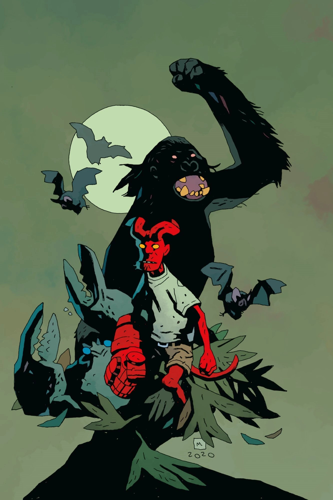
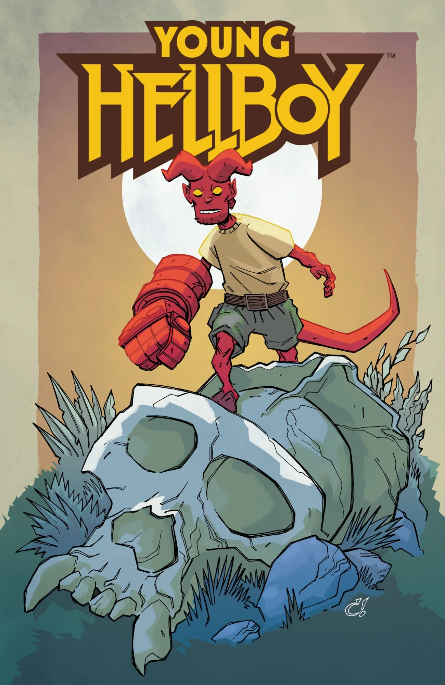
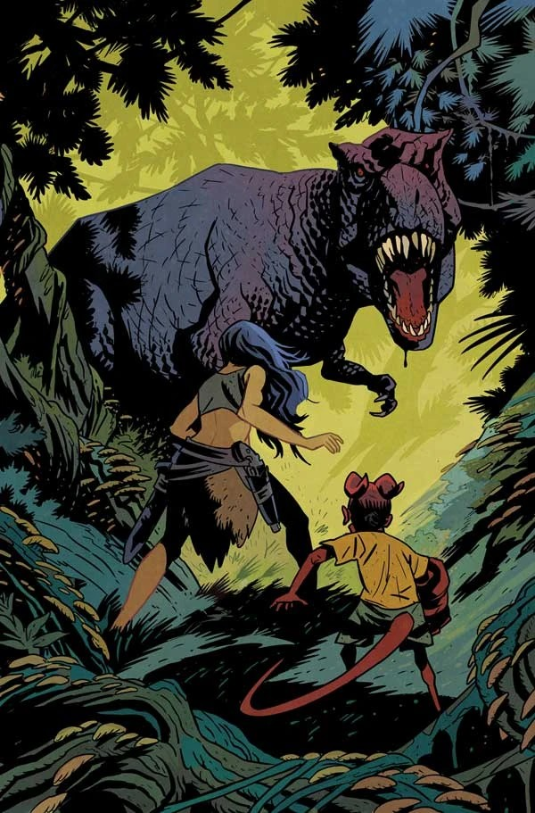
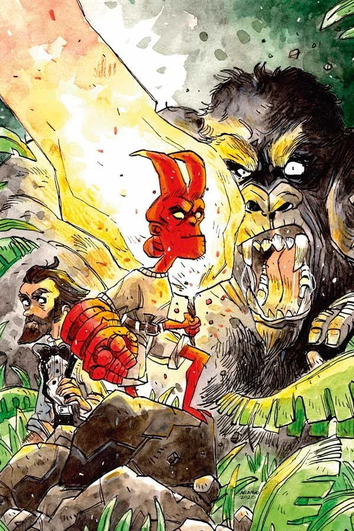
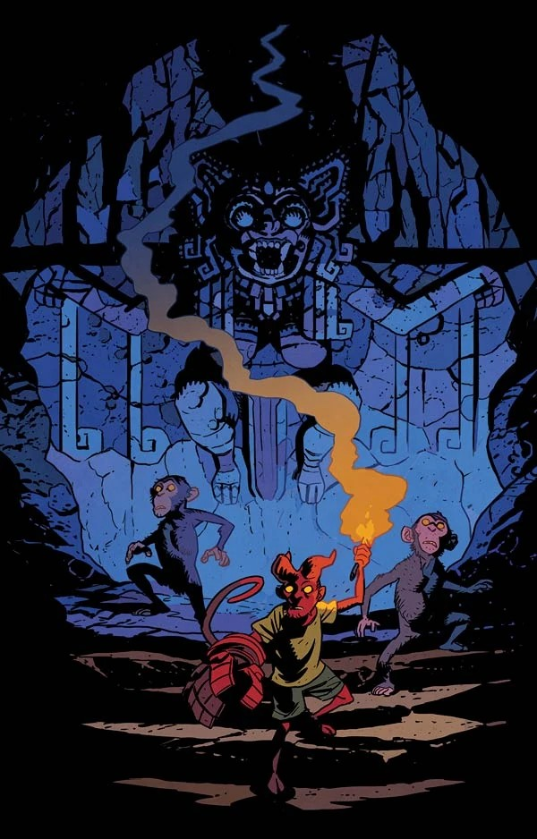
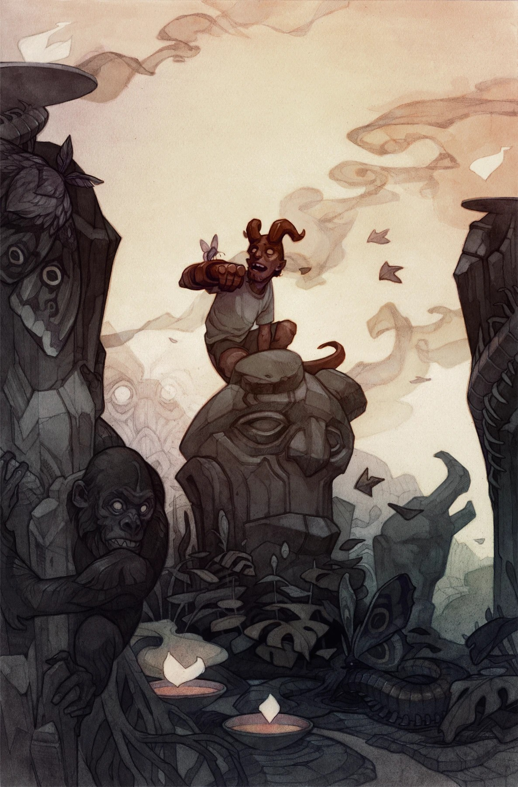
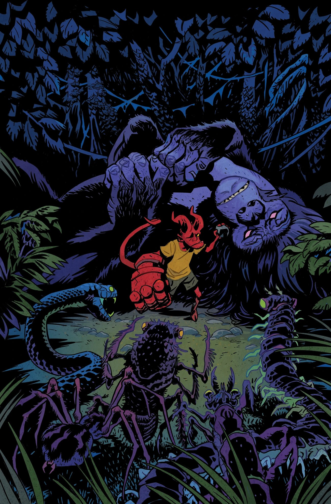
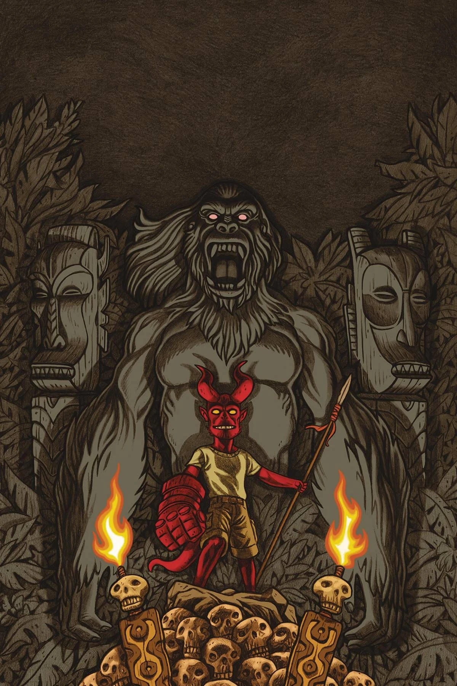

***《隐秘之地》*** 是一部于 2021 年 2 月推出的四期限定迷你连载，由 [Mike Mignola](/entry/Mike_Mignola) 与 Tom Sniegoski 编剧，[Craig Rousseau](/entry/Craig_Rousseau) 作画。这是 *[《少年地狱男爵》](/entry/Young_Hellboy)* 系列的第一个故事。*《隐秘之地》* 中首次登场了一位新角色——[“天空恶魔”斯嘉丽·圣地亚哥](/entry/Scarlett_Santiago)。

## 出版历史

第 \#4 期有部分印本出现印刷错误：封面图使用了低分辨率版本，导致画面几乎呈现出一种“像素化”的效果。

## 剧情简介

### 第一部分

[地狱男爵](/entry/Hellboy_(character))与[布鲁姆教授](/entry/Trevor_Bruttenholm)在前往南美一处发掘现场的途中遭遇意外，被困在一座陌生的岛屿上，迎面而来的是形形色色的怪物！然而，即便出手营救他们的陌生人恰好是地狱男爵心目中的英雄之一，他们也并不像自己以为的那样安全！

### 第二部分

在遇见一位失踪的冒险家、并被岛上的[奥纳尔](/entry/Ohnar)人收留之后，地狱男爵与布鲁姆教授对这座奇异岛屿的谜团展开了更深入的探索。在考察一处前代文明的废墟时，他们揭开了更多当地历史的真相……也引起了一些可怖敌人的注意！

### 第三部分

一股古老的邪恶苏醒，地狱男爵、教授、[斯嘉丽](/entry/Scarlett_Santiago)以及奥纳尔人全部陷入险境。[吸血鬼](/entry/Vampire_(creature))维斯佩拉（Vesperra）与她的亡灵大军太过强大，地狱男爵和同伴们无力独自抗衡，但斯嘉丽手中还藏着一张王牌，能让他们获得一线生机。

### 第四部分

吸血鬼女王维斯佩拉已经苏醒！岛上古老的猿神从自己的化身中现身与她交战，但这或许仍不足以取胜。地狱男爵、布鲁姆教授以及收留他们的主人，能不能撑到这两位冒险家从这座他们意外坠入的神秘岛屿逃出生天？

## 画廊

第 \#1 期  
封面作者：[Matt Smith](/entry/Matt_Smith)

第 \#1 期  
变体封面作者：[Mike Mignola](/entry/Mike_Mignola)  
与 [Dave Stewart](/entry/Dave_Stewart)

第 \#1 期  
变体封面作者：[Craig Rousseau](/entry/Craig_Rousseau)  
（Forbidden Planet 与 Jetpack Comics 独家版）

第 \#2 期  
封面作者：[Matt Smith](/entry/Matt_Smith)

第 \#2 期  
变体封面作者：Rachele Aragno

第 \#3 期  
封面作者：[Matt Smith](/entry/Matt_Smith)

第 \#3 期  
变体封面作者：Wylie Beckert

第 \#4 期  
封面作者：[Matt Smith](/entry/Matt_Smith)

第 \#4 期  
变体封面作者：Anthony Carpenter

|Issue #1 Variant cover by Mike Mignola with Dave Stewart

|Issue #1 Variant cover by Craig Rousseau (Forbidden Planet and Jetpack Comics exclusive)

|Issue #2 Cover by Matt Smith

|Issue #2 Variant cover by Rachele Aragno

|Issue #3 Cover by Matt Smith

|Issue #3 Variant cover by Wylie Beckert

|Issue #4 Cover by Matt Smith

|Issue #4 Variant cover by Anthony Carpenter
