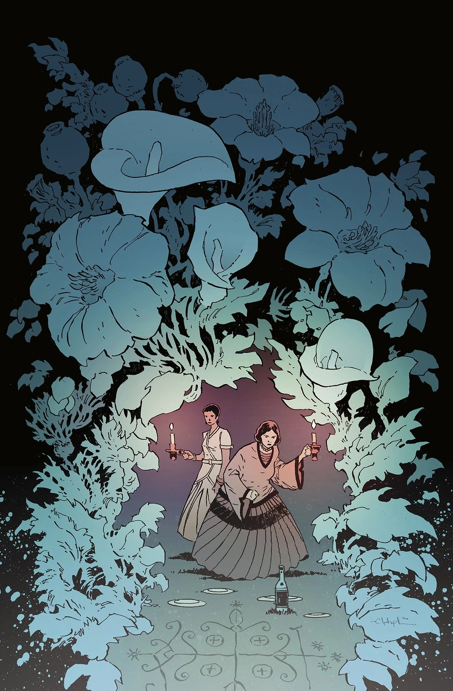
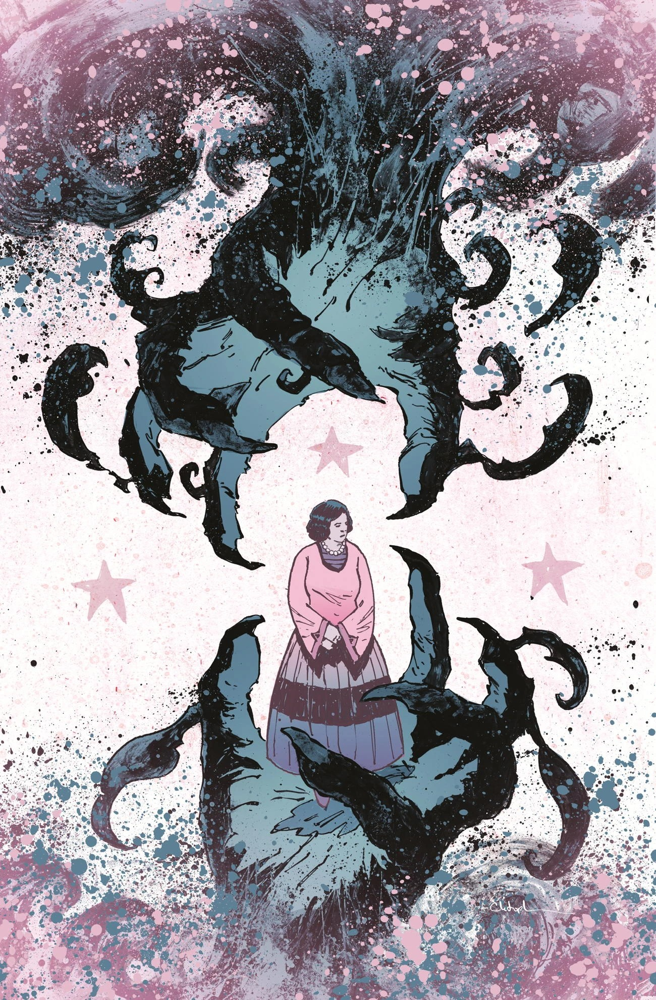
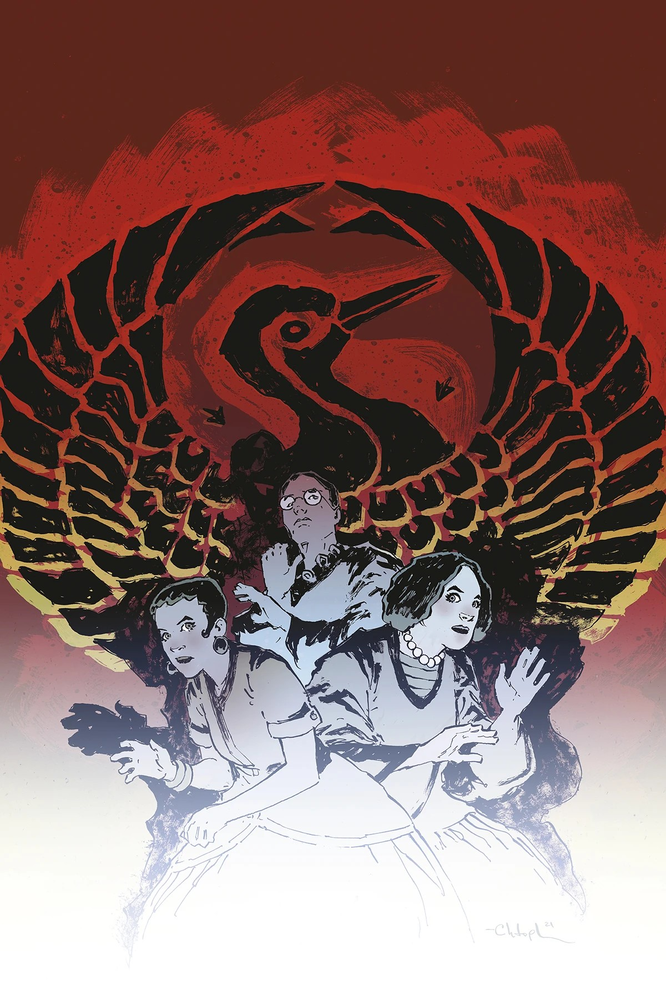
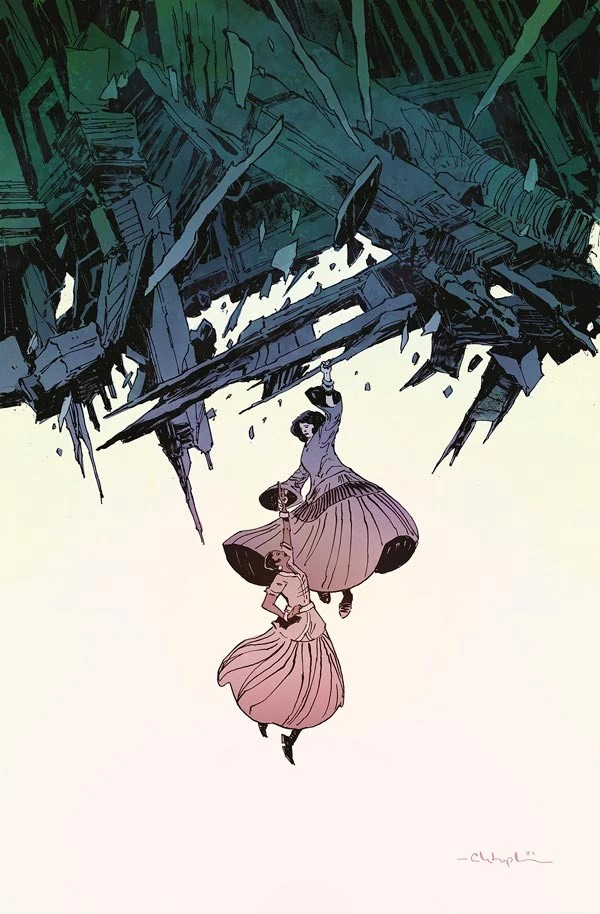

***《失落地平线之屋》（The House of Lost Horizons）*** 是 *[《Sarah Jewell 探案集》](/entry/The_Sarah_Jewell_Mysteries)* 系列的第一个故事弧。这是一起密室谋杀谜案，超自然侦探 [Sarah Jewell](/entry/Sarah_Jewell) 和她的搭档[玛丽-泰蕾兹·拉弗勒（Marie-Thérèse LaFleur）](/entry/Marie-Th%C3%A9r%C3%A8se_LaFleur)负责调查；故事发生在华盛顿州海岸外的一座私人岛屿上，岛上正在举行一场神秘学物品拍卖会。

## 剧情简介

### 第一部分

华盛顿州海岸外一座私人岛屿上的周末之旅出了岔子，一桩密室谋杀谜案令超自然侦探 Sarah Jewell 和她的搭档玛丽-泰蕾兹百思不得其解。两人被风暴困住，身边环绕着为数众多、为神秘学物品拍卖会聚集而来的嫌疑人，这对勇敢的搭档必须破解围绕客人们的超自然谜团，以期揪出凶手！可与此同时，尸体不断增加，Sarah 或玛丽-泰蕾兹随时都可能成为下一个受害者！

### 第二部分

又一具尸体被发现，谋杀谜案继续发酵！风暴肆虐的岛屿上，剩下的客人们从同一个诡异的噩梦中醒来，发现他们中的一人成了下一个惨遭杀害的受害者！但 Sarah 和玛丽-泰蕾兹开始怀疑，作案的凶手可能不止一人。杀手究竟是谁？如果不被揭穿，他们的下一个目标又会是谁？

### 第三部分

已经两具尸体……还会有多少？肆虐的风暴把这群神秘学收藏家困在岛上，但其中一些人似乎比另一些人更加心神不宁。Sarah 和玛丽-泰蕾兹分头行动、各个击破，沿着两名头号嫌疑人的踪迹，走上两条不同却同样危机四伏的道路！

### 第四部分

Sarah Jewell 在一名谋杀嫌疑人企图偷窃一件神秘学文物时将其当场抓获，与此同时玛丽-泰蕾兹继续追查自己的怀疑对象。但她们最终发现的真凶，却是两人谁也没有怀疑过的那个人！

### 第五部分

Sarah 和玛丽-泰蕾兹·拉弗勒已经确认了凶手的身份，但这到头来只是她们最不必担心的事！随着超自然势力将影响蔓延到 Sarah 等人受困的整座岛屿，一个人的自私与愚蠢，可能会让所有人万劫不复。

## 画廊

封面由 [Christopher Mitten](/entry/Christopher_Mitten)绘制

第 \#1 期

第 \#2 期

第 \#3 期

第 \#4 期

第 \#5 期

|第 #2 期

|第 #3 期

|第 #4 期

|第 #5 期
