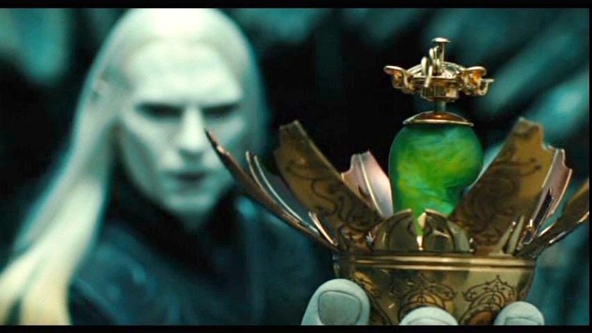
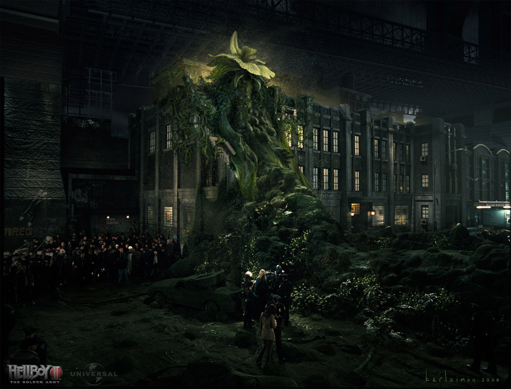

**最后的元素精灵**（The Last Elemental，也被富有诗意地称为“生命赐予者”和“毁灭者”）是土元素实体——一位森林之神。在被[地狱男爵](/entry/Hellboy)开枪打死之前，据说它是同类中最后的幸存者。迄今为止，这种生物仅两次登场：电影续集[《地狱男爵 2：黄金军团》](/entry/Hellboy_II%3A_The_Golden_Army)及其小说版。

## 历史

### 电影事件之前

在[电影](/entry/Hellboy_II%3A_The_Golden_Army)事件发生之前，这种生物的情况无从知晓。影片暗示曾经存在过更多这类生物，根据电影的背景故事可以推测，它们要么因人类在地球上的扩张而全部灭绝，要么死于[人类](/entry/Human)与魔法生物之间的战争。

这类生物被称为森林之神，也被称为生命赐予者与毁灭者。由此可以推断，精灵一族要么曾经、要么至今仍将元素精灵当作神灵崇拜，甚至可能相信它们是自己的创造者。在电影事件发生时是否仍然如此，则不得而知。

最后的元素精灵一直以被动的种子形态，被自我放逐的[精灵](/entry/Elf)[Nuada 王子](/entry/Nuada)安全保管。

### Nuada 的归来

 种子在电影中首次出现时，Nuada 把它放进一个蛋形容器——大概是由[哥布林](/entry/Goblin)自制的。他接到 [Mr. Wink](/entry/Mr._Wink) 死讯后，带着种子来到外面与地狱男爵及其小队对峙。抵达后，王子不顾妹妹劝阻，命令种子杀死地狱男爵，随后将它放出。种子接着一蹦一跳地朝水源移动，掉进了一条排水沟。

进入水中后，种子立刻开始发芽，仅仅几分钟，巨大的元素精灵便冲上街道，毁坏车辆和建筑，在该地区制造混乱，企图杀死附近的任何人。

然而，这头生物的肆虐很短暂：在 Nuada 王子的激将下，地狱男爵用一把名为“[大宝宝](/entry/Big_Baby)”的大口径霰弹枪仅开三枪便轻松解决了它。

死后，这头生物的“血”淹没了街道，并立刻绽放成茂盛的青草。它的“头”同样绽放成一朵巨大的花，开始散播漂浮的植物种子。

## 能力

尚处于种子形态时，这头生物就已表现出智力迹象，能够听懂话语，甚至可以自行移动。它还具备快速发芽和生长的能力。

在“成年”形态下，这头生物拥有巨大的物理力量，并能够吸附在各种表面上——不过不确定这种能力是否是受伤的副作用，也不确定元素精灵是否一直具备这种能力却无法真正控制它。这头生物的“血”能极其有效地促使青草和小花等简单植物生长，而它完全绽放的能量神经节——死后的“头”——则能产生漂浮的植物种子。

它还能自行发声：种子时期“说”的是一串叽里咕噜的声音，成年后则以低吼和生长声表达。

## 外貌

根据“年龄”不同，这头生物有两种形态。它的“幼体”形态是一颗绿色的种子，或者用地狱男爵的话说——一颗豆子。“成年”形态是一个高耸的、约 15 米高的类人生物，长着五条触手状的肢体，躯干由藤蔓覆盖的叶片构成，头部形似花朵。后者由若干叶片组成，包裹着一个发光的能量神经节，既充当大脑，也是一个花苞，只在这头生物死后才绽放成花。

## 趣闻

- Nuada 王子曾说这头生物是同类中最后的幸存者。
- 作为元素精灵，更具体地说是森林元素精灵，可以推测存在过、或至今仍存在基于其他元素的元素生物。
- 这头生物的外形由 Olivier Pron 和 Philippe Gaulier 设计，他们的部分素描收录于《Hellboy 2: The Art of the Movie》一书中。
