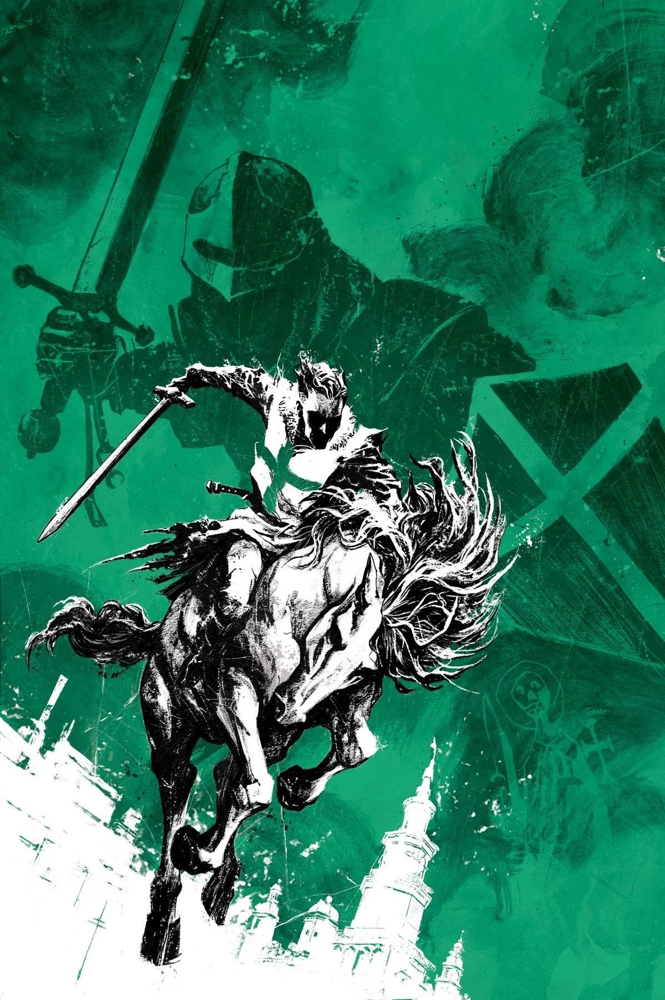
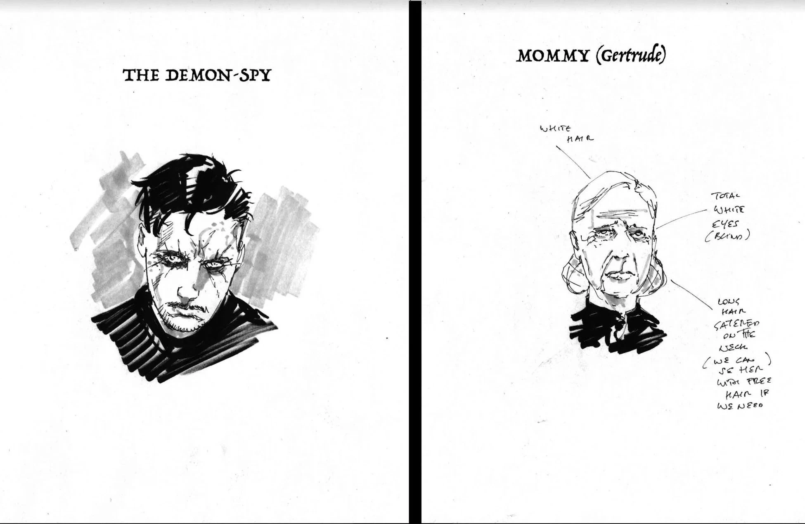
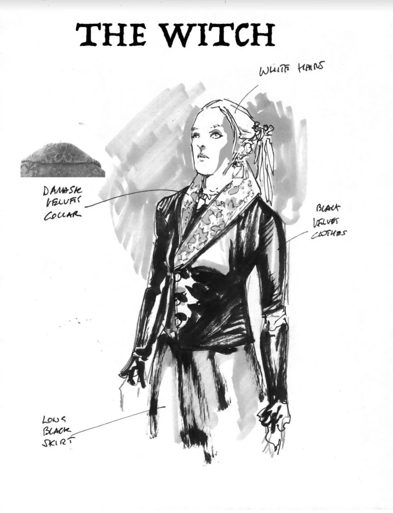
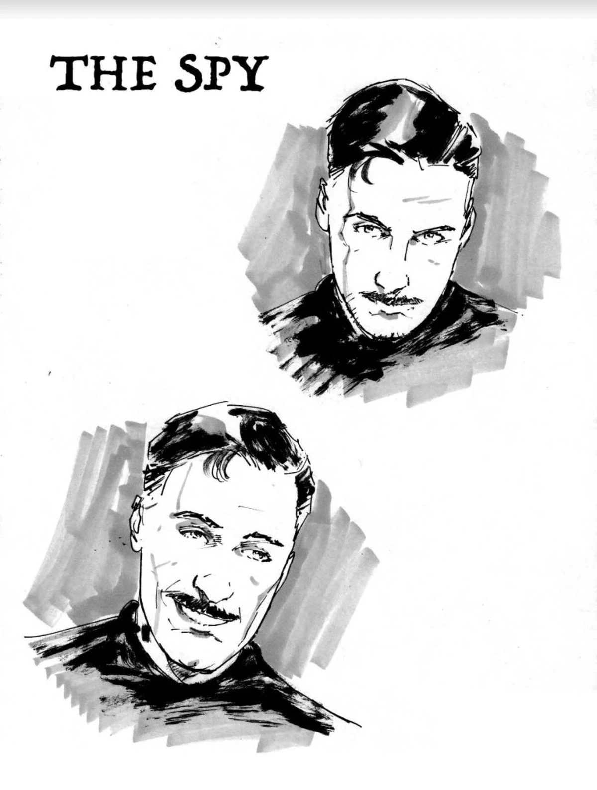
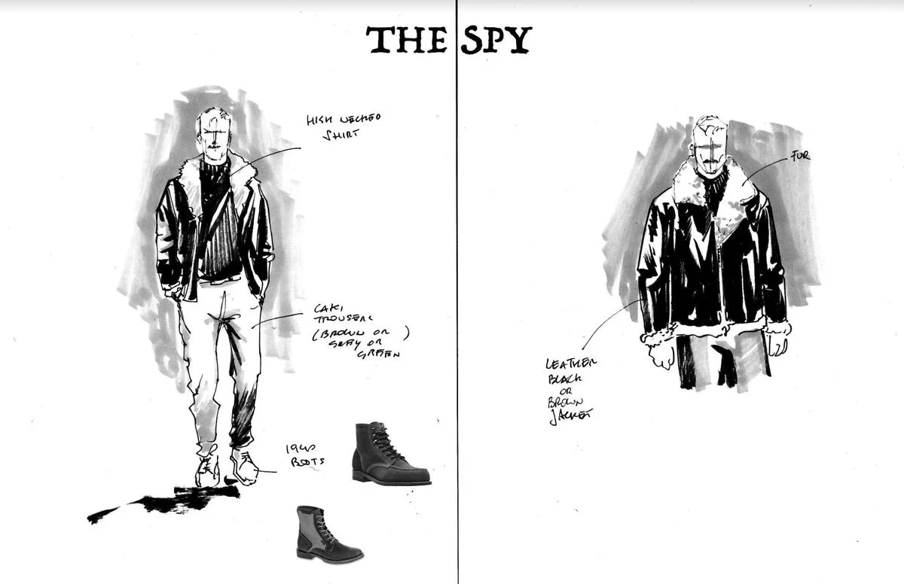

***《圣哈根最后的骑士》***是一部已被取消的四期限定迷你系列，原计划由迈克·米格诺拉与斯科特·阿利编剧、Andrea Mutti 作画。该作于 2020 年 1 月 11 日公布，就在 *[《地狱男爵冬季特刊（2019）》](/entry/Hellboy_Winter_Special_(2019))* 发行前夕，这期特刊收录了一则[短篇故事](/entry/The_Beast_of_Ingelheim)，为这部迷你系列埋下伏笔。

## 出版历史

第一期原定 2020 年 4 月首发，但因新冠疫情爆发而推迟。后来，联合编剧[斯科特·阿利](/entry/Scott_Allie)侵犯他人的劣行被曝光，这部迷你系列随即被取消。

## 出版方简介

### 第一部分

*一名机警的波兰间谍被一群纳粹执法者追捕，仓皇穿过小镇托伦。时值 1939 年，德国占领刚刚开始，他身上携带着给抵抗组织的重要情报。但一颗子弹、一座坟墓，以及一个鬼魂——或许甚至是上帝——对这个间谍另有安排，而这些安排将牵扯到那位神秘的十字军骑士圣哈根。*

### 第二部分

*被鬼魂缠身者重获生命，却肩负赎罪的使命。*

*被圣哈根的意志附身后，一名波兰间谍在愈演愈烈的二战战火中艰难寻找自己的道路。他回到自己疑似丧命的地点，得知了神秘十字军骑士圣哈根的存在——以及圣哈根似乎为这个间谍安排的计划。*

### 第三部分

*一场惊心动魄的追逐在被占领的欧洲大地展开！*

*在圣哈根之灵的驱使下，一名波兰间谍追捕那些偷走了珍贵的抵抗组织情报、又置他于死地的纳粹士兵。信封中的内容是阻止一场秘术末日计划的关键。但第三帝国内部作祟的秘术力量已经察觉到他的存在，正着手截击。一个人——即便有这样的灵魂附身——是否足以对抗阻挡他的一切？*

### 第四部分

*《圣哈根最后的骑士》* 在第 \#4 期征订之前便被取消，不存在内容简介。

## 画廊

封面由 [Sebastián Fiumara](/entry/Sebasti%C3%A1n_Fiumara) 绘制。

第 \#1 期

第 \#2 期

第 \#3 期

概念原画，作者 Andrea Mutti

概念原画，作者 Andrea Mutti

概念原画，作者 Andrea Mutti

概念原画，作者 Andrea Mutti

概念原画，作者 Andrea Mutti

|第 #3 期

|Concept art by Andrea Mutti

|Concept art by Andrea Mutti

|Concept art by Andrea Mutti

|Concept art by Andrea Mutti
