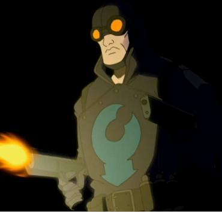

*译名说明：Lobster Johnson 在简体中文网络上的通译是「龙虾强生」；本站采用民间汉化人「不高兴」的个人译名「大螯虾强生」为标准名（「螯」即龙虾之钳），以保留民间翻译的趣味与情怀。*

**大螯虾（The Lobster）**是 20 世纪 30 年代在纽约市秘密活动的一名义警。他以手段暴力著称，比如枪杀毒贩，并把自己标志性的龙虾钳烙印烫在他们额头上。

到了现代，普通公众都以为大螯虾只是一位退休警探转行低俗小说作家后虚构出来的人物。这些通俗故事给他安排了一个（虚构的）另一重身份：坐轮椅的百万富翁 Walter Johnson，他广为人知的绰号"大螯虾强生（Lobster Johnson）"也由此而来。

少数阴谋论者正确地相信大螯虾确有其人，尽管在他活动的年代，从没有人叫过他"大螯虾强生"。

他首次登场于*[《大螯虾强生：我头颅里的杀手》](/entry/The_Killer_in_My_Skull)*这篇后备故事，刊载于*[《地狱男爵：满盒邪恶》](/entry/Box_Full_of_Evil)* \#1。

## 历史

### 义警生涯

大螯虾的出身和身份至今成谜，从未查明。他首次公开露面可确定为 1934 年 2 月匪徒 Donny "Mints" Parker 之死——死者额头上烫着一个钳形印记。此后四年间，大螯虾和他的盟友们单枪匹马地向黑帮开战，1932 年至 1938 年间已确认有上百名（有说法称多达两百五十名）涉黑人员死于其手，其中包括 Zuco Banana、Skinny Joe Lincoln、Victor "鱼仔 Vicky" Cipriani 等有组织犯罪头目。30 年代后期，大螯虾的注意力从打击犯罪转向国际事务，例如挫败外国特工（主要是轴心国间谍和破坏分子）在美国境内的图谋，以及应对超自然威胁。

1932 年，大螯虾与涉入借助神秘力量犯罪的匪徒 [Arnie Wald](/entry/Arnie_Wald)结下梁子。与 Wald 的冲突逼得这名匪徒雇佣了[黑焰](/entry/The_Black_Flame_%28character%29)。

1937 年，大螯虾与神秘的 [Memnan Saa](/entry/Memnan_Saa)发生冲突：后者企图利用 [Kyriakos Gallaragas](/entry/Kyriakos_Gallaragas)教授的著作"[阿努姆之叉](/entry/Anum%27s_Fork)"中的秘密，创造一支龙族大军、复活极北帝国。大螯虾救下了 Gallaragas 的女儿 [Helena](/entry/Helena_Gallaragas)，Saa 的计划也被 Gallaragas 的同事 [Jim Sacks](/entry/Jim_Sacks)摧毁。然而 Memnan Saa 逃脱了，并成了大螯虾的危险敌人。[1]

大螯虾立誓追查 Memnan Saa，但线索屡屡走进死局，还酿成悲剧：他的盟友们在追查 Saa 的过程中相继惨死，最后只剩盟友 [Harry McTell](/entry/Harry_McTell)一人。接连折损人手迫使大螯虾放弃追查，随后他开始以独立特工身份为美国政府效力。[2]

### 为美国政府效力

1938 年，大螯虾在纽约上城区调查一系列反常的科学家谋杀案。在 Skinner 博士公寓发现的一张照片，把大螯虾引向 [Zinco-Davis](/entry/Zinco_Corporation)最初聘用的五名科学家中仅存的一人：[Stanley Corn](/entry/Stanley_Corn)。原来 Stanley 是 Zinco-Davis 一个绝密研究项目的负责人，但因对大脑（包括他自己的大脑）进行危险实验而被解雇。Stanley 随即试图用脑能量波杀死大螯虾、他的助手 [Bob](/entry/Bob)和警察，但被一台干扰装置成功阻挡。随后大螯虾开枪击中 Corn，不料 Corn 的大脑破体而出，想用脊髓勒死大螯虾。幸运的是，大螯虾挣脱出来，把干扰装置砸在那颗大脑上，引发爆炸，大脑就此"死亡"。

1939 年 2 月，在他少有的几次失败任务中，大螯虾未能抓获一名纳粹罪犯，那人杀死了他的助手，还摧毁了一列满载科学家、原定送往曼哈顿计划的火车。

大螯虾的最后一次任务，是 1939 年 3 月 20 日在奥地利的 [Hunte 城堡](/entry/Hunte_Castle)试图阻止纳粹发射一枚太空舱，但行动失败。尽管他赶在发射前强行合上了 Hunte 城堡的屋顶，太空舱仍破顶而出。随后城堡内的爆炸与大火杀死了所有人，只有纳粹科学家[赫尔曼·冯·卡朗普特](/entry/Herman_von_Klempt)幸存。

### 身后传奇

自他殒命后，整个二战期间，大螯虾不断激发公众的想象。他成了 [Norvell Cooper](/entry/Norvell_Cooper)（此公声称自己见过大螯虾并与其共事）出版的低俗杂志中的虚构人物，还在几部电影里短暂走红，比如 Vic Williams 饰演他的《幽灵丛林》（Republic Pictures，1945 年），以及墨西哥导演 Eduardo Fernandez 拍摄的一系列低成本恐怖片。近年来有迹象表明，把大螯虾虚构化是美国政府为掩盖这名义警真实存在而做的努力，[地狱男爵](/entry/Hellboy)（一辈子的大螯虾迷）对此深信不疑。

2001 年 2 月，[B.P.R.D.](/entry/B.P.R.D.)特工地狱男爵和[罗杰](/entry/Roger)在 Hunte 城堡闹鬼的废墟中遇到了大螯虾的鬼魂。在阻止赫尔曼·冯·卡朗普特和[拉斯普廷](/entry/Rasputin)把[征服者蠕虫](/entry/Conqueror_Worm)带到地球的阴谋中，大螯虾发挥了关键作用，在死后完成了他生前未能完成的任务。事后，地狱男爵和罗杰发现了大螯虾布满弹孔、干瘪枯槁的尸体，为这位不得安息的义警举行了葬礼。

然而大螯虾始终没能安息。2003 年 7 月，大螯虾再次帮助罗杰和[丽兹·舍曼](/entry/Liz_Sherman)了结他 1939 年失败的任务，抓获了如今年迈的破坏分子。在对抗 Sadu-Hem 的[蛙怪](/entry/frog_monster)的战争期间，当 Memnan Saa 开始让 B.P.R.D. 感受到他的存在时，大螯虾一度附身[约翰·克劳斯](/entry/Johann_Kraus)的灵质——彼时[本·达米奥](/entry/Ben_Daimio)与小队的关系刚刚灾难性破裂——打破了 Saa 对丽兹的控制。他与 Saa 旧日渊源的一角就此揭开，不久后小队举行降神会，他的灵魂利用自己数十年前调查中掌握的情报，向他们提供了追查 Saa 的第一批线索。B.P.R.D. 最终把 Saa 追踪到他位于斯塔诺夫山脉某处的基地后，在决战的收尾时刻，大螯虾再次附身约翰的形体，试图击败他的老对头。Saa 被杀、大螯虾的心愿了结后，[凯特·考瑞根](/entry/Kate_Corrigan)把他带回奥地利的 Hunte 城堡，他在那里松开了对约翰灵质的控制，重新加入栖居城堡中的鬼魂群——在一个能让他永永远远与纳粹和邪恶势力战斗下去的来世里，他找到了属于自己的那份安宁。

### 《怪探》杂志中的大螯虾

1939 年，纽约市警探 [Norvell Cooper](/entry/Norvell_Cooper)离开警局，投身写作。1940 年 9 月，《怪探》（Weird Detective）杂志刊登了第一篇大螯虾故事《死亡长臂》，Cooper 声称故事基于真实事件。然而，考虑到 Cooper 爱在故事里摧毁著名地标，这让他的说法令人生疑——在他的大螯虾系列故事中，他把帝国大厦炸了两次。这些故事写得热情有余、水准不足。

尽管 Cooper 坚称自己认识真正的大螯虾，故事的其他部分却是虚构的，比如大螯虾那坐轮椅的百万富翁分身 Walter Johnson。

Cooper 一共写了八个大螯虾故事，最后一篇《死亡即正义》发表于 1942 年 2 月。

### 《大螯虾漫画》

20 世纪 40 年代初，Cooper 的大螯虾被改编成漫画。漫画把故事地点从纽约搬到了二战中的欧洲，除此之外角色细节大同小异。大螯虾屡次战斗并杀死希特勒，但这个纳粹恶棍每次都复活，变成越来越怪诞的弗兰肯斯坦式怪物。

大部分大螯虾漫画由 Adam Horowitz 编剧、Isaac "Janky" Rosen 作画。和 Cooper 一样，人们记住他们更多是因为热情而非技艺。1946 年，大螯虾从战时英雄转型为对抗外星人的太空人后，《大螯虾漫画》在出满三十八期后停刊。

### Republic Pictures 电影系列片

Republic Pictures 拍摄了两部各十二集的系列片。第一部《幽灵丛林》以非洲为背景，剧情错综复杂，牵涉亚特兰蒂斯人、变异人和恐龙。观众对它的评价是"烂得惊人"。漫画编剧 Adam Horowitz 形容看这部电影是"[他]一生中最难过的经历之一"。

第二部电影大致改编自 Norvell Cooper 的《死亡帝国》，故事场景回到纽约市。两部影片都于 1945 年上映，由昔日的歌唱牛仔 Vic Williams 饰演大螯虾，尽管以他的年龄和体型出演这个角色明显太老太胖。

### 《大螯虾强生》墨西哥自由式摔跤电影

1951 年至 1959 年，墨西哥导演 Eduardo Fernandez 至少拍了九部以大螯虾为题材的电影，不过他这版角色与原作素材相去甚远。Fernandez 版大螯虾是一个老人或一具尸体，会魔法般变身为戴面具的英雄"大螯虾强生"（这个名字显然是"大螯虾"和"Walter Johnson"的组合）。影片由 [Adolfo Flores](/entry/Adolfo_Flores)饰演片名角色大螯虾强生。

20 世纪 60 年代，这些电影经过大幅剪辑、配上糟糕的英语配音，供美国电视播出。遗憾的是，原版影片没有保存下来任何质量完好的拷贝。

## 能力

大螯虾具备专业级的近身格斗水准，擅长使用火器，尤其是他标志性的手枪。杀死敌人后，大螯虾会用装在手套上的"钳子"留下烙印，不过他究竟如何加热它尚不清楚；极有可能是通过超自然手段。

死后，大螯虾以鬼魂形态存在，并能在自己选择的任何时刻完全实体化。他多次出现在通常极难或根本无法抵达的地方，说明他要么能传送，要么能虚化/隐形。与生前行医时一样，大螯虾死后仍携带着他标志性的手枪，威力丝毫不减。大螯虾也保留了他的"钳子"烙印。

作为鬼魂，大螯虾时常表现出一种超然物外的姿态，或一种洞察更多真相的感觉。罗杰请他帮忙对抗征服者蠕虫时，大螯虾拒绝了，告诉罗杰这是他（罗杰）必须独自完成的任务。很可能成为鬼魂后，宇宙的若干层面已向大螯虾显现，而这些是生者无从知晓的。

大螯虾用一道闪电为罗杰充能后，他化为一具披着残破版制服/战衣的骷髅尸身，暗示大螯虾即使成了鬼魂，可能仍维持着自己死去的肉身。

## 其他媒体

大螯虾出现在未能投拍的《幽灵之螯》预告片段中。

- 大螯虾强生在第二部[地狱男爵动画版](/entry/Hellboy_Animated)电影《[铁血惊魂](/entry/Blood_and_Iron)》中短暂客串，出现在一段闪回场景里，展现地狱男爵的诞生以及 [Malcolm Frost](/entry/Malcolm_Frost)对这个怪物的反应。
  - 片尾字幕后的片段预告了第三部电影《幽灵之螯》，片中大螯虾将协助地狱男爵和[凯特·考瑞根](/entry/Kate_Corrigan)对战[拉斯普廷](/entry/Grigori_Rasputin)的鬼魂。这部电影最终被取消。
- 在《[地狱男爵：邪恶科学](/entry/Hellboy__The_Science_of_Evil)》中，大螯虾被隐约提及。
  - 与已取消 DLC 相关的成就提到了大螯虾（一个名为"尝尝大螯虾的钳子"，另一个提到玩家可"扮演大螯虾"）。游戏制作人员名单中列出 Bruce Campbell 为一个"机密"角色配音，暗示他原本要在这部 DLC 中为大螯虾配音。
- 在电子游戏《[不义联盟 2](/entry/Injustice_2)》中，与[闪电侠](/entry/w%3Ac%3Ainjustice%3AThe_Flash_%28Jay_Garrick%29)（Jay Garrick）的赛前对话里，[地狱男爵](/entry/Hellboy_%28Injustice%29)可能会问 Garrick 有没有见过大螯虾。闪电侠欣赏地回答："啊，总算有个懂历史的人了"，表明他知道这位同为 40 年代打击犯罪的同道。
- 大螯虾在 2019 年电影《[地狱男爵](/entry/Hellboy_(2019_film)))》中短暂登场，由 [Thomas Haden Church](/entry/Thomas_Haden_Church)饰演。

## 参考资料

[1] *[《钢铁普罗米修斯》](/entry/The_Iron_Prometheus)*

[2] *[《黑色女神》](/entry/The_Black_Goddess_%28story%29)*
