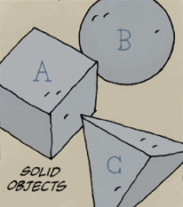

《**魔法师与蛇**》（The Magician and the Snake）是《地狱男爵》创作者 [Mike Mignola](/entry/Mike_Mignola) 与他当时七岁的女儿 [Katie Mignola](/entry/Katie_Mignola) 合作的、荣获艾斯纳奖的作品。

## 出版历史

这部短篇故事最初于 2002 年 9 月发表在《Dark Horse Maverick: Happy Endings》中。该漫画后来被收录进 Dark Horse 于 2010 年 9 月出版的《神奇螺丝头及其他珍奇物件》。它还被收录进[《地狱男爵在地狱》](/entry/Hellboy_Library_Editions)图书馆版，以及[《地狱男爵——第 4 卷：地狱男爵在地狱》](/entry/Omnibus_Editions)全集版。

## 剧情简介

魔法师向他最好的朋友[那条蛇](/entry/The_Snake)透露，他用力过猛：为了被一位猴王封为"世界上最伟大的魔法师"，他让三个几何形状——实体之物——消失了。然而，他并没有让实体之物永久消失，当它们归来之时，魔法师就会死去。魔法师和蛇一起度过了最后的快乐岁月。最终，实体之物归来，魔法师与世长辞。他的朋友蛇为他哀悼。

## 故事中的故事

据 [Mike Mignola](/entry/Mike_Mignola) 所说，《魔法师与蛇》在地狱男爵宇宙中是一个童话故事。[1]

## 实体之物的含义

实体之物的含义被刻意保持模糊，任由解读。不过，在接受 Le Commis des Comics 采访时，[米格诺拉](/entry/Mike_Mignola)确实阐述了实体之物对他而言意味着什么：

*魔法师让这些形状消失了，所有人都说，*'你是一位伟大的魔法师。'*这就像人们对我说，*'你是一位伟大的艺术家。'*可是，我并不觉得自己是一位伟大的艺术家。我觉得自己得到的赞誉超过了我的实际水平。所以我把这种感觉放进了故事里。而那些形状回来时，就有点像有人在说，*'要知道，你其实没那么厉害。'*再说一遍，这是一种非常复杂的情感，这也是那些形状非常重要的原因，因为对我来说，它们关乎我个人创作上的某种非常私人的……东西。*[2]

## 与地狱男爵宇宙的联系

### 实体之物

魔法师使其消失的实体之物出现在《[地狱男爵在地狱](/entry/Hellboy_in_Hell)》和《[B.P.R.D.：你所知道的魔鬼](/entry/The_Devil_You_Know_%28story_cycle%29)》中。

### 雕像

魔法师、蛇和实体之物的雕像是《魔法师与蛇》的最后一个画面。同一座雕像也出现在《[地狱男爵在地狱](/entry/Hellboy_in_Hell)》中。

### 蛇

蛇出现在《地狱男爵在地狱》#5 和[《B.P.R.D.你所知道的魔鬼：喧嚣》#1](/entry/Pandemonium_%28story_arc%29)中。

## 与米格诺拉其他作品的联系

除了与地狱男爵宇宙中的书产生联系之外，《魔法师与蛇》还与收录在《[神奇螺丝头及其他珍奇物件](/entry/The_Amazing_Screw-On_Head_and_Other_Curious_Objects)》中的另外两个故事产生了联系。

### 《火星的囚徒》

[《斯纳普博士如何谋杀独眼巨人教授及其后果》又名《火星的囚徒》](/entry/The_Prisoner_of_Mars)中有一家名为"魔法师与蛇"的客栈，其招牌上融合了魔法师、蛇和实体之物的形象。该漫画的最后一个画面也出现了蛇。

### 《在珍奇物件礼拜堂中》

《[在珍奇物件礼拜堂中](/entry/In_the_Chapel_of_Curious_Objects)》中出现了《魔法师与蛇》结尾所见雕像的一个微缩版本。这个微缩雕像被揭示内部装着实体之物。

## 奖项

- 2003 年艾斯纳奖"最佳短篇故事"

## 参考资料

## 外部链接

- [DarkHorse.com 上的《Dark Horse Mavericks: Happy Endings》产品页](https://www.darkhorse.com/Books/11-975/Dark-Horse-Maverick-Happy-Endings%7C)
- [DarkHorse.com 上的《神奇螺丝头及其他珍奇物件》产品页](https://www.darkhorse.com/Books/16-870/The-Amazing-Screw-On-Head-and-Other-Curious-Objects-hardcover-collection%7C)
- [在 io9.com 上阅读《魔法师与蛇》](https://io9.gizmodo.com/5604593/this-comic-by-mike-mignola-and-his-daughter-is-the-most-heartwarming-thing-youll-read-all-day/%7C)

[1] <https://twitter.com/artofmmignola/status/1006527381354369024>

[2] <https://www.youtube.com/watch?v=jzgwcJ9fr3c>
