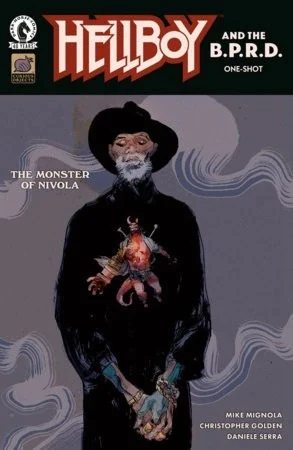

***《尼沃拉的怪物》*** 是 *[《地狱男爵与超自然调查防御署》](/entry/Hellboy_and_the_B.P.R.D.)* 的一个单期故事，由迈克·米格诺拉与 Christopher Golden 编剧，[Daniele Serra](/entry/Daniele_Serra) 作画，这也是他在地狱男爵宇宙中的首次亮相。

## 剧情简介

关于一头怪物的传闻把地狱男爵带到了撒丁岛上一座几近废弃的小镇，搜寻怪物的过程将他引向当地的一座修道院，而这座修道院自身隐藏着一个惊人的秘密。

## 画廊

*《地狱男爵与超自然调查防御署：  
尼沃拉的怪物》*  
作者 Daniele Serra

*《地狱男爵与超自然调查防御署：尼沃拉的怪物》变体封面，作者 Nicolas Nemiri*

|Hellboy and the B.P.R.D.: The Monster of Nivola variant by Nicolas Nemiri
