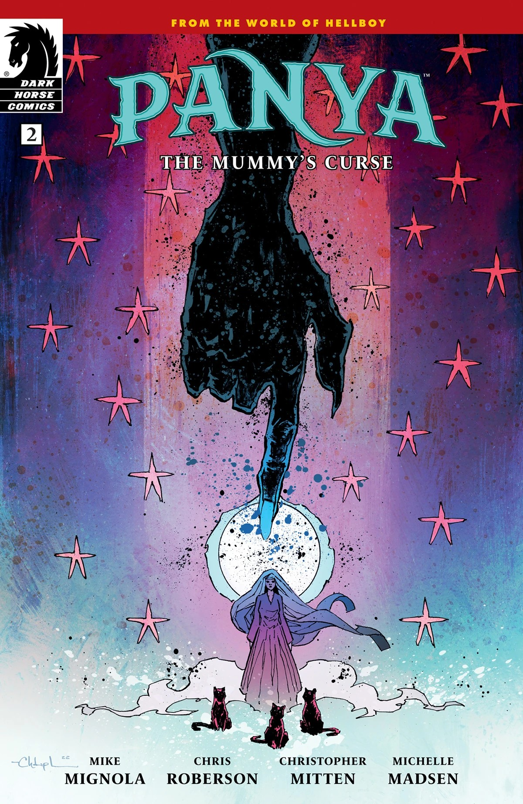
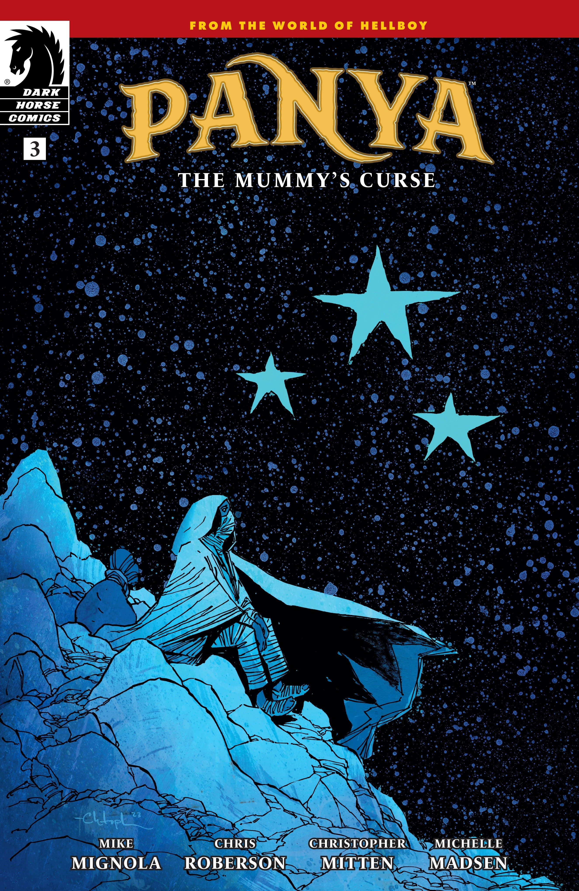
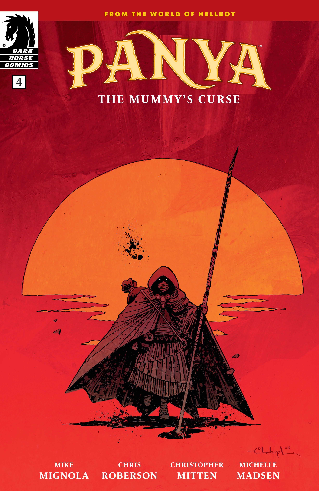

*本条目是一篇小作品。你可以帮助扩充地狱男爵维基。*

***《木乃伊的诅咒》*** 是 *[《潘雅》](/entry/Panya_(series))* 的一个故事线，编剧 Mike Mignola 与 Chris Roberson，作画 Christopher Mitten。

## 剧情简介

### 第一部分

在地狱男爵、超自然调查防御署与诸神黄昏之前的数千年，曾有潘雅。在古埃及，还是少女的她目睹了一个王朝的覆灭，并被赐予——或说被诅咒——关于开端、终结以及巨龙降临的幻象……

### 第二部分

在那场摧毁了她家园的灾难中幸存下来的多年之后，潘雅已经适应了神庙仆役的生活，但仍被噩梦……或是幻象所困扰。与此同时，一批批周游四方的请愿者来到神庙，带来关于一片迫近黑暗的警告，而那黑暗与潘雅自己的梦境有着令人不安的相似。

### 第三部分

潘雅踏遍世界，追寻自己幻象中那座古城背后的真相、她神秘力量的秘密，以及那个低语着让她去寻找光明的声音。但要找到答案，她或许必须先走入黑暗……

### 第四部分

身披暗影、被烈火触碰，潘雅必须与黑暗正面相对，方能让光明显现。

## 画廊

全部封面由 Christopher Mitten 绘制。

*潘雅：  
《木乃伊的诅咒》* \#1

*潘雅：  
《木乃伊的诅咒》* \#2

*潘雅：  
《木乃伊的诅咒》* \#3

*潘雅：  
《木乃伊的诅咒》* \#4

|Panya: The Mummy's Curse #2

|Panya: The Mummy's Curse #3

|Panya: The Mummy's Curse #4
