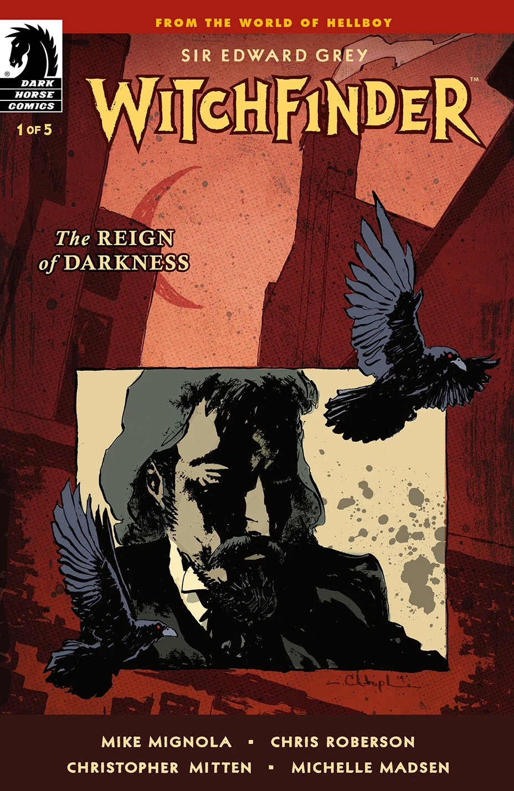
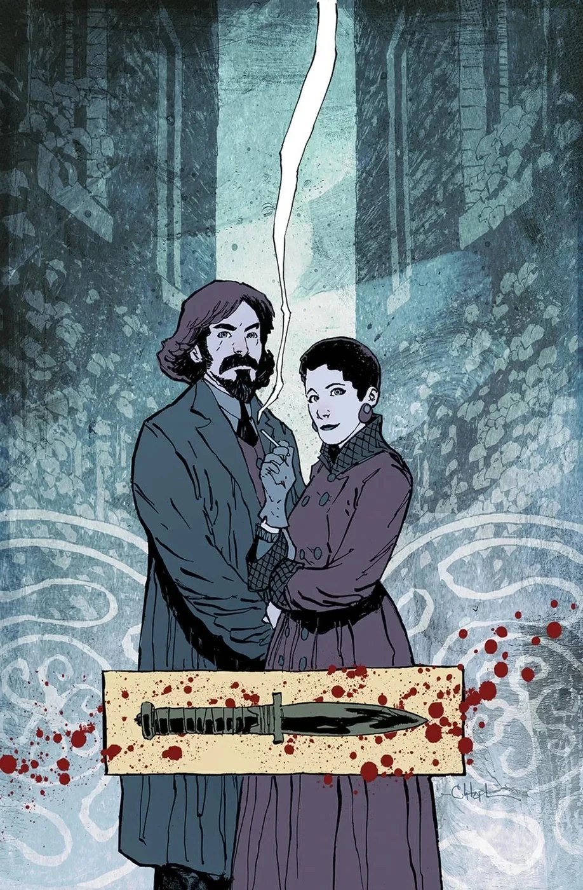
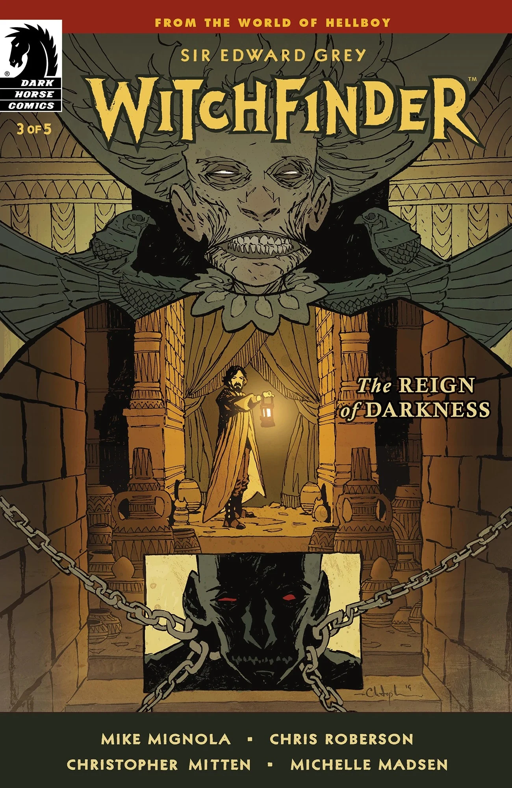
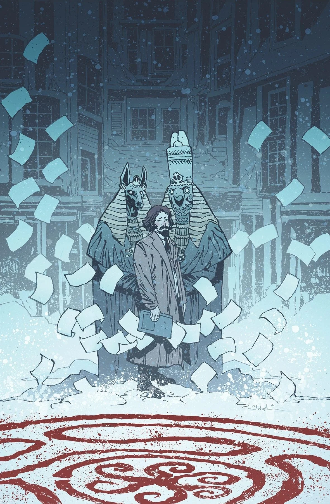
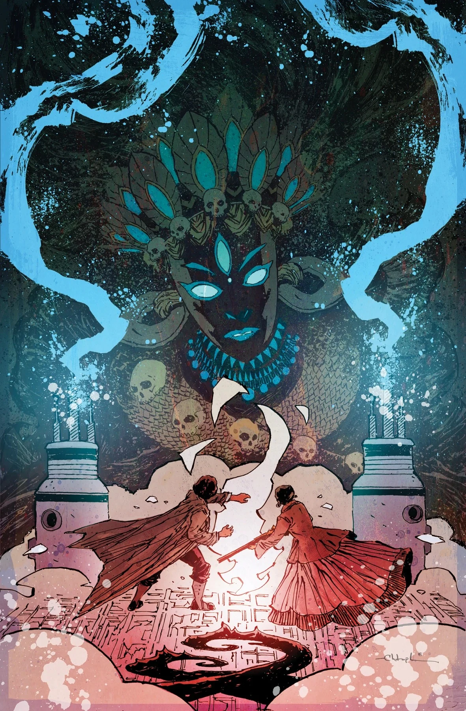

***《黑暗统治》（The Reign of Darkness）*** 是一部五期限定连载，由[迈克·米格诺拉](/entry/Mike_Mignola)和[克里斯·罗伯森](/entry/Chris_Roberson)编剧，[Christopher Mitten](/entry/Christopher_Mitten)负责作画。故事背景设定在 1888 年，围绕[开膛手杰克](/entry/Jack_the_Ripper)的谋杀案展开。

## 剧情简介

### 第一部分

爱德华·格雷爵士接手追查伦敦最臭名昭著的连环杀手！但只有他一个人认为开膛手杰克的谋杀案带有神秘学目的。当苏格兰场对他置之不理时，格雷在美国神秘学冒险家 Sarah Jewell 那里找到了盟友。然而，与他们的调查为敌的势力，比两人中任何一人所想象的都要强大！

### 第二部分

随着猎巫人（Witchfinder）继续调查开膛手谋杀案，一名新的嫌疑人浮出水面！但鉴于他的调查操守正受到质疑，这或许是他眼下最不需要的东西。与此同时，Sarah Jewell 试图渗透神秘的普洛塞庇娜之家（Proserpine Home），此举可能揭露出真凶——也可能让她和爱德华·格雷陷入更大的危险！

### 第三部分

就开膛手一案以及阿斯奎斯（Asquith）与拉神赫利奥皮斯兄弟会（Heliopic Brotherhood of Ra）之间可疑的关联向潘雅咨询之后，猎巫人潜入了兄弟会的神殿。但他对在那里找到的线人完全毫无准备！与此同时，Sarah Jewell 在普洛塞庇娜之家的卧底行动出现转折，使她对真相的追寻骤然变得紧迫起来。

### 第四部分

他最亲密的知己之一死于赫利奥皮斯兄弟会之手，宅邸一片狼藉，盟友日益稀少，对猎巫人而言局势前所未有的凶险。爱德华·格雷爵士怀着前所未有的急迫追缉涉嫌为术士的戈登·阿斯奎斯（Gordon Asquith），在危险中越陷越深；与此同时，Sarah Jewell 在普洛塞庇娜之家的卧底行动也一步步逼近答案。

### 第五部分

爱德华·格雷爵士和 Sarah Jewell 准备迎击两人所遭遇过的最黑暗的存在之一！格雷以为凶手终于露出了破绽，但当他试图将其拿下时，等待他的或许仍是一场意外。

## 画廊

封面由 [Christopher Mitten](/entry/Christopher_Mitten)绘制。

|第 #1 期

|第 #2 期

|第 #3 期

|第 #4 期

|第 #5 期
