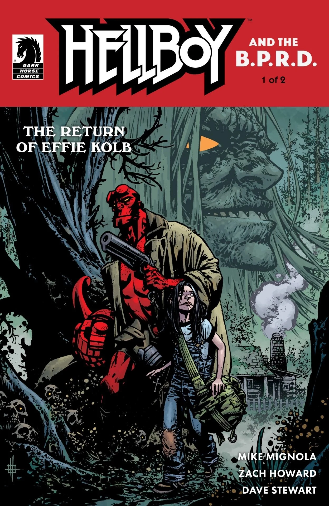
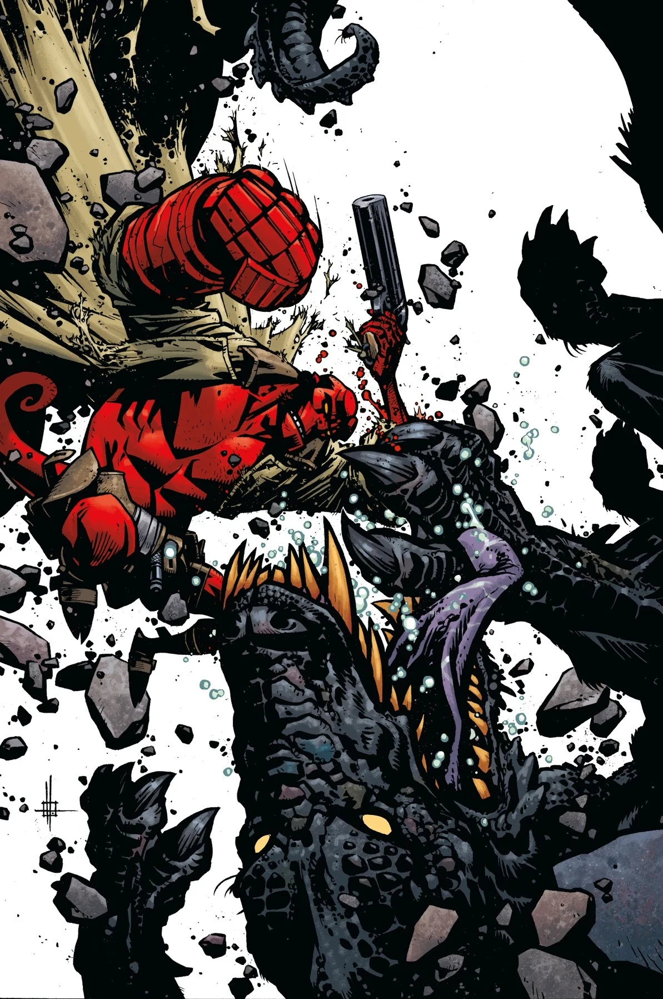

***《艾菲·科尔布归来》（The Return of Effie Kolb）*** 是 *[《地狱男爵与超自然调查防御署》](/entry/Hellboy_and_the_B.P.R.D.)* 的一个两期故事线，由 [Mike Mignola](/entry/Mike_Mignola) 编剧、[Zach Howard](/entry/Zach_Howard) 作画。第二期因 COVID-19 疫情延期。该故事是 *[《地狱男爵：歪男人》](/entry/The_Crooked_Man_(comic_story))*（Hellboy: The Crooked Man）的续作。

## 剧情简介

### 第一部分

在恶名昭彰的林地恶魔[歪男人](/entry/Jeremiah_Witkins)被[地狱男爵](/entry/Hellboy_(character))放逐多年之后，一位[年轻灵媒](/entry/Sara_May_Blackburn)警告[汤姆·费瑞尔](/entry/Tom_Ferrell)大难将至，地狱男爵于是重返阿巴拉契亚。而[歪男人的房子](/entry/The_Hurricane)已不再空无一人，弗吉尼亚的丛林中新旧威胁一同暗涌。

### 第二部分

在地狱男爵与歪男人宅邸的新住户离奇相遇之后，年轻的灵媒仍隐隐觉得，那座弗吉尼亚老宅中正有什么不祥之事发生……而她是对的。

## 画廊

除另有说明外，封面均由 [Zach Howard](/entry/Zach_Howard) 绘制。

第 \#1 期

第 \#1 期  
Mike Mignola 变体封面

第 \#2 期

《地狱男爵与超自然调查防御署》出版顺序

&#10;
前作
《戈洛斯基车站的漫长一夜》
《艾菲·科尔布归来》

后续
《七任妻子俱乐部》

|第 #1 期

|第 #2 期
