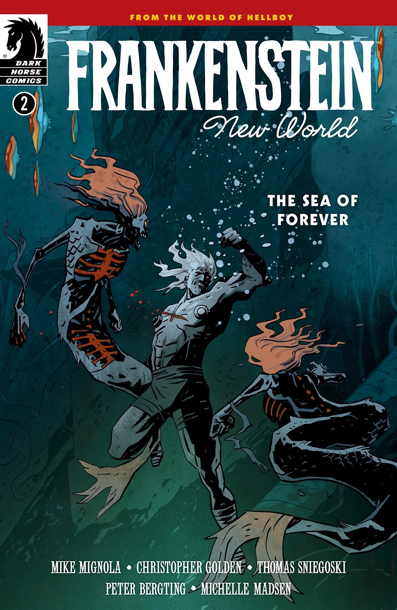
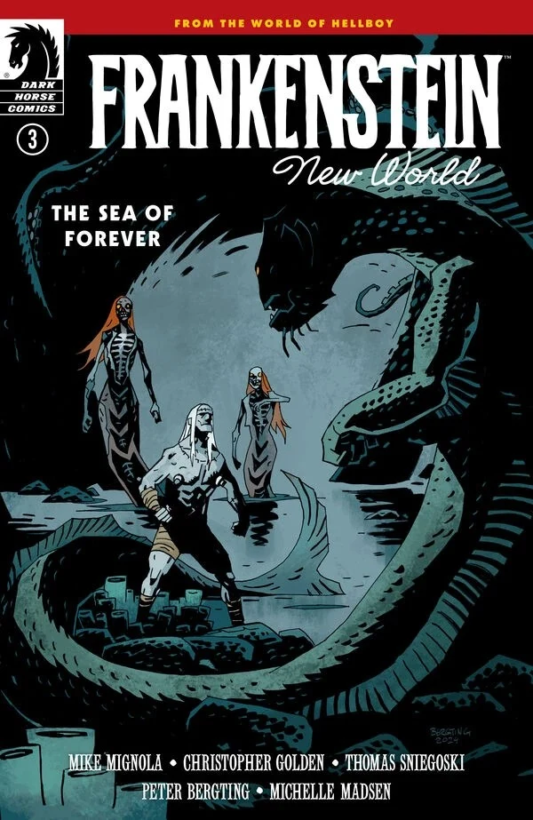
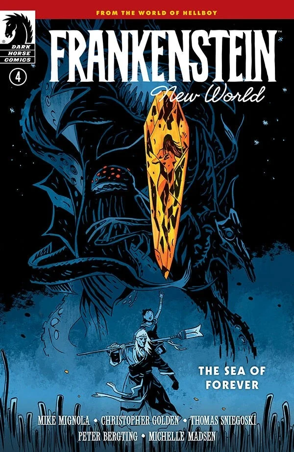

***《弗兰肯斯坦：新世界——永恒之海》*** 是一部四期限定迷你系列，由 [Mike Mignola](/entry/Mike_Mignola)、[Christopher Golden](/entry/Christopher_Golden) 与 [Thomas Sniegoski](/entry/Thomas_E._Sniegoski) 编剧，[Peter Bergting](/entry/Peter_Bergting) 作画。它是[*《弗兰肯斯坦：新世界》* 故事系列](/entry/New_World_(Frankenstein_story_cycle))的第二条故事线。

## 剧情简介

### 第一部分

弗兰肯斯坦与年轻的莉尔雅穿行于地上世界，追寻莉尔雅的幻象，但一个古老而熟悉的邪恶如影随形，他们走到哪里它就跟到哪里。

### 第二部分

身份不明的袭击者为追捕弗兰肯斯坦与莉尔雅而发动攻击，于是他们前往水下寻求帮助，却遇到一头强大的生物，她有着属于自己的、黑暗的生存之道。

### 第三部分

在水面之下，一头传说中的生物威胁着弗兰肯斯坦与莉尔雅；而在水面之上，一股邪恶力量正在感染它周遭的一切。

### 第四部分

在《永恒之海》的终章中，弗兰肯斯坦与莉尔雅直面孕育了新世界的黑暗，以及那股根源仍在的、更深层的邪恶。

## 画廊

所有封面均由 [Peter Bergting](/entry/Peter_Bergting) 绘制。

第 \#1 期

第 \#2 期

第 \#3 期

第 \#4 期

|第 #2 期

|第 #3 期

|第 #4 期
