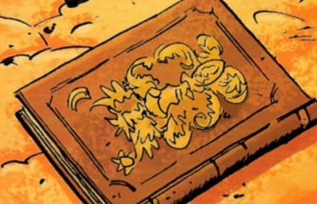

 ***秘火（The Secret Fire）***，又称 ***Flamma Reconditus***，是一份埃及文献的希腊文译本，公元 700 年由伊尼-赫里特（Ini-Herit）写于沉没之城梅诺西斯（Menouthis）。伊尼-赫里特声称，他破译了由魔法师赫尔墨斯·特利斯墨吉斯忒斯（Hermes Trismegistus，即"三重伟大的赫尔墨斯"）镌刻的一版翡翠石板——传说中 Lucifer 被逐出天堂时从他头上坠落的那块传奇之石。

石板上十三行文字的意义与含义几个世纪以来令众神秘学者百思不解；伊尼-赫里特的版本自称是"对宇宙机械之运作、天体之性质与功能、金属之嬗变、以及生命之创造与重构的真实记录"。

根据梵蒂冈图书馆的记载，《秘火》完整译本已知仅有五个印刷版本，且时至今日仍难觅其踪。后世版本的《秘火》还收录了伊尼-赫里特的实验笔记，其中包括他在[人造人](/entry/Homunculus)创造与复原领域的研究。1533 年，[埃德尔·米施拉塞](/entry/Edel_Mischrasse)发现了一部《秘火》抄本，这成为米施拉塞创造其人造人的基础——其中便包括被称为[罗杰](/entry/Roger)的那个人造人。该书的另一部抄本是 John Isaac Hollandus 的版本，为拥有五百余年历史的珍奇秘术法器收藏家——侯爵[阿杜埃·德·法布尔](/entry/Adoet_de_Fabre)所持有。侯爵提出把书交给[凯特·考瑞根](/entry/Kate_Corrigan)（她为复活罗杰而来求取此书），条件是以[亚伯·塞皮恩](/entry/Abraham_Sapien)交换。然而，恶魔[玛科西亚斯](/entry/Marchosias)把法布尔拖入了地狱，考瑞根由此挫败了他的阴谋，但那本书也在混乱中遗失。

V.E.S（[重锤装甲](/entry/Vril_Energy_Suit)）的创造者在讲述[阿努姆](/entry/Anum)如何盗走[维里尔](/entry/Vril)——即从[上帝](/entry/God)手中窃走维里尔——时提到了 Flamma Reconditus。它被暗示是维里尔的另一个名字，意味着这本书描述了维里尔如何运作，或许还记载了驾驭它的方法。
