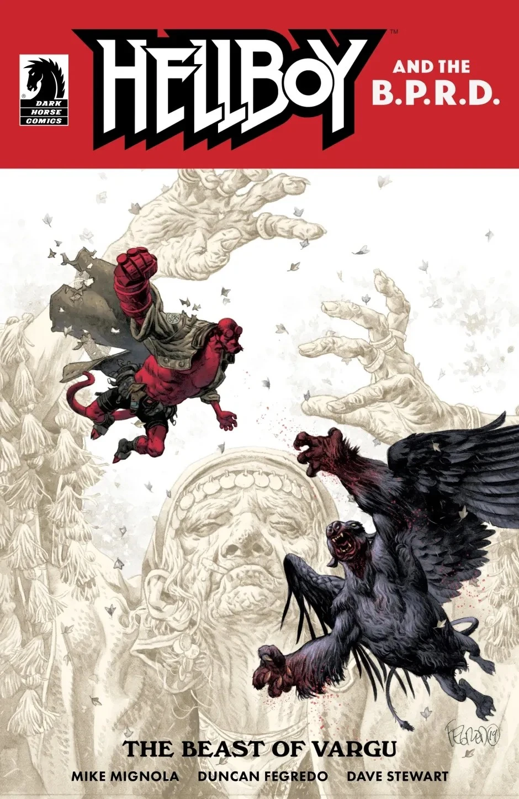
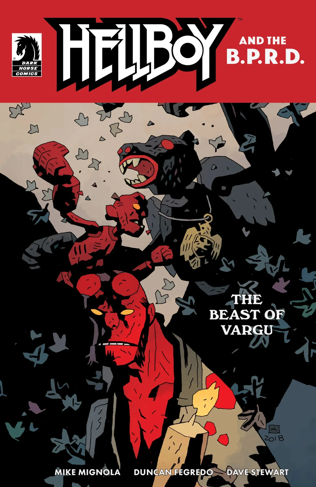

***《罗姆人的秘神》*** 是一篇短篇故事，最初作为 [*《地狱男爵与超自然调查防御署：瓦尔古之兽》*](/entry/The_Beast_of_Vargu) 的附载故事发表；不过在该期正式发行之前，整篇故事已于 2019 年 6 月 14 日在 io9 上作为预览提前公开。

## 剧情简介

这是《地狱男爵与超自然调查防御署》全新时代的首期，Mignola 与 Fegredo 将地狱男爵派往罗马尼亚，讲述发生在一座小村庄里的一对故事：村里背负着数百年的诅咒，还有一头食人怪物；两则故事最终交汇于一场阴森的木偶戏和一位半神注定不祥的晚宴。

## 画廊

[Duncan Fegredo](/entry/Duncan_Fegredo) 封面

[Mike Mignola](/entry/Mike_Mignola) 变体封面

《地狱男爵与超自然调查防御署》出版顺序

&#10;

前作
《瓦尔古之兽》
《罗姆人的秘神》

后作
《土星回归》

|Duncan Fegredo cover

|Mike Mignola variant cover
