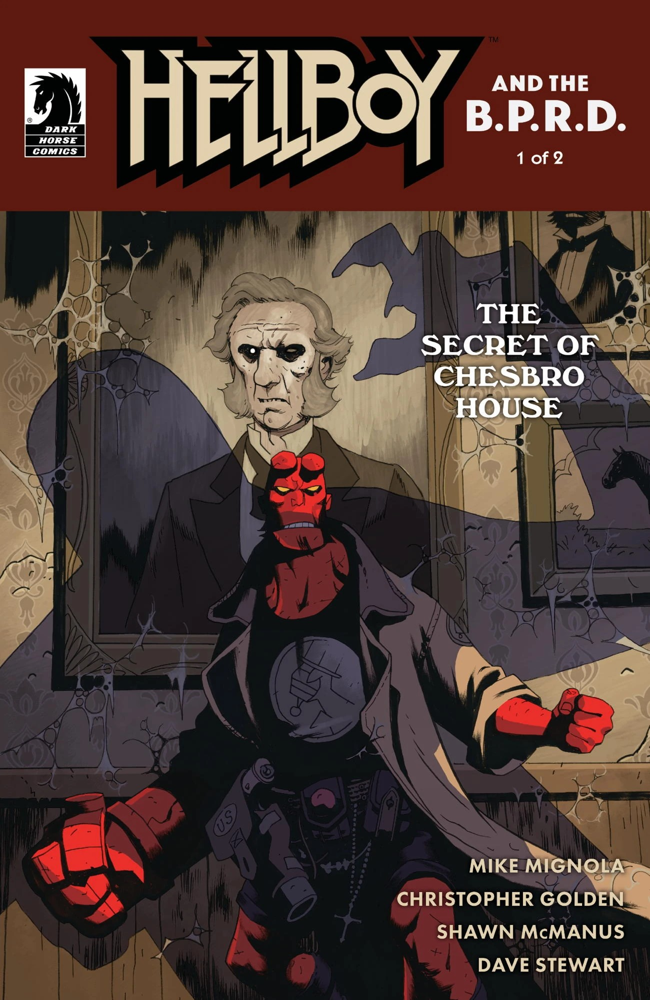
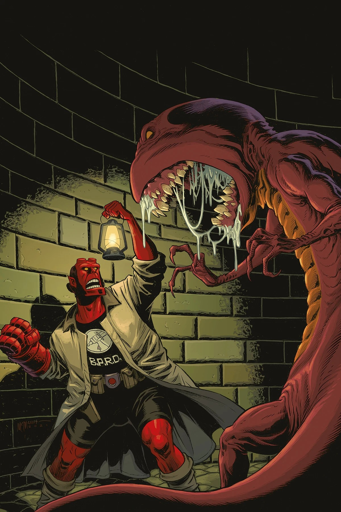
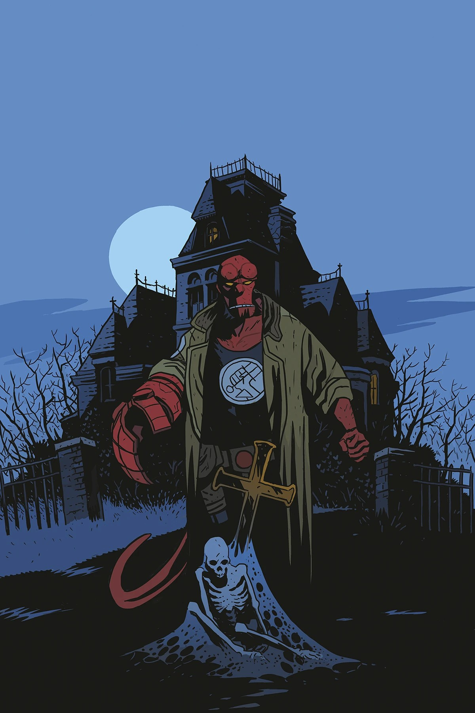

***《切斯布罗宅邸的秘密》*** 是一部两期的 *[《地狱男爵与超自然调查防御署》](/entry/Hellboy_and_the_B.P.R.D.)* 故事线，由 [Mike Mignola](/entry/Mike_Mignola) 与 [Christopher Golden](/entry/Christopher_Golden) 编剧，[Shawn McManus](/entry/Shawn_McManus) 作画。Golden 自 1996 年开始创作 *[《地狱男爵：迷失军团》](/entry/Hellboy%3A_The_Lost_Army)* 以来已多次参与地狱男爵宇宙的创作，而这部漫画是他第一次为 *《地狱男爵》* 漫画编剧。不过 Golden 已承诺未来还会带来更多作品。

## 剧情简介

### 第一部分

地狱男爵与一名灵媒合作，为一栋待拍卖的鬼屋清除阴灵。但宅中的鬼魂并不情愿安然走入那个良夜，而答案或许就藏在它与现实世界的某种联系之中……

### 第二部分

地狱男爵一头栽进这栋鬼屋的黑暗历史，终于目睹宅中鬼魂背后的黑暗真相……以及要如何才能让它离去。

## 画廊

除特别注明外，所有封面均由 [Shawn McManus](/entry/Shawn_McManus) 绘制。

第 \#1 期

第 \#1 期  
[Ben Stenbeck](/entry/Ben_Stenbeck) 变体封面

第 \#2 期

第 \#2 期  
[Matt Smith](/entry/Matt_Smith) 变体封面

|Issue #1 Ben Stenbeck variant

|第 #2 期

|Issue #2 Matt Smith variant
