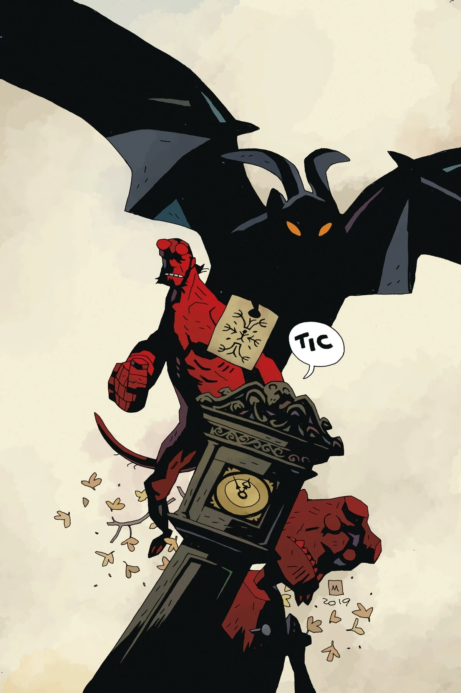

***《降神》*** 是一篇短篇故事，与 *[《她的致命时刻》](/entry/Her_Fatal_Hour)* 一同刊载于一期单刊漫画中，两篇均由 [Mike Mignola](/entry/Mike_Mignola) 编剧、[Tiernen Trevallion](/entry/Tiernen_Trevallion) 作画。

## 剧情简介

地狱男爵与一个幽灵正面对峙——这个幽灵正在寻找一件物品，而它所恐吓的活人对此一无所知。

## 画廊

*地狱男爵与超自然调查防御署：  
《她的致命时刻》与《降神》*  
[Tiernen Trevallion](/entry/Tiernen_Trevallion) 封面

*地狱男爵与超自然调查防御署：  
《她的致命时刻》与《降神》*  
[Mike Mignola](/entry/Mike_Mignola) 变体封面

《地狱男爵与超自然调查防御署》出版顺序

&#10;

前作
《她的致命时刻》
《降神》

后作
《切斯布罗宅邸的秘密》

|Hellboy and the B.P.R.D.: Her Fatal Hour and The Sending Mike Mignola variant cover
