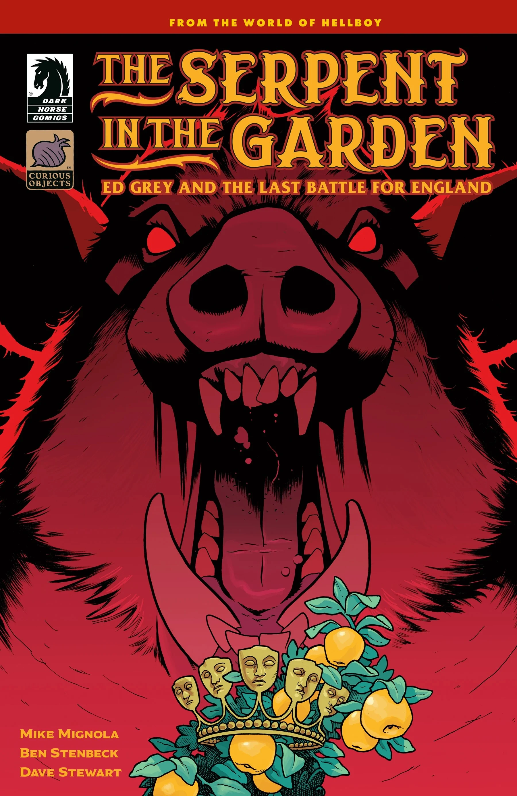
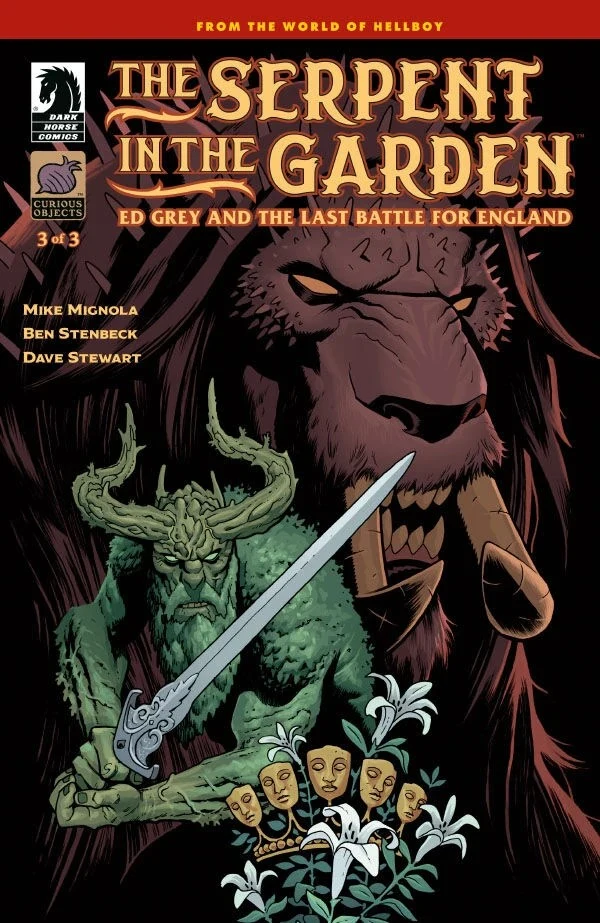

*本条目仍是一个小作品（stub）。你可以帮助地狱男爵维基扩充它。*

***《花园中的蛇：埃德·格雷与英格兰的最后一战》***（The Serpent in the Garden: Ed Grey and the Last Battle for England）是一部三期完的迷你系列，由迈克·米格诺拉编剧，Ben Stenbeck 作画。

## 出版历史

这部漫画是迈克·米格诺拉在黑马漫画（Dark Horse Comics）旗下的“奇物”（Curious Objects）出版品牌推出的首部作品。*《花园中的蛇》*将是 Stenbeck 在相当一段时间内最后一部地狱男爵宇宙故事，此后他将与米格诺拉一同专注于他的原创宇宙*《未知之地》（Lands Unknown）*。

## 剧情简介

### 第一部分

猎巫人埃德·格雷受爱丽丝召唤——她是人间最后一个尚存的王国的女王——要他在最终决战中保卫她和英格兰，对抗摩根勒菲（Morgan Le Fay）及其麾下的斗士。

### 第二部分

猎巫人埃德·格雷受爱丽丝召唤——她是人间最后一个尚存的王国的女王——要他在最终决战中保卫她和英格兰，对抗摩根勒菲及其麾下的斗士。

### 第三部分

随着格鲁阿加与猎巫人迎来他们的最后一战，战斗进入最高潮。

## 画廊

全部封面：Ben Stenbeck

第 \#1 期

第 \#2 期

第 \#3 期

|第 #2 期

|第 #3 期
