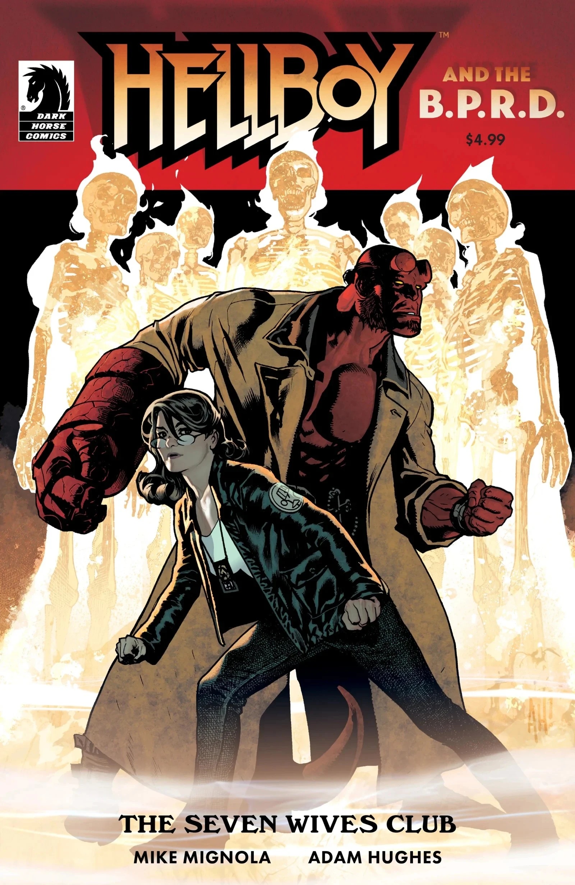

***《七任妻子俱乐部》（The Seven Wives Club）*** 是 2020 年的一部单期完结故事，让 [Mike Mignola](/entry/Mike_Mignola) 与 [Adam Hughes](/entry/Adam_Hughes) 在广受好评的合作 *[《地狱男爵：坎卜斯之夜》](/entry/Krampusnacht)*（Hellboy: Krampusnacht）之后再度联手。该作最初公布时，外界非正式地将其视为《地狱男爵冬季特刊》（Hellboy Winter Special），不过官方并未以此名义推出。

## 出版历史

该故事最初定于 2019 年 12 月出版，后来推迟至 2020 年 4 月，又因 COVID-19 疫情再度延期。

## 剧情简介

一个小女孩的猎鬼行动出了岔子，地狱男爵出手相助；他们探访一所废弃的医学院，揭开了一桩发生在很久以前的恐怖谋杀案背后层层险恶的内幕。

## 画廊

Adam Hughes 封面

Mike Mignola 变体封面

|Adam Hughes cover
## 外部链接

- Mike Mignola 与 Adam Hughes 将再度携手，打造全新地狱男爵故事
- DarkHorse.com 产品页面

《地狱男爵与超自然调查防御署》出版顺序

&#10;
前作
《艾菲·科尔布归来》
《七任妻子俱乐部》

后续
《她的致命时刻》
