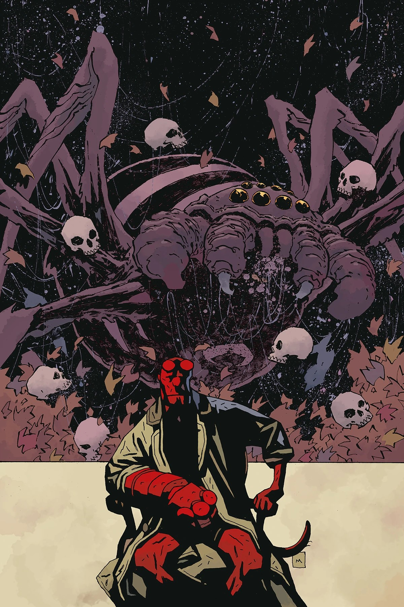
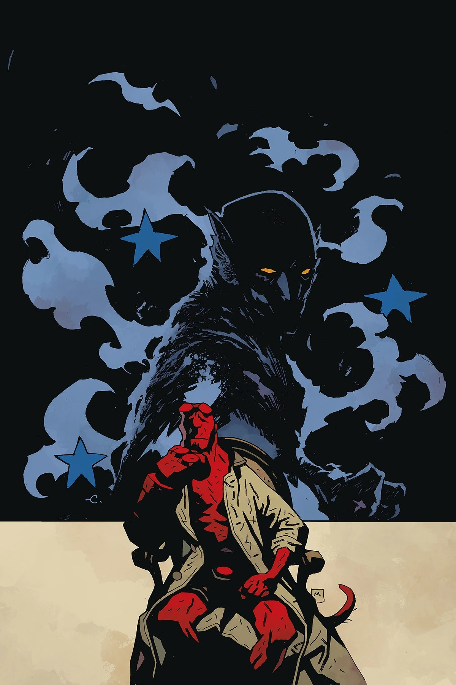
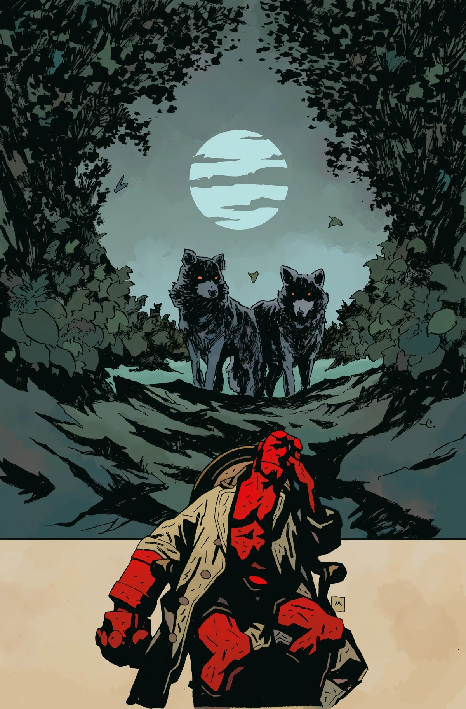
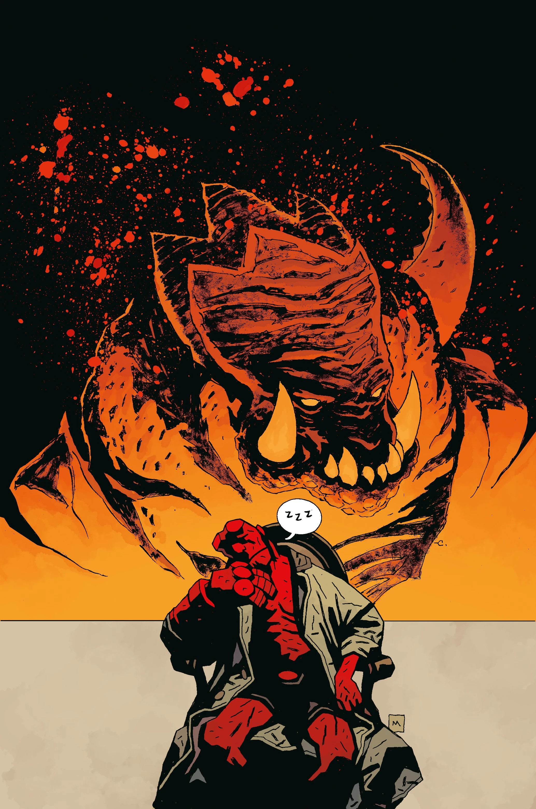

***《银灯社》***是一部五期的 *[《地狱男爵》](/entry/Hellboy)* 故事弧，由 [Mike Mignola](/entry/Mike_Mignola) 与 [克里斯·罗伯森](/entry/Chris_Roberson) 编剧，[Christopher Mitten](/entry/Christopher_Mitten) 与 [Ben Stenbeck](/entry/Ben_Stenbeck) 作画。

## 剧情简介

### 第一部分

地狱男爵的一位秘术调查员亲戚向他讲述了地狱男爵宇宙中最神秘的社团之一那些隐秘而危险的冒险，其中包括一场搞砸了的驱魔仪式以及更多谜团！银灯社成员西蒙·布鲁特霍姆（Simon Bruttenholm）讲述了一则广播时代黎明时分的故事，在故事里爱德华·格雷爵士和 Sarah Jewel 将与……科技正面交锋？

### 第二部分

一名失踪的探险家和一连串离奇的凶杀案之间能有什么共同之处？银灯社成员 Sarah Jewell、白夫人（Lady Bai）、辛格少校（Major Singh）和爱德华·格雷爵士各自以崭新的视角审视彼此的案子……却发现它们在中途意外地交汇了！

### 第三部分

西蒙·布鲁特霍姆与地狱男爵和布鲁特霍姆教授重温旧日往事，他回忆起一个离奇故事：一名女子的通感幻象揭示出一个神秘而邪恶实体的存在。随之而来的是一场惊心动魄的对决，堪称银灯社最精彩的一战！

### 第四部分

西蒙·布鲁特霍姆这一次向地狱男爵和教授讲述了一则离奇故事：危险的生物在伦敦街头潜行捕猎。银灯社与爱德华·格雷一位爱喝伏特加、专猎狼人的老友联手，捉拿这些凶猛的野兽。可当你神志都不完全清醒时，这场追捕就格外艰难！

### 第五部分

正当地狱男爵和教授在超自然调查中走入死胡同时，西蒙·布鲁特霍姆讲了一则故事来给予他们灵感：当年，需要银灯社全员合力，才得以挫败一桩诡异的秘术图谋！

## 画廊

全部封面由 [Christopher Mitten](/entry/Christopher_Mitten)、[Mike Mignola](/entry/Mike_Mignola) 与 [戴夫·斯图尔特](/entry/Dave_Stewart) 绘制。

第 \#1 期

第 \#2 期

第 \#3 期

第 \#4 期

第 \#5 期

|第 #2 期

|第 #3 期

|第 #4 期

|第 #5 期
