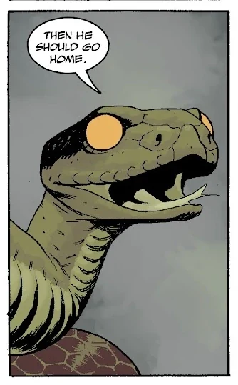

*本条目仍是一个小作品（stub）。你可以帮助地狱男爵维基扩充它。*

**蛇（The Snake）**是一个角色，首次登场于短篇故事 *[《魔术师与蛇》](/entry/The_Magician_and_the_Snake)*，是标题所指的两位角色之一。此后它又在 *[《地狱男爵在地狱》](/entry/Hellboy_in_Hell_(series))* 与 *[《不死者科西切》](/entry/Koshchei_(series))* 的故事线中登场。

## 角色的本质

蛇在《魔术师与蛇》中的初次登场，是一则[地狱男爵宇宙中的童话故事](/entry/The_Magician_and_the_Snake)，那种地狱男爵小时候可能会听到的故事。然而，蛇后来作为一个角色出现在 *[《地狱男爵：三根金鞭》](/entry/The_Three_Gold_Whips)* 中，能够与其他角色交谈并影响事态发展。蛇的确切本质从未得到解释，留给读者自行解读。在某种程度上，蛇是一个超越文本的隐喻，但也可以照字面理解为：它就是出现在《魔术师与蛇》中的那条蛇，并以某种方式从虚构作品中显形进入了现实。无论它究竟是什么，它似乎都不受物理法则的束缚，而是依照某种“梦境逻辑”行事，可以在它希望的任何时间、任何地点现身。
