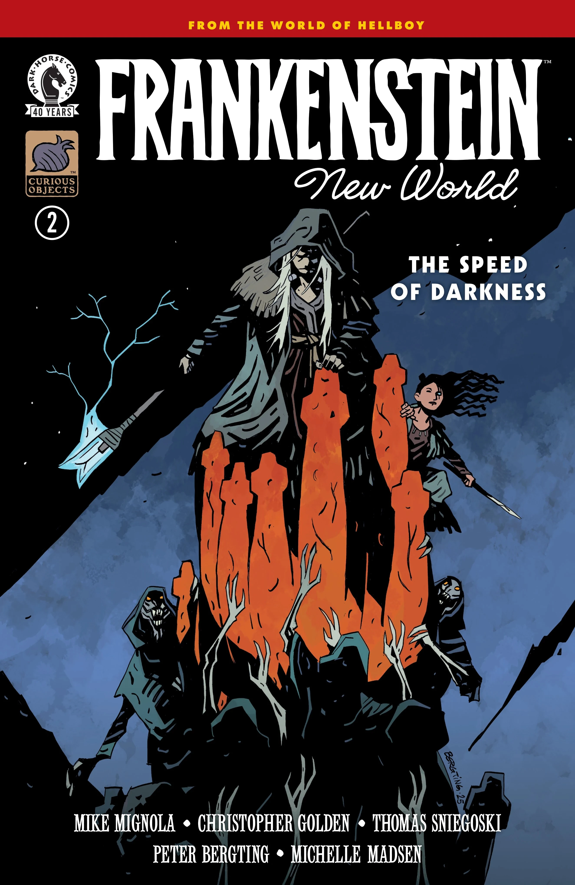
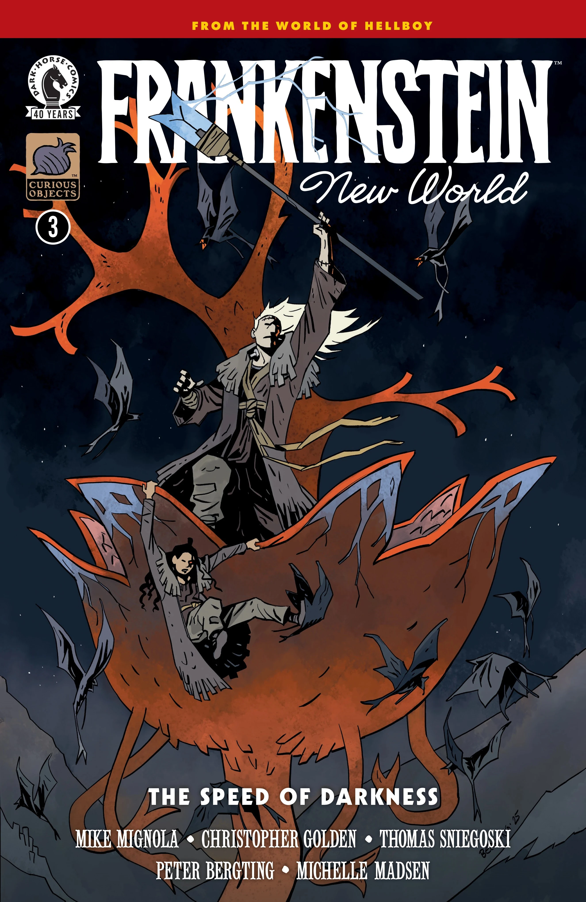
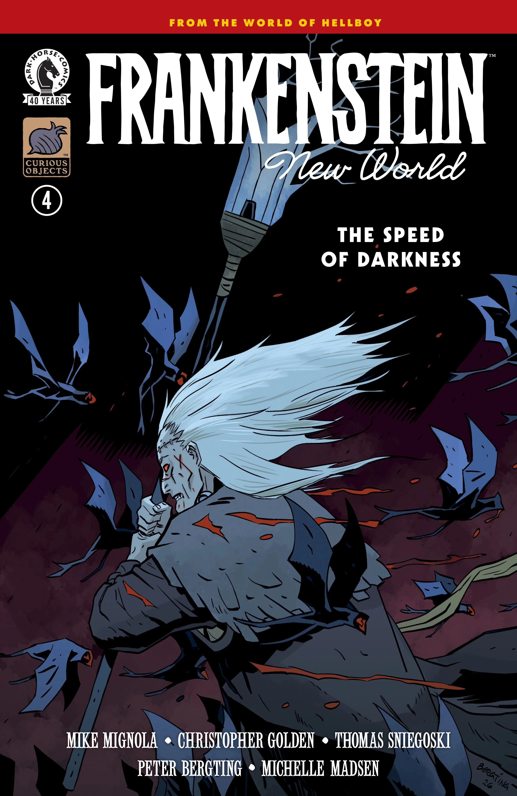

***《弗兰肯斯坦：新世界——黑暗之速》（Frankenstein: New World—The Speed of Darkness）*** 是一部四期迷你连载，编剧 [Mike Mignola](/entry/Mike_Mignola)、[Christopher Golden](/entry/Christopher_Golden) 与 [Thomas Sniegoski](/entry/Thomas_E._Sniegoski)，作画 [Peter Bergting](/entry/Peter_Bergting)。它是[《*弗兰肯斯坦：新世界*》故事系列](/entry/New_World_(Frankenstein_story_cycle))的第三个故事线。

## 剧情简介

### 第一部分

弗兰肯斯坦与莉莉娅（Lilja）在幻象中受到丽兹·舍曼召唤，要去拯救新世界，于是开始借助维利（Vril）能量寻找她。然而大地正被一种寄生性的强大邪恶所侵蚀，而他们阻止它的时间已经所剩无几。

### 第二部分

随着莉莉娅的幻象愈发急迫，弗兰肯斯坦与她继续踏上寻找丽兹·舍曼的旅程，但危险从四面八方涌来，一种阴险的邪恶持续腐蚀着他们周围的世界。

### 第三部分

在生死关头，弗兰肯斯坦唤醒了体内一种他从不知自己拥有的力量；在吸血鬼般的生物将他们以及整个新世界全部吞噬之前，他和莉莉娅一路杀向丽兹。

### 第四部分

为了拯救新世界做最后一搏，弗兰肯斯坦与莉莉娅必须面对一群嗜血怪物——以及一个更加阴险、潜伏暗处的危险——才能抵达丽兹·舍曼身边。

## 画廊

全部封面由 [Peter Bergting](/entry/Peter_Bergting) 绘制。

第 \#1 期

第 \#2 期

第 \#3 期

第 \#4 期

|第 #2 期

|第 #3 期

|第 #4 期
