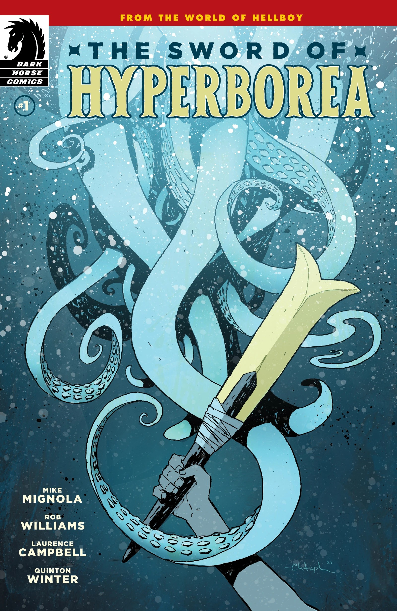
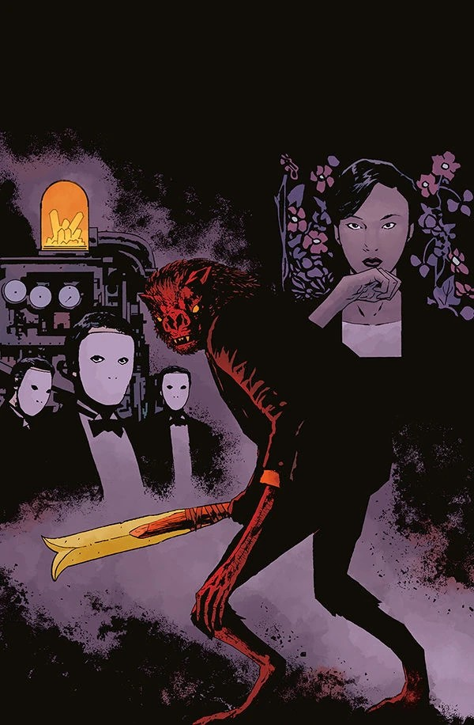
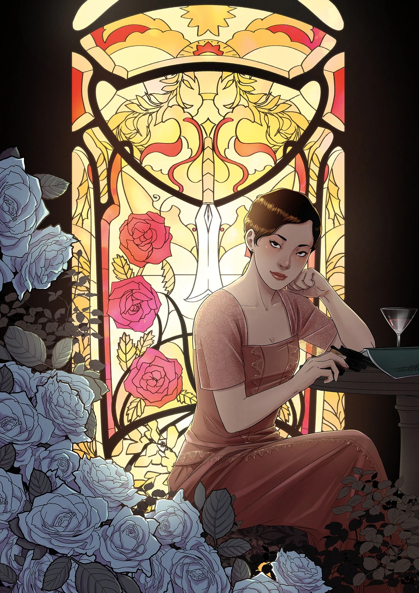
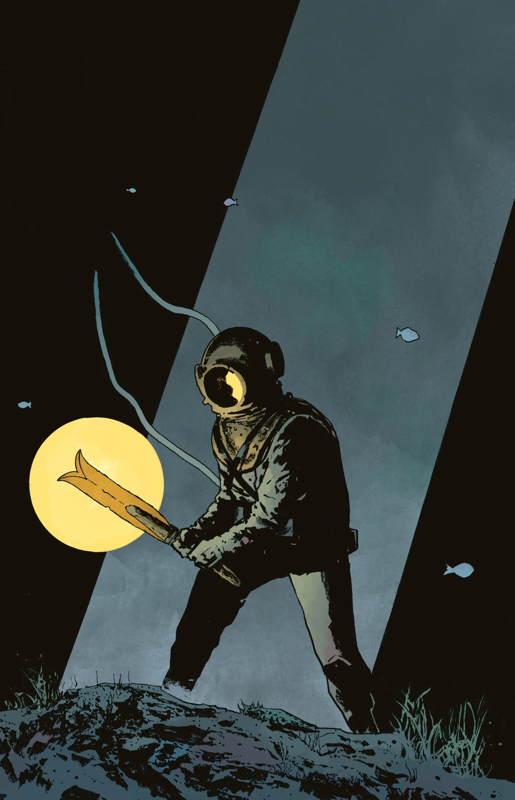
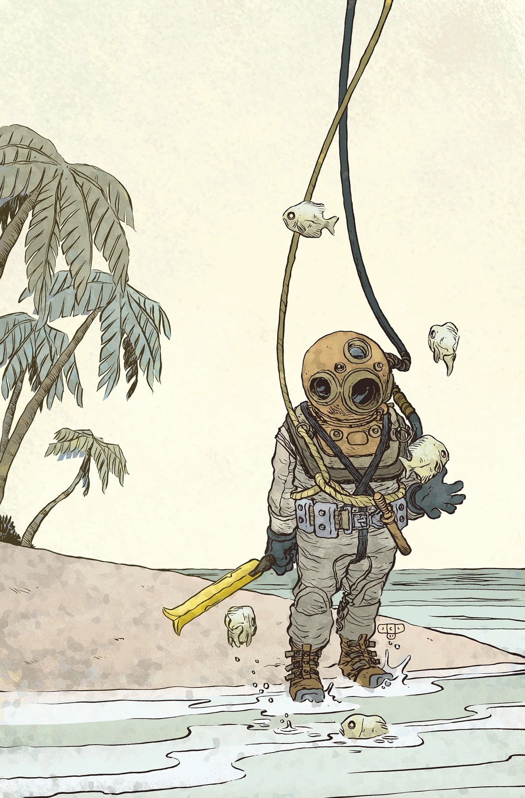
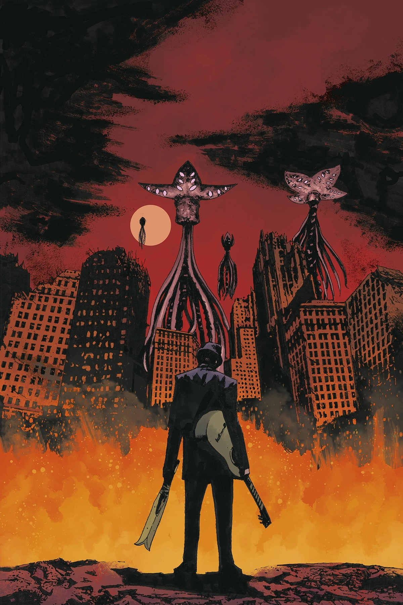
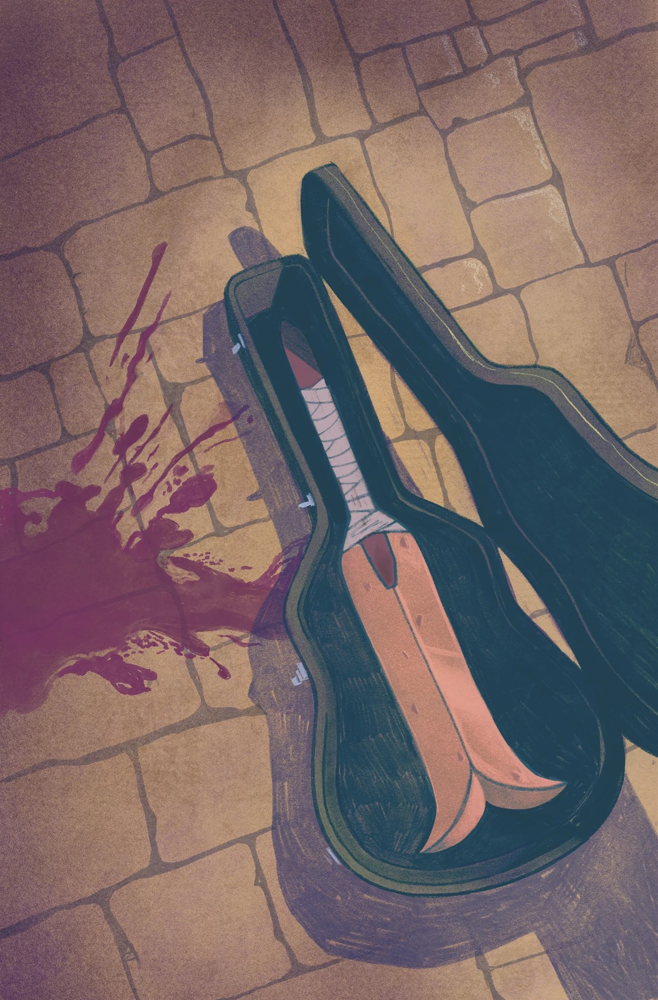

***《海伯利亚之剑》***是一部四期限定迷你系列，由 [Mike Mignola](/entry/Mike_Mignola) 与 [Rob Williams](/entry/Rob_Williams) 编剧，[劳伦斯·坎贝尔](/entry/Laurence_Campbell) 作画。

## 剧情简介

### 第一部分

从古代战士加尔·丹纳（Gall Dennar），到爱德华·格雷爵士，再到超自然调查防御署的霍华德斯特工，这把出自地狱男爵世界、极具标志性的海伯利亚之剑曾落入许多举足轻重的人物手中。而这绝非偶然。循着这把剑的轨迹，追随那些冒险与邂逅——它们最终将它带到世界尽头的拉格纳·洛克（Ragna Rok），见证这把剑穿越历史的旅程。

### 第二部分

海伯利亚之剑继续它穿越历史的跋涉，以惊人的力量赐福于每一位被选中、挥舞它的人。当它在第一次世界大战的关键时刻出现时，这柄剑刃将被用于善还是用于恶？间谍、超自然生物与秘密社团在这段快节奏的剑之传奇续篇中正面碰撞！

### 第三部分

一位专业潜水员被迫从英吉利海峡中一艘坠毁的齐柏林飞艇上取回一件神秘的神器，他由此面临来自超自然与现实世界的双重致命危险。一个人究竟能被允许拥有多少次重来的机会——哪怕他手中挥舞着海伯利亚之剑？

### 第四部分

1952 年，芝加哥，海伯利亚之剑出人意料地出现在一位崭露头角的布鲁斯乐手手中。即便以一位天才乐手的标准来看，伊莱贾·博恩（Elijah Bone）也有些与众不同，而那个向他低语的诡异声音，自有一整套计划等着他去完成。三角洲布鲁斯、超自然生物与秘密社团，在这部米格诺拉宇宙传奇的终章中交汇碰撞！

## 画廊

除特别注明外，全部封面由 [劳伦斯·坎贝尔](/entry/Laurence_Campbell) 与 [戴夫·斯图尔特](/entry/Dave_Stewart) 绘制。

第 \#1 期

第 \#1 期变体封面  
作者：[Christopher Mitten](/entry/Christopher_Mitten)

第 \#2 期

第 \#2 期变体封面  
作者：[Yishan Li](/entry/Yishan_Li)

第 \#3 期

第 \#3 期变体封面  
作者：Jesse Lonergan

第 \#4 期

第 \#4 期变体封面  
作者：Victor Bizar Gómez

|Issue #1 variant cover by Christopher Mitten

|第 #2 期

|Issue #2 variant cover by Yishan Li

|第 #3 期

|Issue #3 variant cover by Jesse Lonergan

|第 #4 期

|Issue #4 variant cover by Victor Bizar Gómez
