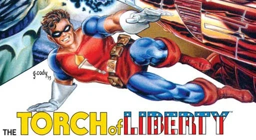
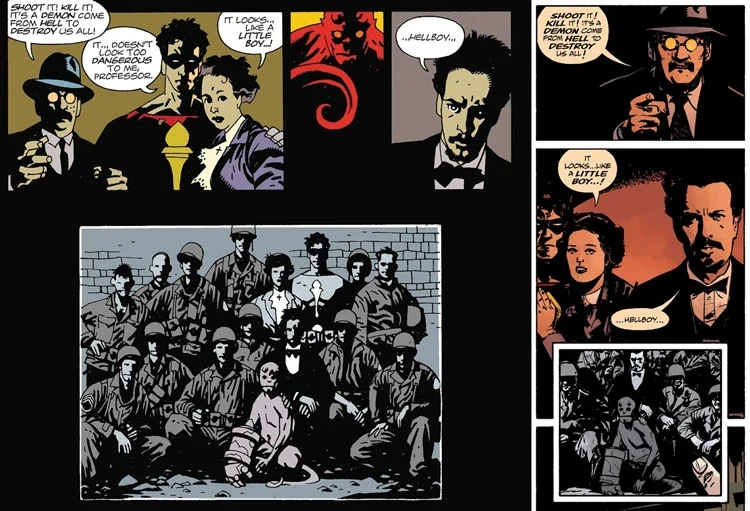

**自由火炬（The Torch of Liberty）**是一名身穿制服的美国英雄，在第二次世界大战期间与纳粹势力作战。他在《[地狱男爵](/entry/Hellboy_%28series%29)：[毁灭之种](/entry/Seed_of_Destruction)》中短暂登场。

自由火炬是《地狱男爵》系列中少数并非由[迈克·米格诺拉](/entry/Mike_Mignola)创造的角色之一——他其实是由[约翰·伯恩](/entry/John_Byrne)创造的，后者根据米格诺拉的故事为《毁灭之种》撰写剧本。把他纳入故事，是早期一次让多部黑马漫画系列跨界联动的流产尝试的一部分。自《毁灭之种》完结以来，他再也没有在《地狱男爵》中登场，甚至没有再被提及。

## 角色经历

自由火炬是一名制服英雄。第二次世界大战期间，他以与纳粹作战的方式报效祖国，这些事迹曾以新闻影片的形式呈现。

1944 年 12 月下旬，自由火炬与美国陆军及英国超自然研究学会联手，共同试图阻止纳粹的「[诸神黄昏计划](/entry/Project_Ragna_Rok)」。12 月 23 日，一场由纳粹策划、[格里高利·拉斯普廷](/entry/Grigori_Rasputin)主持的仪式，在盟军阵地附近召唤出了[一个孩童般的红色生物](/entry/Hellboy_%28character%29)。自由火炬说这生物看起来并不危险，他的同伴[特雷佛·布鲁顿霍姆](/entry/Trevor_Bruttenholm)则把这个半恶魔命名为「[地狱男爵](/entry/Hellboy_%28character%29)」；这一夜后来被称为「[地狱男爵事件](/entry/Seed_of_Destruction)」。[1]

后来，自由火炬送给地狱男爵[一把大型单发手枪](/entry/Hellboy%27s_gun)。[2] 他说地狱男爵是他训练过的枪法最差的人。[3]

## 出版历史

### 约翰·伯恩

 自由火炬由[约翰·伯恩](/entry/John_Byrne)创造，登场于《Danger Unlimited》第 1–4 期（1994 年 2 月—5 月）的后备故事；他（与地狱男爵一起）在第四期中客串登场。自由火炬还登场于以他名字命名的《Torch of Liberty Special》（1995 年 1 月）。

保罗·吉布尼 1915 年生于伊利诺伊州，于 1941 年接过了自由火炬的衣钵。[4] 漫画故事揭示，他原本是第二次世界大战欧洲战场的一名士兵，在战斗创伤中被推上了非凡的高度。

### 《地狱男爵》

自由火炬登场于《毁灭之种》第 1 期（1994 年 3 月），并在该迷你系列之后的几期中被提及。

#### 「Legend」跨界

另见：[Dark Horse Comics § Legend](/entry/Dark_Horse_Comics)

在[黑马漫画](/entry/Dark_Horse_Comics)Legend 厂牌的时代，[约翰·伯恩](/entry/John_Byrne)（《Next Men》/《Danger Unlimited》）、亚特·亚当斯（《Monkeyman and O'Brien》）和[迈克·米格诺拉](/entry/Mike_Mignola)（《地狱男爵》）曾计划让他们创造的角色部分地存在于一个共享宇宙中。其成果之一便是自由火炬在《地狱男爵：毁灭之种》中的登场。然而米格诺拉回忆说，三人很早就意识到这个想法问题重重，三人之间协调起来太过困难，最好还是各自独立经营自己的系列。[5]

自由火炬在<em>[毁灭之种](/entry/Seed_of_Destruction)</em>第 1 期（左）中的突出亮相，与他在<em>[Hellboy and the B.P.R.D.](/entry/Hellboy_and_the_B.P.R.D.)：[1952](/entry/1952)</em>第 1 期（右）中被弱化的描绘之对比

自由火炬在《毁灭之种》中的登场是这些被放弃的共享宇宙计划的遗留物；自那以后他再没有在系列中正式回归。后来对地狱男爵事件的描绘往往弱化或完全省略他在该事件中的存在。在《[Hellboy: The Companion](/entry/Hellboy__The_Companion)》等补充资料中也没有提到自由火炬。

#### 未来登场的可能性

由于该角色归伯恩所有，他几乎不可能再次出现在《地狱男爵》故事中。2007 年，伯恩曾开玩笑说，米格诺拉如果「客气地请求」，就可以再次使用自由火炬。[6]

编辑[斯科特·阿利](/entry/Scott_Allie)解释道：

> 自由火炬是约翰·伯恩的财产，不是迈克或黑马的，所以，为了让这些书都归迈克所有，我们使用他原创的角色。约翰在别处忙着，所以自由火炬即便没被遗忘，也不会再出现了。[7]

谈到在《毁灭之种》中使用自由火炬的决定时，米格诺拉回忆道：

> 我当时觉得有一个超级英雄式的人物挺酷的——有点像我当年漫威漫画作品的复古味道，一个二战版的美国队长和大兵们混在一起。我一直想要这样的元素。既然约翰已经创造了这个类似美国队长的角色，我就想：「嗯，这简直完美。」但现在，我从不想回头把它删掉，约翰也从没让我把它删掉。我们承认它在那里，只是不太过多谈论它。[8]

米格诺拉补充说，如果他当时就想到了[大螯虾·约翰逊](/entry/The_Lobster)，他就会用后者来填补《毁灭之种》开篇的这个位置。[9]

## 参考资料

<references/>

[pt-br:Tocha da Liberdade](/entry/pt-br%3ATocha_da_Liberdade)

[1] *[毁灭之种](/entry/Seed_of_Destruction)* 第 1 期

[2]

[3] *[毁灭之种](/entry/Seed_of_Destruction)* 第 3 期（地狱男爵：「自由火炬说我是他试过训练的人里枪法最差的……」）

[4]

[5]

[6] 伯恩，约翰。[《Q for JB-Hellboy and Torch of Liberty》，*Byrne Robotics* 论坛](https://byrnerobotics.com/forum/forum_posts.asp?TID=18384)。

[7] Hellmail，*[War on Frogs](/entry/War_on_Frogs)* 第 4 期（2006 年 12 月）

[8]

[9] 平丘克，汤姆。[《Hellboy Creator Mike Mignola Reflects on All Eras of His Comics Career》。*Nerdist*（经 *Geek & Sundry* 转载）。](https://nerdist.com/article/hellboy-creator-mike-mignola-reflects-on-all-eras-of-his-comics-career/) 2018 年 5 月 2 日。
