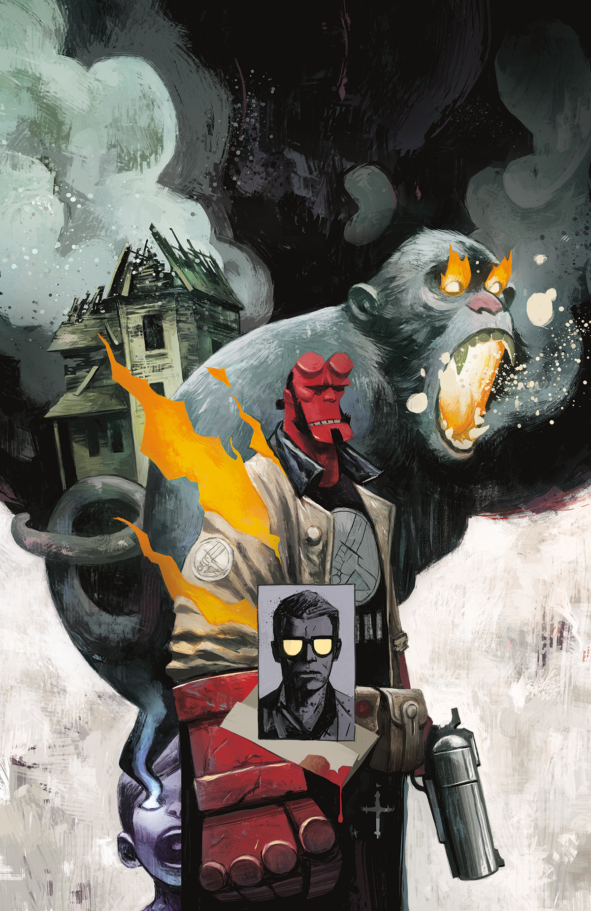

***The Unreasoning Beast*** 是《[Hellboy and the B.P.R.D.](/entry/Hellboy_and_the_B.P.R.D.)：1954》的一部单期完结故事弧，由 Mike Mignola 与 Chris Roberson 编剧，Patric Reynolds 作画。

## 剧情简介

一次不同寻常的猎鬼行动，把地狱男爵引向一只幽灵猴子——它要给一个深陷悲痛的家庭捎去一则讯息。

## 画廊

封面作者 [Mike Huddleston](/entry/Mike_Huddleston)。

|*The Unreasoning Beast*
