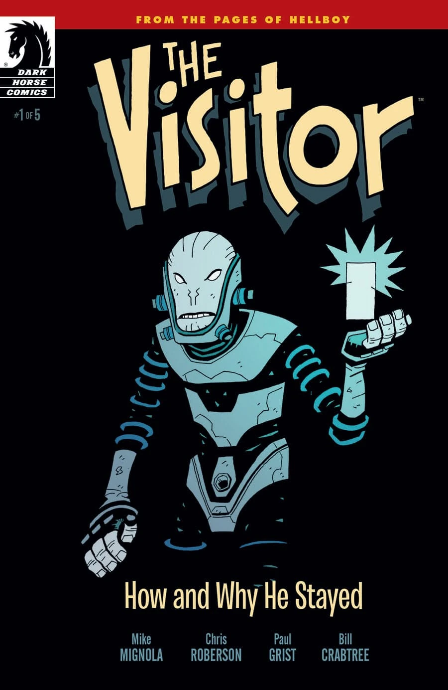
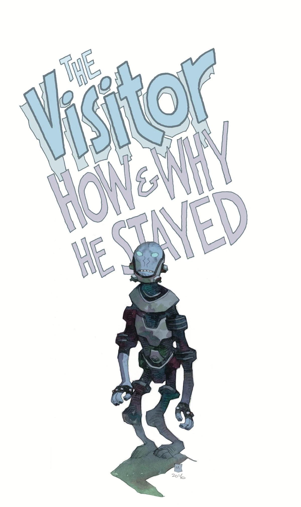
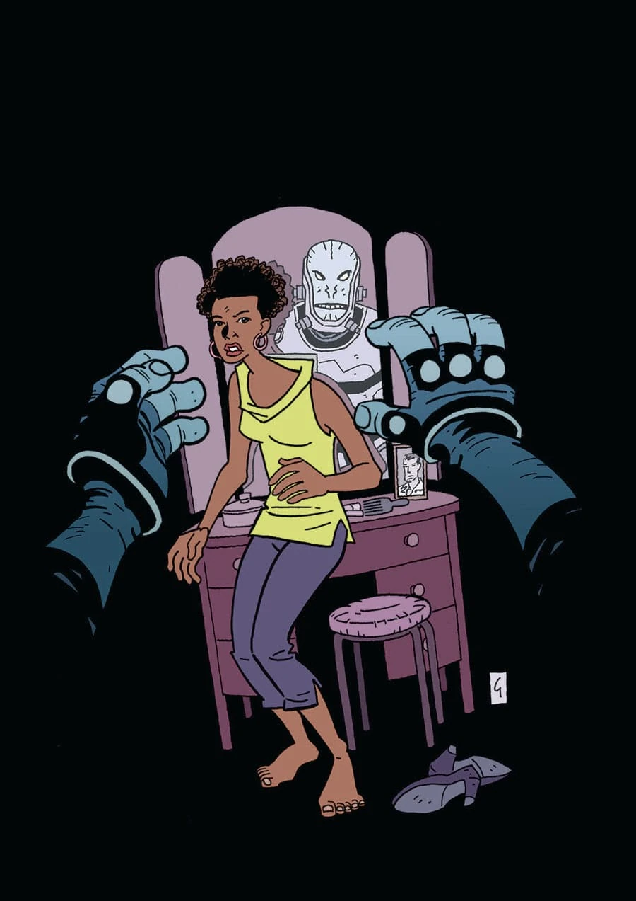

***《访客：他为何及如何留下》*（The Visitor: How & Why He Stayed）**是一部五期限定迷你系列，由迈克·米格诺拉和克里斯·罗伯森编剧，保罗·格里斯特（Paul Grist）绘画。

## 剧情梗概

### 第一部分

1944 年，地狱男爵在一场旨在为希特勒提供终极神秘武器的仪式中被召唤出来。幸运的是，特雷弗·布鲁滕霍尔姆教授当时在场见证，并引导地狱男爵成长为世界上最伟大的超自然侦探。但布鲁滕霍尔姆并不是地狱男爵降临的唯一目击者。一位访客也在那里，他被派来杀死那头被预言会毁灭全人类的野兽。这位访客看到了什么、他又为何收住了手——由此引出迄今为止最神秘的地狱男爵衍生作品……

### 第二部分

访客继续从远处监视地狱男爵，同时在 20 世纪 60 年代以一个外星人的身份试图摸索、融入美国社会。

### 第三部分

一名据信很久以前就被 BPRD 除掉的危险女人重新出现，将访客引向西南部某个邪教的营地。

### 第四部分

随着越来越多的奥格德鲁·赫姆（Ogdru Hem）发动袭击，访客向 BPRD 发出警报；而作为一个生活在地球上的外星人，他所面临的种种挑战也让他付出了代价。

### 第五部分

在以人的身份生活了数十年后，访客得到了回到太空中同族身边的机会，但他必须先给地狱男爵带一个口信。

## 画廊

 \#1

 \#1
ComicsPRO 变体版

 \#2

 \#3

 \#4

 \#5
