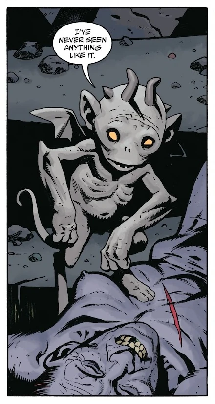
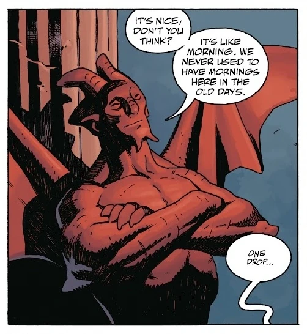

这只恶魔姓名不详，是他的种族中最后一个仍行走在如今一派生机的地狱里的成员。[不死者科西切](/entry/Koshchei_(character))在艾达·博盖（Ida Boguet）的尸体脖颈上挂着的一个瓶子里发现了他。

他向发现者承诺，可以帮忙消灭残存的[女巫](/entry/Witches)——她们如今是[普路托](/entry/Pluto)的追随者——报酬仅仅是一滴血。

在一场由他协助挑起的、暴烈而令人精疲力竭的战斗之后，地狱里最后一只恶魔趁科西切疲惫之际，把他吸成了干尸。借助偷来的血，他获得了高大的身量、肌肉、红色的皮肤和一个鼻子。对自己的新形态心满意足后，他把已干得如同一具尸体的科西切扔进了地狱黑暗幽深的水中
