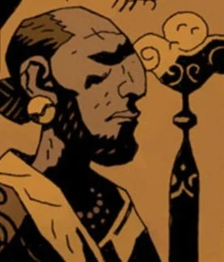
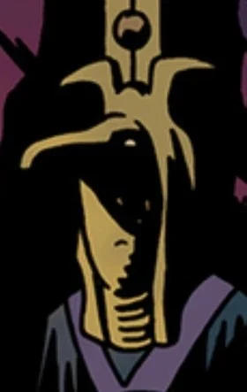

**透特（Thoth）**是[极北族人](/entry/Hyperboreans)最后一位伟大的王。

## 历史

相传文字由透特所创，他还下令在首都戈里尼乌姆建造了一座著名的雕像。这座彰显极北族人力量的雕像之中，封存着[毁灭右手](/entry/Right_Hand_of_Doom)——它属于守望者[阿努姆](/entry/Anum)。透特的大部分知识要归功于居住在他秘密花园中的三位被放逐的[守望者](/entry/Watchers)。他把这些天使的知识记录在四十二卷书中，只有两卷向他的子民公开，其余四十卷由他自己秘藏。

在他统治期间的某个时候，透特决定让自己的王国作为“世界之光”传播得更远。为此，他派出七个儿子去建造新城，并挑选了七名女子——每人都蒙受[维利](/entry/Vril)秘火的祝福——作为新城活生生的心脏与力量之源。

后来，透特被日后称为[赫卡特](/entry/Hecate)的女神勾引和欺骗：她借透特接近守望者，通过杀害他们、饮下他们的鲜血窃取知识。透特很快识破了赫卡特的背叛，诅咒她，把她变成半女半蛇的怪物。但为时已晚，透特已无法阻止守望者的知识传遍极北之地，并最终导致极北族文明的覆灭。

## 画廊

|

|A later interpretation of Thoth as an Egyptian deity.
