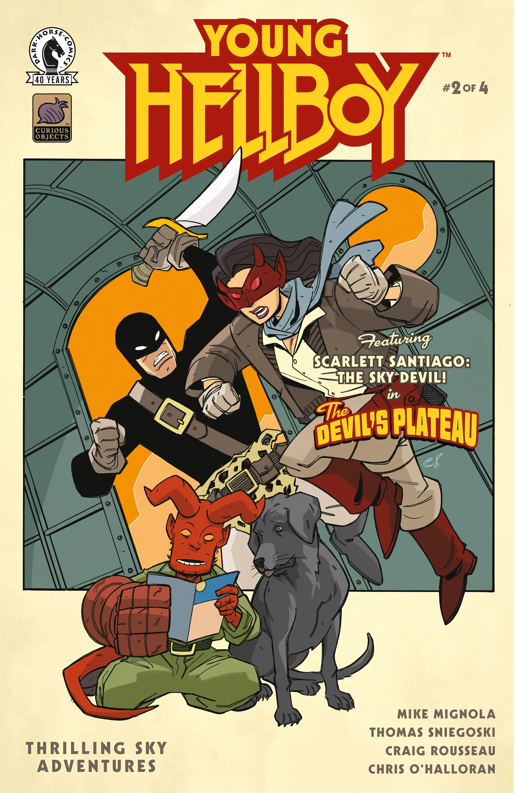
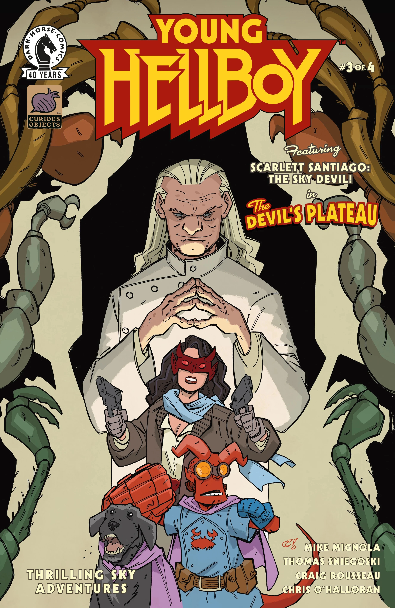
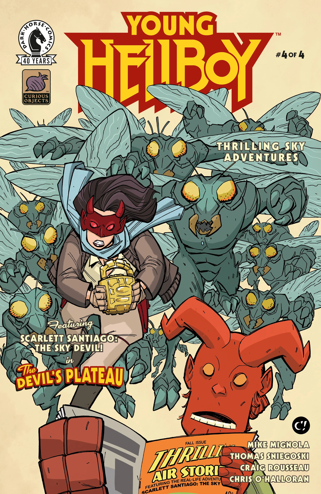
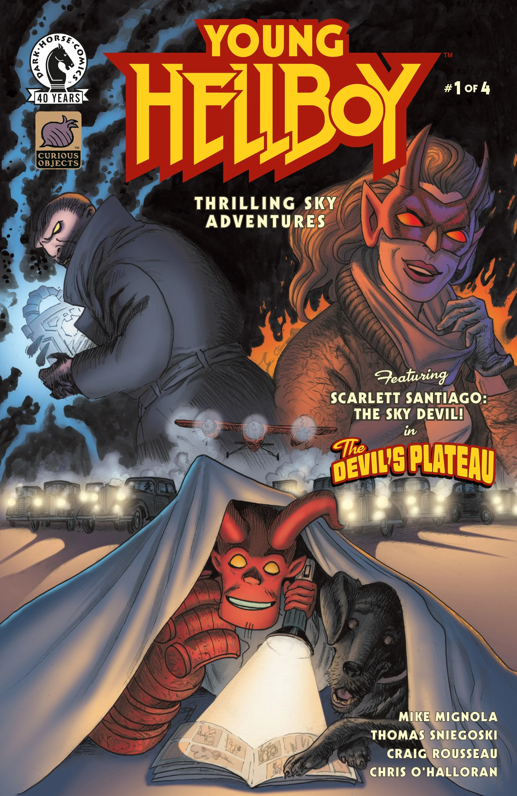
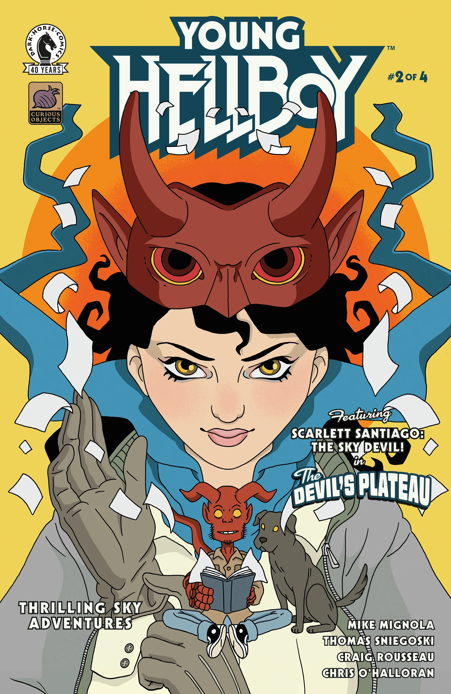
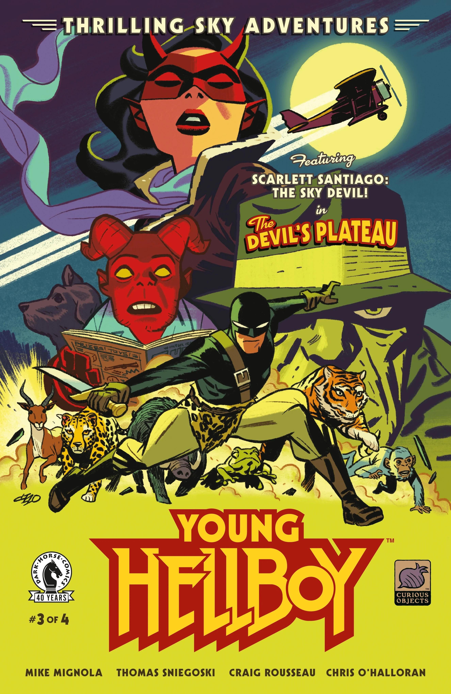
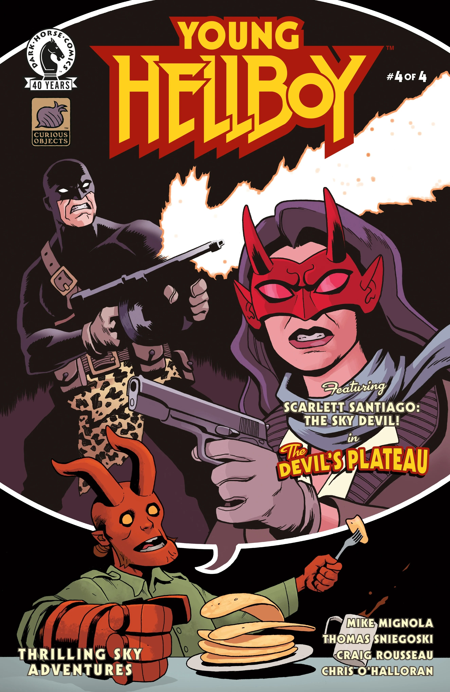

***《惊险空中冒险》（Thrilling Sky Adventures）***是由 [Mike Mignola](/entry/Mike_Mignola) 与 Tom Sniegoski 编剧、[Craig Rousseau](/entry/Craig_Rousseau) 作画的一部四期限定迷你系列。它是 *[《少年地狱男爵》](/entry/Young_Hellboy)*（Young Hellboy）系列的第三个故事。

## 剧情简介

### 第一部分

在一个“漫画冒险中嵌套漫画冒险”的故事里，斯嘉丽·圣地亚哥（Scarlett Santiago）打败的反派也许太多了，已无法再在街头保持低调。为了自保并击败追杀她的坏蛋，她可能需要与一个目标相似、神秘的猫样人物联手。

### 第二部分

斯嘉丽驾机启程执行另一项任务，机上载着一名需要她帮助的男子；但一个偷渡客可能会打乱她的计划，试图阻止她。斯嘉丽能驾驭飞机的剧烈颠簸，可她能否理清乘客与偷渡客之间互相矛盾的说辞，弄清究竟谁才真正可信？

### 第三部分

斯嘉丽与乘客们降落在臭名昭著的魔鬼高原（Devil's Plateau），乍看之下那里毫无“魔鬼”之气。但黑暗邪恶的事物也许就潜伏在转角处，而空中恶魔（Sky Devil）在追查魔鬼高原背后真相的过程中绝不会放过任何一块石头。

### 第四部分

当斯嘉丽发现潜伏在那里的东西，并不如这支队伍——包括斯嘉丽自己在内——可能变成的东西那般危险时，魔鬼高原背后的谜团终于揭开。又一个《少年地狱男爵》系列在这场欢闹的动作冒险大结局中画上句号！

## 画廊

主封面作者：[Craig Rousseau](/entry/Craig_Rousseau)。

第 \#1 期

第 \#2 期

第 \#3 期

第 \#4 期

|第 #2 期

|第 #3 期

|第 #4 期

|Issue #1 by David Hitchcock

|Issue #2 by Alice Darrow

|Issue #3 by Michael Cho

|Issue #4 by Ben Stenbeck
### 变体封面

第 \#1 期  
作者：David Hitchcock

第 \#2 期  
作者：Alice Darrow

第 \#3 期  
作者：Michael Cho

第 \#4 期  
作者：[Ben Stenbeck](/entry/Ben_Stenbeck)
