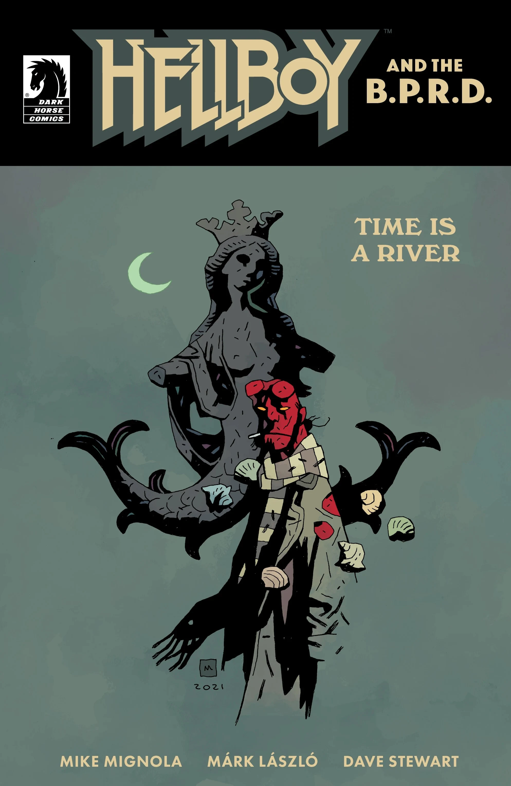
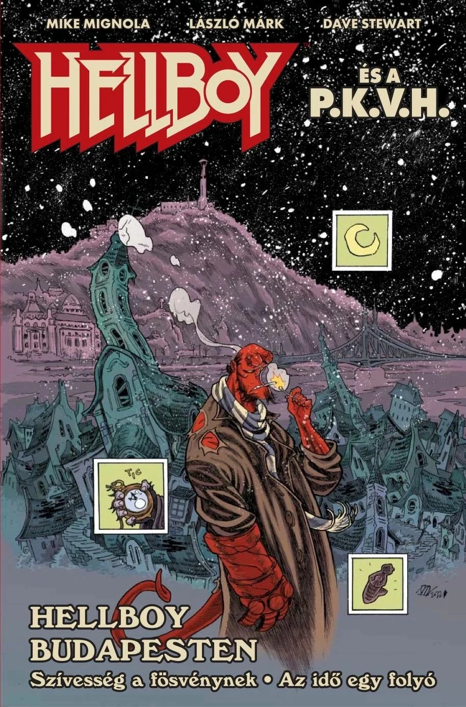

***《时间是一条河》***是 *[《地狱男爵与超自然调查防御署》](/entry/Hellboy_and_the_B.P.R.D.)* 的一部单完结故事弧，由迈克·米格诺拉编剧，Márk László 绘制。它是短篇故事 *[《吝啬鬼的礼物》](/entry/The_Miser's_Gift)* 的续作。

## 出版历史

2022年10月9日，匈牙利出版社 Vad Virágok 发行了“*Hellboy Budapesten*”（《地狱男爵在布达佩斯》），这是一本双倍篇幅的刊物，收录 *[《吝啬鬼的礼物》](/entry/The_Miser's_Gift)* 与《时间是一条河》，配有 Márk László 绘制的新封面以及一本14页的速写集。

## 剧情简介

在《吝啬鬼的礼物》中，[地狱男爵](/entry/Hellboy_(character))无意中把博学杂家拉约什（Lajos）留在了一个幽灵版本的布达佩斯，他当时并未意识到这会带来多么深远的后果！随着多条时间线彼此交错，现实开始崩解，地狱男爵必须重返那座幽灵之城，趁一切还来得及之前把拉约什找回来。

## 画廊

*《地狱男爵与超自然调查防御署：  
时间是一条河》*  
作者 Márk László

*《地狱男爵与超自然调查防御署：  
时间是一条河》*  
作者 迈克·米格诺拉、戴夫·斯图尔特

*Hellboy es a P.K.V.H.:  
Hellboy Budapesten*  
（匈牙利特别版）  
作者 Márk László

|Hellboy and the B.P.R.D.: Time Is a River by Mike Mignola and Dave Stewart

|Hellboy es a P.K.V.H.: Hellboy Budapesten (special Hungarian edition) by Márk László
