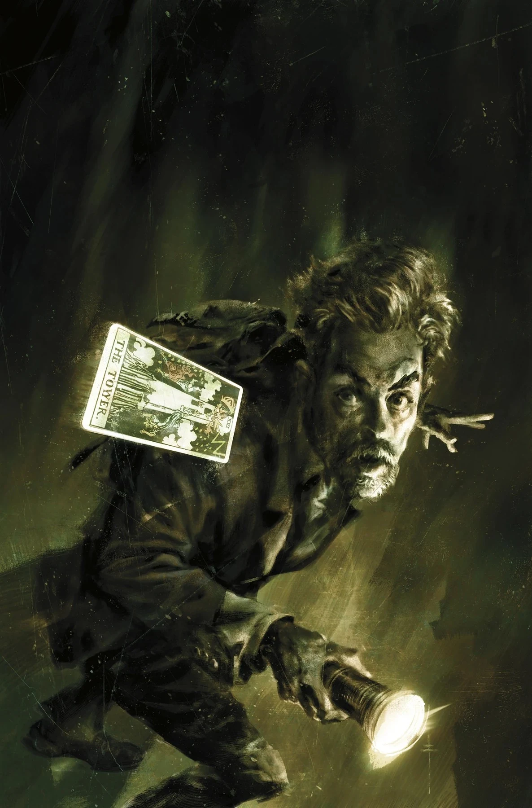
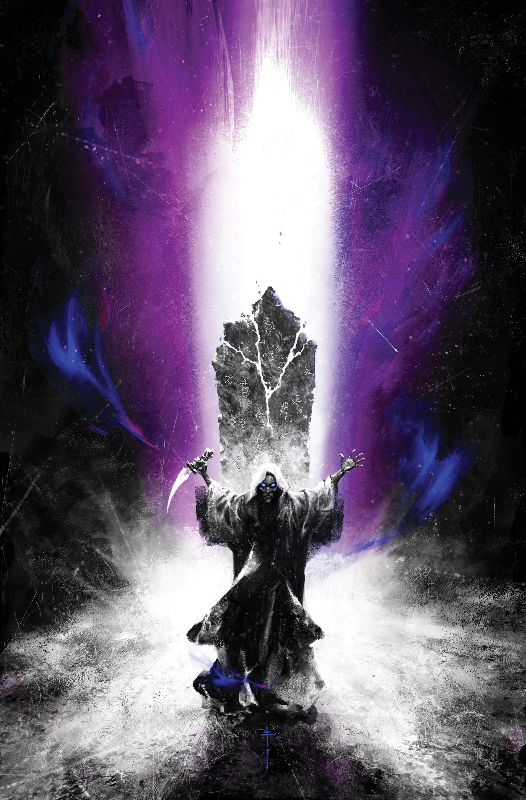
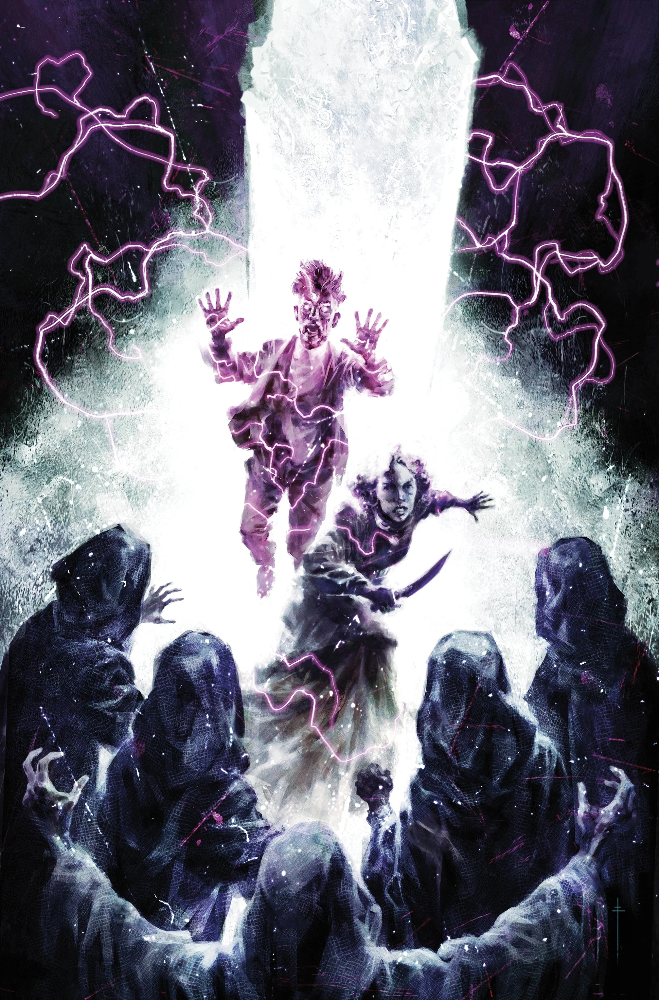

***《无从追忆》（Time Out of Mind）***是一部四期的*[英国超自然学会](/entry/The_British_Paranormal_Society_(series))*故事弧，由 [迈克·米格诺拉](/entry/Mike_Mignola) 与[克里斯·罗伯森](/entry/Chris_Roberson)编剧，[Andrea Mutti](/entry/Andrea_Mutti) 作画，[Lee Loughridge](/entry/Lee_Loughridge) 上色。

## 剧情简介

### 第一部分

英国超自然学会成员西蒙·布鲁滕霍姆（Simon Bruttenholm）与霍诺拉·格兰特（Honora Grant）一同抵达诺克斯顿（Noxton），但两人各怀目的：霍诺拉希望查明这座小镇种种奇异传统的底细，而西蒙则在寻找他失踪的助手。然而他们各自的调查却通向了同一条扭曲的道路——在诺克斯顿天真无邪的表象背后，隐藏着一个黑暗的秘密！

### 第二部分

西蒙在诺克斯顿村神秘的立石附近遭到一只奇怪生物的袭击，之后他与霍诺拉定下一计，打算从守口如瓶的镇民口中撬出一些情报。

### 第三部分

霍诺拉与西蒙被更深地卷入诺克斯顿的谜团之中！西蒙一旦查明袭击者的身份，就必须争分夺秒地弄清他失踪的研究员究竟遭遇了什么，以及这一切与这座古怪小镇有何关联。

### 第四部分

西蒙与霍诺拉亲身体验到诺克斯顿立石那超尘世的本质，以及它们悲惨的过往。随着谜团被层层揭开，一个由超尘世影响催生、最终滑向误入歧途的信仰的当地秘密——以及它所酿成的恐怖——也随之水落石出。

## 画廊

全部封面由 [Sebastián Fiumara](/entry/Sebasti%C3%A1n_Fiumara) 绘制。

第 \#1 期

第 \#2 期

第 \#3 期

第 \#4 期

|第 #2 期

|第 #3 期

|第 #4 期
