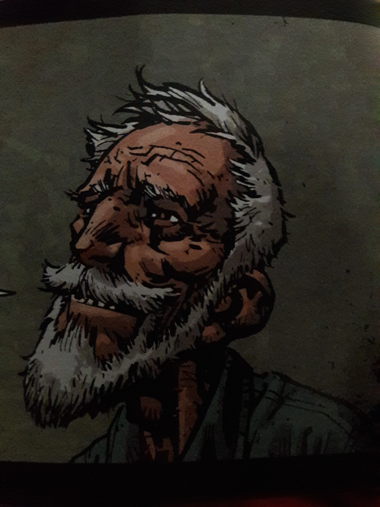

**汤姆·费雷尔（Tom Ferrell）**约于 1923 年出生在[飓风镇](/entry/the_Hurricane)附近的阿巴拉契亚山区；我们对他的母亲知之甚少，他的父亲 Charles E. Ferrel 则有在偏僻林子里喝酒的习惯。他早年在巫术中的荒唐遭遇导致他自我放逐、远走他乡。二十年后他的归来却成了一件幸事——他和[地狱男爵](/entry/Hellboy)至少解除了[杰里迈亚·威特金斯](/entry/Jeremiah_Witkins)及其女巫们笼罩在这片地区的诅咒。

## 历史

### 早年与出走

汤姆在山里长大，是个乡野小子；用他自己的话说，十五岁时他的脑子还不如一袋蜗牛灵光。但他并不是个坏人。他头一回沾惹黑暗面，是因为偷看[埃菲·科尔布](/entry/Effie_Kolb)沐浴。她先教了他一些关于女性身体的事，随后便企图把他引上巫术之路。十五岁、又不怎么懂事的汤姆觉得这倒是个打发时间的好法子。于是他找来一只被压扁的黑猫，把肉煮脱了骨，再把骨头洗干净。按埃菲的说法，[魔鬼](/entry/Satan)会现身，而他当时握在手里的那根[骨头](/entry/Lucky_cat_bone)将被注入力量。

汤姆见到了魔鬼，认出他就是[杰里迈亚·威特金斯](/entry/Jeremiah_Witkins)。他这才意识到自己当了傻瓜，连忙逃回家，却看见一只癞蛤蟆蹲在门阶上等他。他认出那是威特金斯派来的恶魔魔宠，便一言不发地离开了家。他一路辗转到了港口，最终参军入伍，在第二次世界大战中与日军作战并活了下来。虽然无法证实，但他怀疑是自己的幸运骨帮他安然闯过了好几次险境。

### 归乡与对决

离家二十年后，汤姆回到家乡，发现地狱男爵正俯身查看一个被女巫害死的女孩的尸体，便主动提出自己的建议和见闻。当地人告诉他，他的母亲已经去世，多年前被一位亲戚接走；而他的父亲在他离家的第二天就失踪了。两人一边交换各自的人生经历，一边前往[科拉·费希尔](/entry/Cora_Fisher)的小屋。他们与科拉当面对质，科拉表示忏悔；随后埃菲出声招呼——自他上次见到她以来，她丝毫没有变老——还声称威特金斯有话要跟他说。她骑来的那匹马，原来正是汤姆的父亲。

在教堂安葬父亲之后，汤姆决定与这个恶魔做个了断。途中汤姆被迫动用猫骨把众人送到安全之地，但他为此懊悔不已，因为这使他成了一名巫师。教堂里随即爆发一场激烈的对决，最终汤姆、地狱男爵、科拉的鬼魂和[沃茨 牧师](/entry/Reverend_Watts)取得了胜利。牧师将圣灵注入猫骨，又为一把铁锹祝圣。地狱男爵将威特金斯击倒，女巫们四散而逃。

随后汤姆和地狱男爵前往吝啬鬼的宅邸，他把猫骨朝对方掷去，将其永远消灭。

地狱男爵离开后，他陪同沃茨牧师前去收拾仍盘踞在附近矿坑里的女巫。许多女巫一听到沃茨神圣的祷文便丧命，剩下的则被他用铁锹解决。

### [《Effie Kolb 的归来》](/entry/The_Return_of_Effie_Kolb)

沃茨不久后去世，把教堂的产业留给了汤姆。他在当地几个小伙子的帮助下重建了那里；由于自己不是牧师，他决定不把它修成教堂。汤姆后来搬进了这栋建筑，并获得了"巫医"的名声。人们偶尔登门拜访，或有所求，或想听他讲述与威特金斯搏斗的故事、看一看那把铁锹。

步入晚年之后，汤姆收留了[Sara May Blackburn](/entry/Sara_May_Blackburn)——她的父母把她的预知能力误当成巫术，把她赶出了家门。

1967 年，Sara 的能力向她预示"有什么坏东西要来了"。汤姆打电话给[超自然调查防御署（B.P.R.D.）](/entry/Bureau_for_Paranormal_Research_and_Defense)请求前来调查。地狱男爵抵达后，汤姆说出了自己的怀疑：佝偻人的宅邸里正在发生什么。由于汤姆年事已高、腿脚又不方便，Sara 主动提出带地狱男爵去那栋房子。

夜里，归来的科尔布出现在汤姆面前，他用铁锹将她赶跑。

## 能力

汤姆对巫术有足够的了解，能辨认[女巫球](/entry/witchball)并提出破解之法。他对自己老家的这片地盘了如指掌。几十年来他随身带着一根[幸运猫骨](/entry/Lucky_cat_bone)，它能护他免遭伤害，还曾让他把两个人一同传送到安全之处。他还受过一些军队训练，并在[第二次世界大战](https://en.wikipedia.org/wiki/World_War_II)的实战中得到磨练。

## 其他媒体

汤姆·费雷尔登场于[《Hellboy: The Crooked Man》](/entry/Hellboy__The_Crooked_Man_%28film%29)，由[Jefferson White](/entry/Jefferson_White)饰演。

## 趣闻

- 汤姆·费雷尔的原型是 Manly Wade Wellman 创作的角色"银约翰"（Silver John）。
- 在 1948 年 5 月号的《时代》杂志上看到地狱男爵的照片时，汤姆以为他是只可爱的小猴子。
- 汤姆曾把埃菲及其主人造成的恶行深深归咎于自己，几乎主动把自己送到他们手里。
