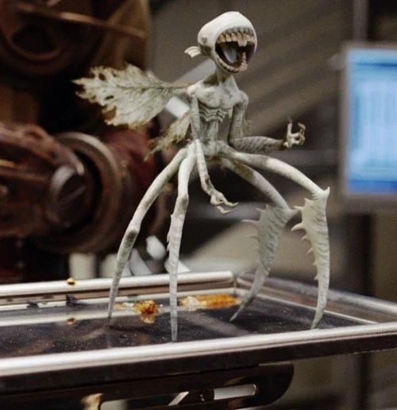

*"这些东西就会吃、吃、拉，然后接着吃"*

——[亚伯·塞皮恩](/entry/Abe_Sapien) 对牙仙的评价。

**牙仙**（学名 *Carcharodon calcarea*）是出现在 *[《地狱男爵2：黄金军团》](/entry/Hellboy_II__The_Golden_Army)* 中贪得无厌的多足有翼生物。

牙仙原产于德国黑森林。它们主要以钙质（血肉、骨骼、器官及其他组织）为食，由于牙齿中上述矿物质的含量更高，它们尤其偏爱牙齿（其名称也由此而来）。袭击活的猎物时，它们会专攻受害者的牙齿，不过它们会把猎物吃得只剩排泄物才罢休。它们成群结队、数量庞大，足以淹没一个类人目标，在数秒内将其血肉剥食殆尽。尽管行为凶残，它们却具有意识，也有能力进行交流，只是无法使用人类语言。它们大概因其破坏性而被视为违禁品。

努阿达王子（Prince Nuada）在巨魔市场非法购得牙仙，将其饿上一阵后放进一家拍卖行，致使七十余人丧生。随后，[超自然调查防御署](/entry/Bureau_for_Paranormal_Research_and_Defense) 的探员们前来调查这起骚乱，其中包括 [地狱男爵](/entry/Hellboy_(character))、[亚伯](/entry/Abe_Sapien) 和丽兹。一场恶战夺走了两名人类超自然调查防御署探员的性命，战后丽兹运用她的念火能力轰穿拍卖行，将牙仙活活烤死，爆炸也把地狱男爵从一扇窗户掀飞出去，暴露在公众视野之中。之后，[约翰·克劳斯](/entry/Johann_Kraus) 利用灵体塑型术（teleplasty）使一只在丽兹发动能力时被杀死的牙仙重新活动起来。它在再度死去之前，传达出自己是在巨魔市场被买下的信息。
