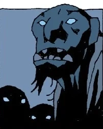

**巨魔（Troll）**是同时出现在地狱男爵漫画和 [《地狱男爵2：黄金军团》](/entry/Hellboy_II__The_Golden_Army) 中的神话生物。

## 漫画中

巨魔是一种体型庞大、性情粗野的类人物种，文中暗示他们格外凶暴。他们无法在白天外出，因为阳光会把巨魔变成石头。据说挪威的巨魔居住在巨魔之乡（Troll-heim），但尚不清楚还有多少其他国家遭受巨魔的威胁。在挪威，许多巨魔似乎对一把木勺心怀恐惧和（或）视其为弱点——[巨魔女巫](/entry/The_Troll_Witch)（Troll Witch）曾用它杀死过巨魔同类。[地狱男爵](/entry/Hellboy_(character)) 从巨魔女巫本人手中得到这把木勺，用以在一群劫掠成性的巨魔的洞穴外将他们困住。他们对这件武器的记忆恐惧至极，竟不敢跨过它。他们宁肯在阳光下化作石头，也不敢越过木勺。巨魔女巫的外形酷似巨魔，不过无法确定她本身就是巨魔，还是仅仅长得像。在地狱男爵故事 [《狂猎》](/entry/The_Wild_Hunt)（The Wild Hunt）中，[达奥恩·希](/entry/Daoine_Sidhe)（Daoine Sidhe）曾提到北欧巨魔，因此二者之间似乎存在某种关联。

## 《地狱男爵2：黄金军团》

**巨魔**是 *[《地狱男爵2：黄金军团》](/entry/Hellboy_II__The_Golden_Army)* 中出现的一类魔法生物。巨魔种类繁多，使用着各种各样的语言。具体种类包括 [洞穴巨魔](/entry/Cave_Troll)（如 [温克先生](/entry/Mr._Wink)（Mr. Wink））、跟班巨魔（Cronie Trolls）以及 [弗拉格勒旺普](/entry/Fragglewump)（Fragglewumps）。巨魔曾参加对抗 [人类](/entry/Human) 的最初那场战争。有些巨魔在 [巨魔市场](/entry/The_Troll_Market) 里购物——该市场位于布鲁克林大桥之下，对外界保密。

## 画廊
