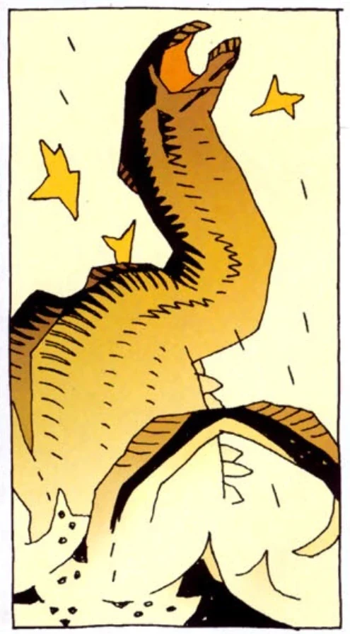
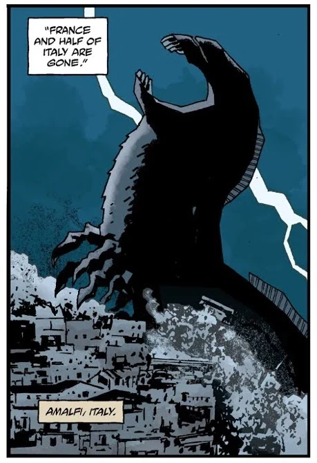

**乌尔戈-赫姆（Urgo-Hem）** 是 369 个[奥格德鲁·赫姆](/entry/Ogdru_Hem)之一——[奥古·桀哈](/entry/Ogdru_Jahad)的子嗣，在《地狱男爵：岛屿》中担任主要反派。

### [《岛屿》](/entry/The_Island)

乌尔戈-赫姆借着一位 16 世纪西班牙神父的血从囚禁中被释放。这位神父曾在特诺奇蒂特兰被焚毁之前在那里生活过，在当地了解到奥格德鲁·赫姆的历史。他因这些知识遭到宗教裁判所迫害，最终被一个致力于保存古代世界宝藏的秘密修会藏了起来。

[地狱男爵](/entry/Hellboy_%28character%29)偶然发现他时，神父的血释放了乌尔戈-赫姆。奥古·桀哈的这个子嗣显然是一只水生巨兽，外形像一条无眼巨蛇，苍白的腹部两侧长着锋利的甲壳类步足。经过一场血战，乌尔戈-赫姆自己撞上附近一艘沉船的桅杆被刺穿，地狱男爵趁机逃脱。

### [诸神黄昏](/entry/Ragna_Rok)

后来，[拉斯普廷](/entry/Rasputin)被带回凡界并唤醒了地球上所有沉睡的奥格德鲁·赫姆，有人看到乌尔戈-赫姆以一个巨大得多（但仍能辨认）的形态耸立在意大利阿马尔菲上空。

## 外观

乌尔戈-赫姆是一只巨大的水生无眼蛇状生物，苍白的腹部两侧长着锋利的甲壳类步足。被拉斯普廷复活后，它的体型比之前庞大得多。

## 画廊

 《岛屿》中的乌尔戈-赫姆

 诸神黄昏中的赫姆

## 首次漫画登场

- [《岛屿》](/entry/The_Island)
- [《诸神黄昏》](/entry/Ragna_Rok_%28story_arc%29)

## 趣闻

- 一只与乌尔戈-赫姆相似的水生蛇形怪物出现在*[《地狱男爵：风暴之剑》](/entry/Hellboy__Sword_of_Storms)*中；[丽兹](/entry/Liz_Sherman)在一场持久战中试图烧死它，但在它的"兄弟"雷与电被击败后，它最终退走了。

## 外部链接

- [乌尔戈-赫姆](https://villains.fandom.com/wiki/Urgo-Hem)，见 [恶人维基（Villains Wiki）](https://villains.fandom.com/wiki/Main_Page)
