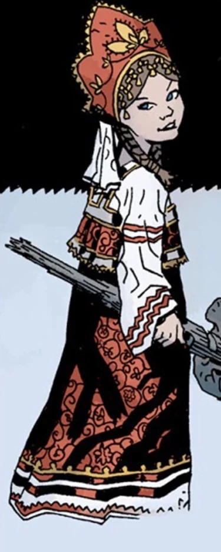

 **瓦西丽莎（Vasilisa）**是[摩根勒菲（Morgan Le Fey）](/entry/Morgan_Le_Fey)城堡里的一名侍女。

## 历史

瓦西丽莎首次登场于《[黑暗召唤](/entry/Darkness_Calls)》，她把[地狱男爵](/entry/Hellboy_%28character%29)从[不死者科西切（Koshchei the Deathless）](/entry/Koshchei_the_Deathless)手中救下，用的是一盏取自[雅加婆婆](/entry/Baba_Yaga_%28character%29)屋里的灯。瓦西丽莎解释说，这盏灯是她继母把她送到雅加婆婆那里、指望女巫杀了她时得到的。多亏一个魔法娃娃的帮助，雅加婆婆反而放她走，还让她带走了灯。她刚讲完故事，科西切就一箭射穿了她，她死在地狱男爵怀中。弥留之际，她把一把梳子和一块手帕交给他——那是她的娃娃临终前送给她的。

当摩根敦促地狱男爵拿起[王者之剑（Excalibur）](/entry/Excalibur)、接受自己作为合法国王的英格兰王位宿命时，地狱男爵拒绝了：他既被此前对[巨人族](/entry/Giant)的血腥屠杀所困扰，也不愿接受自己作为 [Azzael](/entry/Azzael) 之子和[毁灭右手](/entry/Right_Hand_of_Doom)持有者的宿命。但瓦西丽莎认为，他太把 [Astaroth](/entry/Astaroth)、[拉斯普廷](/entry/Grigori_Rasputin)以及其他所有一口咬定他是怪物、是邪恶工具的人的话放在心上。瓦西丽莎问，他为什么不能相信[爱丽丝·莫纳汉](/entry/Alice_Monaghan)和许多其他人所相信的：他就是他自己，能够用自己的力量行善。

在地狱男爵大军与[血皇后](/entry/Queen_of_Blood)的最终决战中，瓦西丽莎递给地狱男爵一把铁剑，由女王头盔顶端的渡鸦锻造而成，地狱男爵用它杀死了血皇后。

## 趣闻

- 瓦西丽莎的名字和外貌都与[瓦尔瓦拉](/entry/Varvara)十分相似，但两者之间尚未建立明确的联系。

- 她似乎取材自童话《美丽的瓦西丽莎》。
