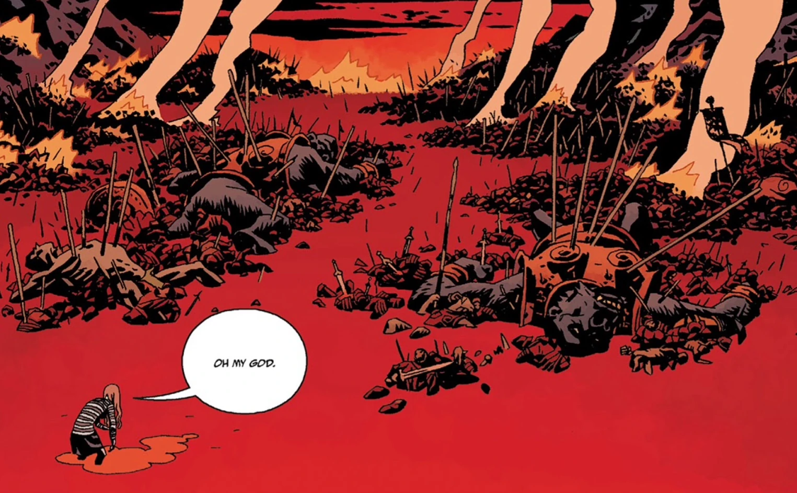

**维格里德（Vigrid，北欧神话中的决战原野）**是[诸神黄昏](/entry/Ragna_Rok_(event))期间的关键地点，一场重要的战役将在此打响。

## 历史

当[妮缪](/entry/Nimue)被[奥古·桀哈](/entry/Ogdru_Jahad)附身后，她/巨龙统率一支怪物大军与[启示录四骑士](/entry/Four_Horsemen_of_the_Apocalypse)，命他们前往人类的世界，“把他们赶尽杀绝”。

幸运的是，乔治·沃什布鲁克（George Washbook）手持[圣剑](/entry/Excalibur)，率领英格兰的亡灵贵族迎击怪物大军，将他们歼灭。与此同时，[地狱男爵](/entry/Hellboy_(character))与妮缪/奥古·桀哈交战，击败了巨龙，但自己也在此役中殒命。[沃尔德王](/entry/King_Vold_(character))也出现在战场上。

尽管正义的一方取得了胜利，这却只是终结时代的开端：战役之后，[奥格德鲁·赫姆](/entry/Ogdru_Hem)开始大量涌现，大不列颠的大部分领土从地图上被抹去。

## 描述

*“这片原野……它叫维格里德。而这早已写在星辰与树根之中……当诸神黄昏降临时，一切就会发生在这里……[人类的勇士](/entry/Hellboy_(character))将与[巨龙](/entry/Ogdru_Jahad)交战……然后，一切都将终结。”*

## 登场

- [《狂怒》](/entry/The_Fury)
