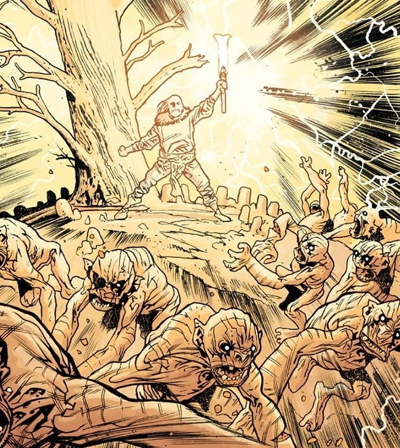

**维利**(Vril)，又称 *Flamma Reconditus*、**秘火**(The Secret Fire)，乃是[上帝](/entry/God)本身的力量。

## 起源

守望者[阿努姆](/entry/Anum)(Anum)曾运用维利，以泥土创造了[奥古·桀哈](/entry/Ogdru_Jahad)。其他守望者在这个造物身上留下印记，赋予它生命。但这怪物直到夜幕降临、黑暗充盈其体才真正活过来，并生下了 369 只[奥格德鲁·赫姆](/entry/Ogdru_Hem)——又一个邪恶怪物的种族。守望者们向奥格德鲁·赫姆开战，击败了它们，并一度将它们逐出地球。随后，阿努姆再次运用维利之力，将奥古·桀哈封入一座水晶囚笼，把它们投入了宇宙深处。

[极北族人](/entry/Hyperboreans)曾能够驾驭维利之力，使他们的文明成为统治地球的乐园，并延续了成千上万个千年。

## 维利能量服（V.E.S.）

科学家加拉拉加斯教授(Professor Gallaragas)受古代极北族传说的启发，长期以来一直试图理解并驾驭维利之力。他创造了一台名为"阿努姆之叉"(Anum's Fork)的装置，能够驾驭维利之力。随后，教授与他的女儿[海伦娜](/entry/Helena_Gallaragas)(Helena)用阿努姆之叉为一套金属战甲——[维利能量服](/entry/Vril_Energy_Suit)——供能，并以失意的棒球运动员[吉姆·萨克斯](/entry/Jim_Sacks)(Jim Sacks)作为试飞员。身着维利能量服时，吉姆能够以致命的效果驾驭维利之力。最初的战甲"钢铁普罗米修斯"(Iron Prometheus)，在术士 Memnan Saa 企图窃取阿努姆之叉后被毁。尽管吉姆与[大螯虾强生](/entry/Lobster_Johnson)成功阻止维利落入 Saa 之手，加拉拉加斯教授与吉姆都在这场争斗中丧生。然而，吉姆身着战甲时发生了变化：维利之力将他变成了一个"新近进化的超级存在"。他死去之时，窥见了宇宙运行的奥秘。

海伦娜在 Memnan Saa 的袭击中幸存，并得以制造出第二版维利能量服。受美国政府启用的厄庇墨透斯计划——亦称[重锤](/entry/Sledgehammer_44_(series))(Sledgehammer)——在第二次世界大战期间投入使用，用以对抗纳粹。

## [伊丽莎白·舍曼](/entry/Elizabeth_Sherman)

[超自然调查防御署](/entry/Bureau_for_Paranormal_Research_and_Defense)特工[丽兹·舍曼](/entry/Elizabeth_Sherman)在少女时代就成长为一名控火者，一个火能力者。在一生的大部分时间里，她对自己的能力都只能有限地控制。她与体内的这团火有着强烈的联结——在地狱男爵故事[《近乎巨像》](/entry/Almost_Colossus)(Almost Colossus)中，当她的火被抽干时，她几乎丧命。Memnan Saa 认为，丽兹就是维利之力的活化身，正是这一点赋予了她驾驭火焰的力量。

## 弗兰肯斯坦的怪物

作为[维克多·弗兰肯斯坦](/entry/Victor_Frankenstein)(Victor Frankenstein)的造物，这个怪物由一道奇异的闪电赋予生命。[拉的赫利奥皮斯兄弟会](/entry/Heliopic_Brotherhood_of_Ra)的一位科学家揭示，弗兰肯斯坦的怪物体内含有维利。在千年之后的未来，弗兰肯斯坦已展现出对维利的掌控，既能将它用于战斗，也能用来复活死者。

## 鱼人(Icthyo Sapien)

[鱼人](/entry/Frog_monster)(Icthyo Sapien)——例如[亚伯·塞皮恩](/entry/Abe_Sapien)——与丽兹一样被认为是维利的容器，但无法像丽兹那样运用它。然而，在他死于[格里高利·拉斯普廷](/entry/Grigori_Rasputin)之手后，卵从亚伯的体内涌出，孵化出一个新的种族；在人类被驱入地下之后，这个新种族统治了地表。

一切生物体内都有[沙克蒂](/entry/Shakti)(Shakti)，即维利的对立面。因此，鱼人很可能是以维利取代了沙克蒂。
