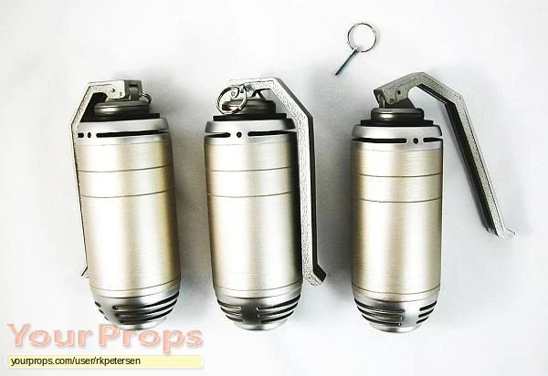

**伏尔甘手雷（Vulcan Grenades）**是电影*[《地狱男爵》](/entry/Hellboy_(2004_film))*（2004年）中出现的超大号手雷。

这种专用爆炸物由[超自然调查防御署](/entry/Bureau_for_Paranormal_Research_and_Defense)研发，用于猎杀大型怪物。

## 描述

这种手雷有大号汽水瓶那么大，爆炸威力远超 C4 炸药。[地狱男爵](/entry/Hellboy_(2004%E2%80%932008_film_character))用它们来消灭[贝希摩斯](/entry/Behemoth_(Ogdru_Hem))：他在身上挂满一整排手雷并引信上膛，任由自己被贝希摩斯吞下，以便从内部将其摧毁。
