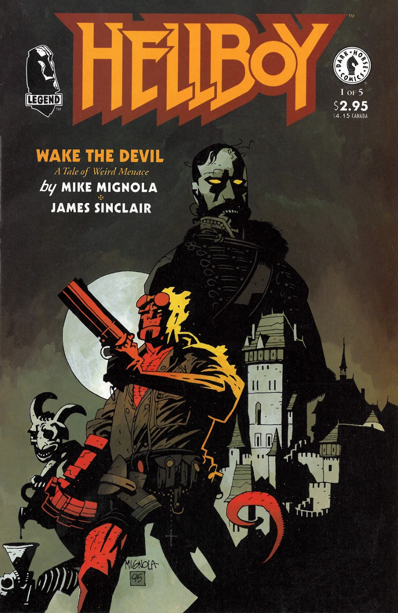
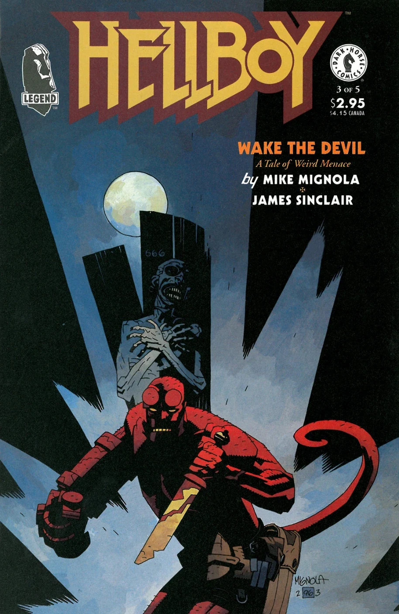
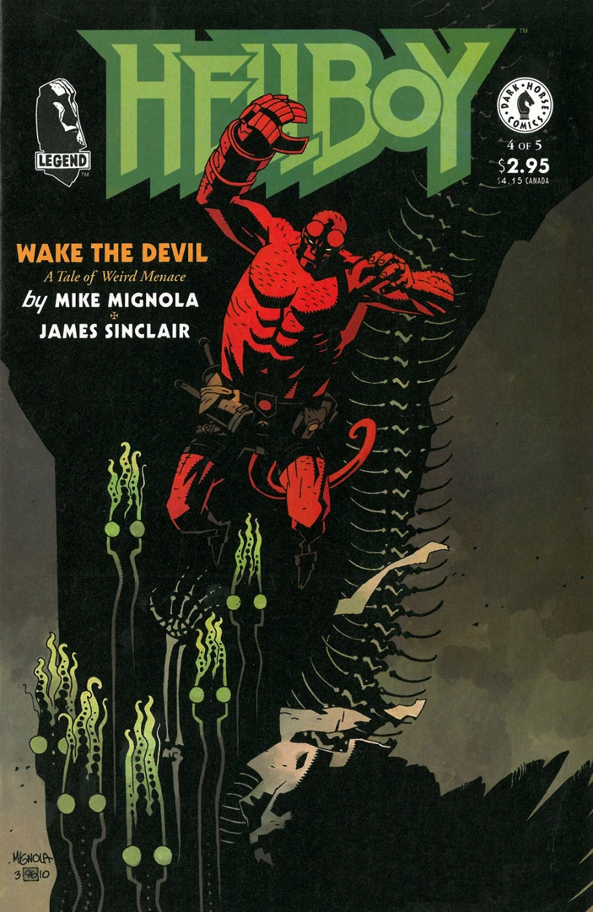
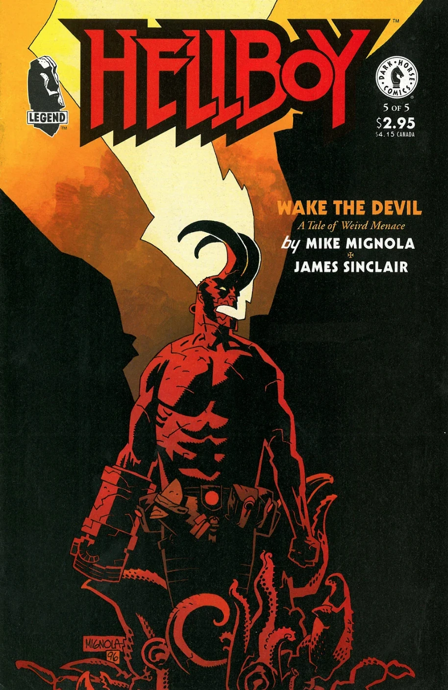

《**唤醒恶魔**》（Wake the Devil）是第二部 *[地狱男爵](/entry/Hellboy_%28series%29)* 迷你系列。故事接续 *[毁灭之种](/entry/Seed_of_Destruction)* 的结尾，发生在挪威的一座城堡。故事讲述纳粹神秘学者继续推行他们的计划，试图复活一个[吸血鬼](/entry/Vampire_%28creature%29)。本篇向读者介绍了[弗拉基米尔·朱雷斯库](/entry/Vladimir_Giurescu)、[雅佳婆婆](/entry/Baba_Yaga_%28character%29)、[赫卡忒](/entry/Hecate)、未来的 [B.P.R.D.](/entry/Bureau_for_Paranormal_Research_and_Defense) 成员[罗杰](/entry/Roger)，以及（非常短暂登场的）[爱德华·格雷爵士](/entry/Sir_Edward_Grey)。

## 出版历史

该故事最初以五期迷你系列《地狱男爵：唤醒恶魔》第 1–5 期（1996 年 6–10 月）的形式发表。这些期数中还收录了加里·詹尼创作的后备故事《如坟墓般寂静》（Silent as the Grave），由[怪物人](/entry/MonsterMen)主演。1997 年 5 月，该故事加上一个全新的五页尾声，在 *[《地狱男爵：第 2 卷 唤醒恶魔》](/entry/TPB)* 中重印。

## 剧情简介

### 第一部

漫画开场于北极圈内的挪威北部海岸，一架[津科](/entry/Roderick_Zinco)直升机正降落在[毁灭之种](/entry/Seed_of_Destruction)结尾出现过的那座城堡前。公司负责人[罗德里克·津科](/entry/Roderick_Zinco)闯入城堡，与[卡尔·克罗南](/entry/Kroenen)、[伊尔莎·豪普斯坦](/entry/Ilsa_Haupstein)和[利奥波德·库尔茨](/entry/Leopold_Kurtz)对峙，但津科解释说他见到了[格里高利·拉斯普京](/entry/Grigori_Rasputin)，并承诺会倾尽所有为他们所用。

一年后，在纽约市苏豪区，纳粹分子杀死了一家蜡像馆的馆长霍华德·斯坦曼，又名[汉斯·乌布勒](/entry/Hans_Ubler)。在康涅狄格州费尔菲尔德的 [B.P.R.D.](/entry/B.P.R.D.) 总部，[汤姆·曼宁](/entry/Tom_Manning)和[凯特·科里根](/entry/Kate_Corrigan)向探员们简要介绍[弗拉基米尔·朱雷斯库](/entry/Vladimir_Giurescu)的生平，以及他永远不死的事实：每当满月照在朱雷斯库城堡中的他身上，他便能自愈。1944 年，[海因里希·希姆莱](/entry/Heinrich_Himmler)提出了[吸血鬼风暴](/entry/Vampir_Sturm)计划，一个由伊尔莎·豪普斯坦率领的纳粹代表团被派去招募朱雷斯库。在与朱雷斯库会面之后，希特勒下令逮捕、处决并消灭朱雷斯库家族。然而，有可能是那位博物馆馆长在朱雷斯库的尸体被焚烧之前，将其偷运出了德国。[B.P.R.D.](/entry/B.P.R.D.) 担心有人会试图在他的城堡中让朱雷斯库重新复活。但是，朱雷斯库城堡的位置有三种可能，于是[汤姆·曼宁](/entry/Tom_Manning)把探员们分成三组：地狱男爵独自一人；[亚伯·塞皮恩](/entry/Abe_Sapien)与[克拉克先生](/entry/Clark)一组；[丽兹·谢尔曼](/entry/Liz_Sherman)与[巴德·沃勒](/entry/Bud_Waller)和[西德尼·利奇](/entry/Sidney_Leach)一组。

在罗马尼亚，[伊尔莎·豪普斯坦](/entry/Ilsa_Haupstein)打开偷来的、装着朱雷斯库尸体的箱子，命令士兵把它抬到一个特定的房间。与此同时，在挪威，库尔茨和克罗南监视着伊尔莎，画面揭示他们正在制造自己的军队。回到罗马尼亚，探员们都在一架飞机上，亚伯·塞皮恩和地狱男爵谈论[诸神黄昏计划](/entry/Project_Ragna_Rok)的介入，因为他觉得这让地狱男爵忧心忡忡。地狱男爵跳出飞机，他的喷气背包爆炸，把他撞进了朱雷斯库城堡。

### 第二部

伊尔莎命令半机械纳粹[乌恩施](/entry/Unmensch)去杀死地狱男爵，两人打了起来，最后双双穿过地板坠落。一段闪回回到 1944 年的塔马甘特岛，拉斯普京命令伊尔莎、克罗南和库尔茨前往挪威。在现在，拉斯普京现身，让她离开城堡，并说下次她见到朱雷斯库时，他将重新变得年轻。在城堡里，地狱男爵醒来时纳粹已经不见，只留下了他的金属手臂。

在附近的一个村庄里，一位老人让女儿带着她的孩子们离开、永远不要回来，并说对他而言离开已经"太晚了"。

地狱男爵循着一道血迹追踪，发现一个男人正在啃食那纳粹的腿；此人表明自己是[弗拉基米尔·朱雷斯库](/entry/Vladimir_Giurescu)的父亲，并称是女神[赫卡忒](/entry/Hecate)让朱雷斯库复活。地狱男爵问朱雷斯库在哪里，老人拒绝告诉他，地狱男爵便把他烧死了。地狱男爵离开房间后，想起老人说过关于一扇月亮门的话，便看到一扇上面有月亮形状的门；门内是装着尸体的箱子，前面摆着三颗士兵的头颅。但他被一群乌鸦包围，乌鸦们变成色萨利女子，开始攻击他。

### 第三部

在朱雷斯库城堡，地狱男爵枪击色萨利女子，直到朱雷斯库从他的箱子里出来。地狱男爵试图杀死他时，朱雷斯库变成一只乌鸦，地狱男爵刺中了他。朱雷斯库跌进一具石棺，最终落到地下。地狱男爵赶到那里时，朱雷斯库躺在地上，胸前插着刀，但随即他化作蛇群逃走了。地狱男爵离开墓穴之后，赫卡忒使朱雷斯库复活。拉斯普京向伊斯拉讲述自己的生平，并提出让伊尔莎·豪普斯坦像他一样重生。

在罗马尼亚切格城堡的废墟中，[丽兹·谢尔曼](/entry/Liz_Sherman)、[巴德·沃勒](/entry/Bud_Waller)和[西德尼·利奇](/entry/Sidney_Leach)发现一扇门，门通向一个巨大的房间，里面有一个毫无生气的[霍蒙库鲁斯](/entry/Roger)。丽兹触摸他胸口的一个洞，却无法松手；随着丽兹把自己的能量转移给他，霍蒙库鲁斯活了过来。巴德开枪打中她的手臂才让她挣脱。霍蒙库鲁斯陷入惊慌，扭断了巴德·沃勒的脖子后逃走。

在挪威，罗德里克·津科给[克罗南](/entry/Kroenen)带来了[赫尔曼·冯·克莱姆普特](/entry/Herman_von_Klempt)教授的头颅，好让克罗南把冯·克莱姆普特纳入他们的计划。在罗马尼亚的圣巴塞洛缪修道院，第二部中的老人斯蒂芬告诉他当神父的兄弟，镇子将回归它的"老规矩"，因为他能感知到朱雷斯库，但他的兄弟并不相信他。回到朱雷斯库城堡，地狱男爵找到一个装满炸药的房间，设好定时器，让炸药在一小时后引爆。

### 第四部

地狱男爵离开城堡时，化身为蛇形的[赫卡忒](/entry/Hecate)拦住了他，她试图让地狱男爵回归他"古老的族类"，并对他说他已在人性中迷失了自己。地狱男爵与赫卡忒打了起来，她对他说他将带来世界的终结，他无法逃脱自己的命运。地狱男爵用矛刺中她，两人一起撞穿墙壁；她的皮肤和血肉在日光下燃烧，就在这时炸药引爆，城堡被炸上了天，而地狱男爵就在城堡外面。

[亚伯·塞皮恩](/entry/Abe_Sapien)和克拉克从森泰什城堡的废墟向 [B.P.R.D.](/entry/B.P.R.D.) 总部汇报。他们一无所获，但看到地狱男爵所在位置升起一股烟柱，于是奉命前去寻找地狱男爵。

在罗马尼亚，[雅佳婆婆](/entry/Baba_Yaga_%28character%29)的仆人[科库](/entry/Koku)给拉斯普京带来一具铁处女，以启动伊尔莎·豪普斯坦的重生；她走了进去，立刻丧命。拉斯普京告诉科库，他还会回来看雅佳婆婆。

斯蒂芬和另外两个人在朱雷斯库城堡废墟外发现了地狱男爵的身体，把他送到十字路口。

在挪威，冯·克莱姆普特引诱克罗南加入自己，而不是继续执行拉斯普京的计划；库尔茨大怒，试图杀死冯·克莱姆普特。克罗南试图阻止库尔茨，结果刺中并杀死了他。

在罗马尼亚，地狱男爵被锁链拴在一根粗木桩上。拉斯普京对他说，他就在这里腐烂吧。

### 第五部

亚伯·塞皮恩和克拉克降落在罗马尼亚村庄，村里每户人家的房子都被封死，门和窗上画着十字架。他们走进教堂，看见斯蒂芬的兄弟站在那里，手里拿着地狱男爵的信号腰带。他毫无反应；当克拉克碰他的肩膀时，神父的头掉了下来，两人随即穿过地板坠落。克拉克被一根尖桩刺穿，而亚伯在坠落中幸存。拉斯普金出现在亚伯面前，并威胁说：正如亚伯曾经（在 *[毁灭之种](/entry/Seed_of_Destruction)* 中）用矛刺过他一样，他有朝一日也会用矛刺亚伯。神父被砍下的头说道："亚伯拉罕·塞皮恩。你听见了吗……沉没的钟声正在为你敲响。出自[努姆-亚比斯克的洞穴](/entry/Caverns_of_Num-Yabisc)，黑暗而可怕的深渊，大海正在召唤她的孩子们回家。"

在十字路口，地狱男爵仍被锁链拴在粗木桩上，一个完全复活的[弗拉基米尔·朱雷斯库](/entry/Vladimir_Giurescu)骑在马上与他对峙。地狱男爵挣裂木桩，用它击中那匹马；马和朱雷斯库瞬间化为白骨。铁处女变成蛇一般的[赫卡忒](/entry/Hecate)，对地狱男爵说他无法逃脱自己的命运。她把他吞下；他的双角完全重新长出，他看见了奥格德鲁·贾哈德，但随后他拒绝帮助终结世界，并掰断了自己的角。他重新出现在十字路口，[凯特·科里根](/entry/Kate_Corrigan)在那里找到了他。

在挪威，拉斯普京与冯·克莱姆普特、克罗南和津科对峙，并暂时弄瞎了津科；津科意外按下一个按钮，炸毁了整座城堡。在罗马尼亚上空的一架直升机里，地狱男爵被告知没有发现铁处女的踪迹。在该期结尾，画面揭示[弗拉基米尔·朱雷斯库](/entry/Vladimir_Giurescu)的骸骨原本正在被运往 [B.P.R.D.] 总部的途中，但它在布加勒斯特机场临时存放期间消失，从此再未被找回。文中还揭示，尼古拉斯·布登茨神父的头颅再也没有说过话，但在数周之内一直是骚灵活动的焦点，包括气温骤降和物体悬浮。

### 尾声

在世界之树尤克特拉希尔那里，[雅佳婆婆](/entry/Baba_Yaga_%28character%29)对拉斯普京说，他成不了神，他已经失败了。她请拉斯普京留在她身边，但他决定继续努力，让自己成为神。

## 故事年表

尽管没有明说，《唤醒恶魔》似乎发生在 1997 年；[1] *[《地狱男爵指南》](/entry/Hellboy__The_Companion)* 将故事中的事件定在 1997 年 3 月。故事发生在 *[被锁链的棺材](/entry/The_Chained_Coffin)*（1994）之后一段时间，以及 *[近乎巨像](/entry/Almost_Colossus)* 的 8 天前。[2]

## 内容

### 角色

#### [B.P.R.D.](/entry/Bureau_for_Paranormal_Research_and_Defense)

- [托马斯·曼宁](/entry/Thomas_Manning)
- [伊扎尔·霍夫曼](/entry/Izar_Hoffman)
- [凯瑟琳·科里根](/entry/%E5%87%AF%E7%89%B9%C2%B7%E8%80%83%E7%91%9E%E6%A0%B9))
- 被派往朱雷斯库城堡
  - [地狱男爵](/entry/Hellboy_%28character%29)
- 被派往森泰什城堡
  - [亚伯拉罕·塞皮恩](/entry/Abraham_Sapien)
  - [斯科特·克拉克](/entry/Scott_Clark)
- 被派往切格城堡
  - [巴德·沃勒](/entry/Bud_Waller)
  - [西德尼·利奇](/entry/Sidney_Leach)
  - [伊丽莎白·谢尔曼](/entry/Elizabeth_Sherman)
- 无名工作人员

#### [纳粹](/entry/%3ACategory%3ANazi)与[诸神黄昏计划](/entry/Project_Ragna_Rok)

- [津科公司](/entry/Zinco_Corporation)
  - [罗德里克·津科](/entry/Roderick_Zinco)
  - 直升机飞行员
- [诸神黄昏计划](/entry/Project_Ragna_Rok)
  - [利奥波德·库尔茨](/entry/Leopold_Kurtz)
  - [卡尔·鲁普雷希特·克罗南](/entry/Karl_Ruprect_Kroenen)
  - [伊尔莎·豪普斯坦](/entry/Ilsa_Haupstein)
  - [格里高利·拉斯普京](/entry/Grigori_Rasputin)
  - [乌恩施](/entry/Unmensch)
  - [奥格德鲁·贾哈德](/entry/Ogdru_Jahad)
- [汉斯·乌布勒](/entry/Hans_Ubler)（又名霍华德·斯坦曼）
- [海因里希·希姆莱](/entry/Heinrich_Himmler)（被提及）
- [克劳斯·维尔纳·冯·克鲁普特](/entry/Klaus_Werner_von_Krupt)（闪回）
- [赫尔曼·冯·克莱姆普特](/entry/Herman_von_Klempt)
- 无名的诸神黄昏/纳粹士兵
- 不死纳粹士兵

#### 朱雷斯库家族

- [弗拉基米尔·朱雷斯库](/entry/Vladimir_Giurescu)
- 米哈伊尔·朱雷斯库
- [弗拉基米尔·朱雷斯库的](/entry/Vladimir_Giurescu)情人们（沃伊卡、伊琳娜、卡罗琳、玛丽、凯瑟琳和安娜）（画作/被提及）

#### [女巫](/entry/Witches)及其盟友

- [女巫](/entry/Witches)
  - [赫卡忒](/entry/Hecate)
  - [雅佳婆婆](/entry/Baba_Yaga_%28character%29)
- 色萨利女子
- [科库](/entry/Koku)

#### 其他

- 罗马尼亚村民（玛丽亚、斯蒂芬、尼古拉斯，以及数个无名村民）
- [罗杰](/entry/Roger)（未具名）
- [极北族人](/entry/Hyperboreans)
  - 祭司与公民
  - [透特](/entry/Thoth)（被提及）
- 俄国皇室
  - [费利克斯·尤苏波夫亲王](https://en.wikipedia.org/wiki/Felix_Yusupov)（闪回）
  - 其他成员（闪回）
- [达因·希仙灵](/entry/Daoine_Sidhe)
  - [达格达](/entry/Dagda)
- [爱德华·格雷](/entry/Edward_Grey)[3]

### 地点

- 挪威
  - [诸神黄昏计划的](/entry/Project_Ragna_Rok)城堡
- 加勒比海
  - 津科名下的岛屿（闪回）
- 美国
  - [汉斯·乌布勒的](/entry/Hans_Ubler)蜡像馆（纽约苏豪区）
  - [B.P.R.D.](/entry/Bureau_for_Paranormal_Research_and_Defense)总部（康涅狄格州费尔菲尔德）
- 罗马尼亚
  - [朱雷斯库](/entry/Vladimir_Giurescu)城堡
  - 圣巴塞洛缪
    - 修道院
    - 十字路口
  - 切格城堡废墟
    - [埃德尔·米施拉塞的](/entry/Edel_Mischrasse)作坊
  - 森泰什城堡
- 苏格兰（闪回）
  - 塔马甘特岛（闪回）
- [地狱](/entry/Hell)
  - [深渊](/entry/Abyss)（闪回）
- [极北之地](/entry/Hyperboreans)（闪回）
- 俄罗斯（闪回）
- [尤克特拉希尔](/entry/Yggdrasil)

### 值得注意的物品

- [B.P.R.D.](/entry/Bureau_for_Paranormal_Research_and_Defense)喷气背包
- [雅佳婆婆的](/entry/Baba_Yaga_%28character%29)石臼和研杵
- [赫卡忒的](/entry/Hecate)铁处女
- [雅佳婆婆的](/entry/Baba_Yaga_%28character%29)鸡腿屋

## 画廊

封面由[迈克·米格诺拉](/entry/Mike_Mignola)绘制。

 第 1 期

 第 2 期

 第 3 期

 第 4 期

 第 5 期

## 注释

[1] 在第 1 期中地狱男爵 52 岁；1944+52=1996，但他的"生日"在 12 月，所以是 1997 年。接着在第 3 期中[丽兹](/entry/Elizabeth_Sherman)说她加入 [B.P.R.D.](/entry/Bureau_for_Paranormal_Research_and_Defense) 已经 23 年。在 *[毁灭之种](/entry/Seed_of_Destruction)* 第 1 期中我们读到，丽兹于 1974 年成为 B.P.R.D. 的受监护人。所以 1974+23=1997。

[2] 《近乎巨像》第 1 期

[3] 他被提及，也以一个戴面具的人物形象出现，但两个角色此时尚未被揭示为同一人。
