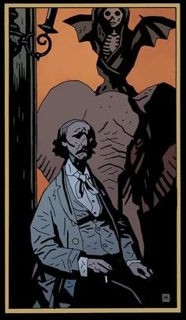

**沃尔特·埃德蒙·希普（Walter Edmond Heap）**是一位画家兼作家。他主要因三部关于[一颗会拧上的小机械头](/entry/The_Amazing_Screw-On_Head)的散文作品而被人铭记。他就是画作[《骑象的死神》](/entry/Death_Riding_an_Elephant_%28painting%29)的作者——[爱德华·格雷爵士](/entry/Edward_Grey)相当喜爱这幅画。

希普于 1911 年在印度旅行期间去世。他遇上铁路事故，不久后又被老虎吃掉。一篇关于希普的小传收录在[*《地狱男爵在地狱——第 1 卷：降临》*](/entry/Trade_Paperback_Collections)中，后来又被收入相应的[图书馆版](/entry/Hellboy_Library_Editions)和[合集版](/entry/Omnibus_Editions)。
